# Mallorca Data Platform

[](https://github.com/AlexandreColl/MallorcaDataPlatform/actions/workflows/ci.yml)
[](https://github.com/AlexandreColl/MallorcaDataPlatform/actions/workflows/e2e.yml)
[](https://alexandrecoll.github.io/MallorcaDataPlatform/coverage/)
[](https://alexandrecoll.github.io/MallorcaDataPlatform/)


**English** · [Español](README.md)

A **modular, fully local** data platform built on real open data about Mallorca. One `docker compose up` starts
Airflow, PySpark, MinIO (S3), PostgreSQL, dbt and Grafana. A parameterised DAG extracts the chosen sources, checks
their quality and leaves everything ready to analyse.

The project, its web front end and the detailed documentation (`docs/`, the ADRs and each connector's README) are
written in Spanish; this page is the English overview.

<picture>
  <source media="(prefers-color-scheme: dark)" srcset="docs/img/web/inicio-oscuro.png">
  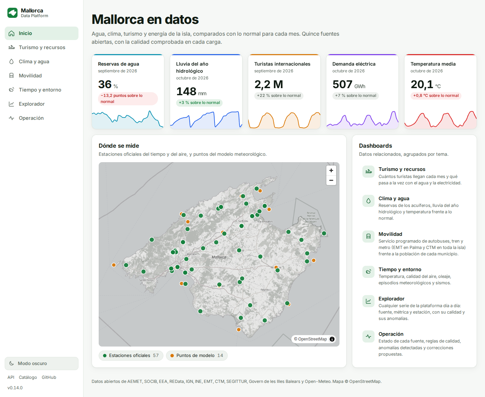
</picture>

```json
{"connectors": ["open_meteo"], "days": 30, "region": "mallorca"}
```

## Architecture

<picture>
  <source media="(prefers-color-scheme: dark)" srcset="docs/img/architecture-dark.svg">
  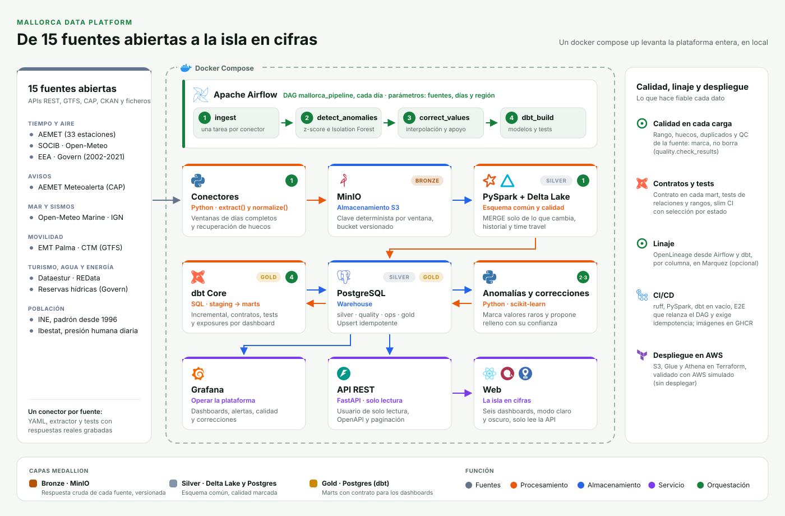
</picture>

The diagram is generated with `node scripts/architecture/diagram.mjs` (light and dark versions, Simple Icons logos).

Airflow orchestrates every arrow with the `mallorca_pipeline` DAG: one `ingest` task per connector, then
`detect_anomalies`, `correct_values` and `dbt_build`. Bronze lives in MinIO; silver in a Delta table in MinIO and in
Postgres; gold in Postgres.

| Layer | Where | Content |
|---|---|---|
| **bronze** | `s3://bronze/<source>/<dataset>/window=<from>_<to>/payload.json` | The API response, untouched. A deterministic key plus bucket versioning: a rerun does not duplicate and the previous raw file is kept |
| **silver** | Delta table `s3://silver/observations` (one partition per source, `source=…`) and `silver.observations` | A common schema: `source, entity, metric, ts, value, unit, quality, lat, lon` (+ `quality_reasons`, `run_id`, `ingested_at`). Each load is a version of the Delta table: history and time travel ([below](#silver-in-delta-lake)) |
| **gold** | `gold` schema (dbt: staging → intermediate → marts, [details](dbt/README.md)) | Incremental facts (`fct_observations`, `agg_daily_metrics`), marts per domain (daily weather, sea, electricity, bus, air quality, earthquakes) and the health of the sources |

### Design decisions

The full case, with its context, constraints, every decision and its reason, what was discarded and what it costs, is
in [docs/architecture.md](docs/architecture.md). It also covers what breaks first at 10× and 100× and what it would
cost on AWS ([trade-offs, costs and scaling](docs/architecture.md#5-trade-offs-costes-y-escalado)). Every decision has
its ADR in [docs/adr](docs/adr/README.md), including those that were superseded or rejected. The data model (silver,
the gold star schema, the grain of each fact and the contracts) is in [docs/data-model.md](docs/data-model.md). The
owner, licence, access and SLA of each source are in [docs/data-governance.md](docs/data-governance.md). In short:

- **A fixed core, interchangeable connectors.** The core only knows `extract()` and `normalize()` (and the optional
  `describe()`, which names stops and stations). A connector is a folder with its YAML, its extractor and its tests
  with recorded responses.
- **Idempotent at every layer**: full-day windows (always the same request), deterministic keys in bronze, `MERGE`
  into the silver Delta table and `INSERT … ON CONFLICT … WHERE IS DISTINCT FROM` in Postgres, so unchanged rows are
  not rewritten. The CI end-to-end test runs the DAG twice and checks that the row counts do not change.
- **One source down does not stop the rest.** Each connector is an independent task with retries (2, 4 and 8 min).
  If it finally fails, dbt rebuilds gold with what did load, and the failure is recorded in `ops.ingestion_runs` with
  its error type. The next run of that source **recovers the missed days**: its window starts the day after its last
  successful load (up to `catch_up_days`; a longer gap in extra runs up to `recover_days`, where the API keeps
  the history). The end-to-end test tells an API that is down, or a source that stopped
  publishing (`SourceNotUpdatedError`: a warning), from a real failure (an error).
- **Flag ≠ correct.** Quality rules label (`ok` / `suspect` / `missing`) and explain (`quality_reasons`), but never
  change the value. Corrections go elsewhere, into `silver.corrections`, and gold shows both values
  ([below](#corrections-with-support-sources)).
- **Local first, cloud later.** MinIO speaks S3 and Spark uses S3A: moving to AWS means changing the endpoint and
  the credentials. With `S3_CREDENTIALS=role`, bronze and Spark write with temporary credentials of a
  least-privilege role, locally too against MinIO's STS ([details](infra/terraform/README.md)).

## Getting started

Requirements: Docker Engine with Compose and ~8 GB of free RAM (Linux, macOS or Windows with WSL2). A guide for
Windows with WSL2 + Debian (in Spanish): [docs/setup-windows.md](docs/setup-windows.md).

```bash
make up                                      # creates .env, builds the image and starts everything
make run CONNECTORS=open_meteo DAYS=30       # triggers the DAG (missing days only; ONLY_MISSING=false: all)
make run-local CONNECTORS=open_meteo DAYS=1  # the same pipeline without Airflow
make backfill CONNECTORS=aemet START=2016-09-01 END=2026-10-25  # history, one run per year
```

| Service | URL | Access |
|---|---|---|
| **Web** | http://localhost:3002 | the island in figures: KPIs, maps and the state of the sources ([below](#web-front-end)) |
| Airflow | http://localhost:8080 | no login (local demo mode) |
| Grafana | http://localhost:3000 | anonymous read-only · admin/admin |
| MinIO | http://localhost:9001 | minioadmin/minioadmin |
| REST API | http://localhost:8000/docs | public read-only (`api_reader` role) |
| PostgreSQL | localhost:5432 | `make psql` |
| Marquez (optional) | http://localhost:3001 | OpenLineage lineage, with `COMPOSE_PROFILES=lineage` ([below](#lineage-with-openlineage)) |

Other commands: `make help`.

**Restarting the computer neither loses nor repeats anything.** Postgres, MinIO, Grafana and the logs live in Docker
volumes (`make down` keeps them; only `make clean` deletes them). The DAG runs by itself every day
(`MDP_SCHEDULE=@daily`): if the computer was off, Airflow starts the pending run once when it comes back. Each
connector downloads only the days no successful load has covered, from the first missing one, and does not call its
source at all when nothing is missing ([ADR 0021](docs/adr/0021-solo-los-dias-que-faltan.md)).

## Connectors

| Connector | Status | Data | Key |
|---|---|---|---|
| [open_meteo](connectors/open_meteo/README.md) | ✅ | Air quality (CAMS) and weather, hourly, 6 towns | No |
| [redata](connectors/redata/README.md) | ✅ v0.2.0 | Hourly electricity demand, daily generation mix and CO₂ of the Balearic system | No |
| [socib](connectors/socib/README.md) | ✅ v0.2.1 | Real observations from 3 stations and 1 buoy (temperature, humidity, pressure, wind), hourly with the source's QC | No |
| [ign](connectors/ign/README.md) | ✅ v0.2.2 | Earthquakes located by the IGN in Mallorca and the surrounding sea (magnitude, depth, epicentre) | No |
| [emt_palma](connectors/emt_palma/README.md) | ✅ v0.2.3 | Scheduled buses and lines per stop and day (875 stops, static GTFS) | No |
| [open_meteo_marine](connectors/open_meteo_marine/README.md) | ✅ v0.2.4 | Waves, sea temperature, currents and sea level (model) at 8 points along the coast | No |
| [aemet](connectors/aemet/README.md) | ✅ v0.2.5 | Official daily values of AEMET's 33 stations in Mallorca (temperature, rain, humidity, wind, sunshine, pressure) | Yes |
| [ctm](connectors/ctm/README.md) | ✅ | TIB buses, SFM train and metro scheduled per stop and day across the island (763 stops, static GTFS) | No |
| [dataestur](connectors/dataestur/README.md) | ✅ | Monthly Balearic tourism: international tourists and their spending, hotel occupancy and Palma airport passengers | No |
| [water_reserves](connectors/water_reserves/README.md) | ✅ | Groundwater reserves of Mallorca per aquifer and for the island, monthly (10 years for the island) | No |
| [goib_air_quality](connectors/goib_air_quality/README.md) | ✅ history | Hourly NO₂, O₃, PM10, PM2.5, SO₂ and CO from 11 official stations in Mallorca, 2002 to June 2021 (the regional government's catalogue). Only with `make backfill` | No |
| [eea_air_quality](connectors/eea_air_quality/README.md) | ✅ | Hourly NO₂, O₃, PM10, PM2.5, SO₂ and CO from 9 official stations in Mallorca (the regional network, through the EEA), verified since 2013 | No |
| [aemet_warnings](connectors/aemet_warnings/README.md) | ✅ | AEMET weather warnings (rain, storms, wind, coastal…) per zone of Mallorca and hour, level 0 to 3 | Yes |
| [ine_population](connectors/ine_population/README.md) | ✅ | Population of Mallorca's 53 municipalities on 1 January, by sex, from the INE register (since 1996) | No |
| [ibestat_iph](connectors/ibestat_iph/README.md) | ✅ | People present in Mallorca each day, residents plus visitors (Ibestat's Human Pressure Indicator, since 1997) | No |

### Open-Meteo

One request per dataset with every location of the region. 10 hourly metrics (PM10, PM2.5, NO₂, O₃, EAQI,
temperature, humidity, precipitation, wind, pressure). With `DAYS=1` that is 6 × 24 × 10 = 1,440 observations. This
is model data, not station data.

### Open-Meteo Marine

The same API with wave and ocean models at 8 sea points around the island: wave height, period and direction, swell,
sea temperature, currents and sea level. It subclasses the Open-Meteo connector and only changes the points it
queries (the region's locations are inland). In Grafana: drops on the map coloured and sized by wave height; the
other metrics in the selector.

### AEMET

**Daily** climate values of AEMET's official stations in Mallorca (mean, minimum and maximum temperature, rain,
humidity, wind, hours of sunshine and pressure). It needs a free API key in `.env` (`AEMET_API_KEY`); without it the
connector is left out of the default selection. The API takes two steps, accepts up to 25 stations per request and
publishes 2-3 days late, so the connector declares `lag_days: 3`. In Grafana: sun and cloud icons on the map with
the last published day.

### AEMET (warnings)

AEMET's warnings (Meteoalerta) for the nine zones of Mallorca (five on land and four of coastal waters), hour by hour
and per phenomenon: rain, storms, wind, coastal events, temperatures, fog, *rissagas*… The value is the level: 0 no
risk, 1 yellow, 2 orange and 3 red. It uses the same key as `aemet`. Each AEMET issue is a snapshot of the warnings in
force: a warning that stops appearing has been withdrawn, with no `Cancel`. So every hour takes its level from the
snapshot in force at the time. The archive gives the past hours and the latest issue gives today and the coming days.
In gold, `fct_weather_warnings` gives one period per warning; on the web, a map with the zones coloured by level.
[Details and real tests](connectors/aemet_warnings/README.md).

### INE (population)

The population of each municipality of Mallorca on 1 January, by sex, from INE's continuous register (table 2860,
since 1996; there was no register in 1997). It is the first yearly source: the core gained `frequency: 1y` (gaps
counted in calendar years). Each run re-reads the last three years, because INE revises the figures once, and the
window ends 350 days before yesterday, because a year's figures come out in mid-December. The `dim_municipalities`
seed holds the boundary of each municipality (IGN, simplified to about 150 m). In gold, `fct_population_yearly` adds
the density and the change since the previous register; the island total is the sum of its municipalities. On the
web, the Mobility dashboard crosses the population with the stops of each municipality: on a weekday Palma has 186
scheduled calls per 1,000 inhabitants and Manacor 27.
[Details and real tests](connectors/ine_population/README.md).

### Ibestat (human pressure)

The people present in Mallorca each day: the registered residents, plus the visitors arriving by port or airport,
minus the residents who are away (Human Pressure Indicator, dataset `000011A_000002` of Ibestat's eDatos API, since
1997). The API returns a flat cube. The connector asks only for Mallorca and the days of the window, without
metadata, in requests of one year at most. Recent days are estimates and get revised, so each run re-reads 120 days.
The window ends 95 days before yesterday, because a month comes out early in the third month after it. In gold,
`fct_human_pressure_daily` compares it with the register: on 11 August 2026 there were 1,517,631 people on the
island, 1.58 per resident. On the web, Mobility overlays the last three years against the registered population.
[Details and real tests](connectors/ibestat_iph/README.md).

### REData

Red Eléctrica publishes the whole Balearic electricity system (Mallorca is ~80 % of the demand). Three datasets with
different granularities, each with its own `frequency` for the gap rule:

| Dataset | Granularity | Metrics |
|---|---|---|
| Demand | hourly (requests split into 28-day blocks) | `electricity_demand` (MWh) |
| Generation | daily | `generation_<technology>` and `generation_total` (MWh) |
| Emissions | daily | `co2_emissions` (tCO2eq), `co2_intensity` (tCO2eq/MWh) |

The API's series are mapped to metrics in the YAML; a new series (say, a technology that joins the mix) raises a
warning instead of being silently lost. In Grafana: hourly demand and CO₂ intensity on one chart, and the mix by
technology in the series table.

### SOCIB

**Real** observations from weather stations (ParcBit, Cala Millor, Muro) and from the Bay of Palma buoy, read as CSV
from SOCIB's THREDDS server (no key). The data arrives every 1-10 minutes with SOCIB's QC per variable; the connector
aggregates it by hour using only the good samples and flags as `suspect` the hours with fewer than 50 % valid
samples. The metrics are named as in Open-Meteo, so Grafana compares the real station with the model on one chart.

### IGN (earthquakes)

Earthquakes located by Spain's National Geographic Institute, read from EMSC's FDSN service (a standard, no key) in
the box of the region widened by 1° around the island. It is the first **event** source: there is no regular
sampling, so its dataset declares `frequency: event` (no gap rule), and a window without earthquakes, the usual case,
is a successful run with 0 rows. In gold, `fct_earthquakes` gives one row per earthquake with its distance to Palma;
in Grafana they appear on the map (size and colour by magnitude) and in a stat panel. Real test: 57 earthquakes since
2020, maximum magnitude 3.0.

### EMT Palma (city buses)

EMT Palma's static GTFS (open on its GitHub, no key) turned into a **daily series per stop**: for each day the
connector resolves the services that run (the weekly calendar plus the holiday exceptions) and counts the scheduled
buses and the distinct lines calling at each of the 875 stops. EMT publishes trips as frequencies
(`frequencies.txt`: "every 20 min from 07:15 to 20:35"), which the connector expands. Days outside the feed's
validity produce no rows, so the gap rule flags them. In Grafana, a heat map of the service. Real test: about 78,000
bus calls on a weekday, 52,800 on a Sunday.

### CTM (island buses, train and metro)

The GTFS of the Consorci de Transports de Mallorca (no key, CC BY 4.0) with the same logic as EMT, now in
`core/connectors/gtfs.py`: TIB buses, SFM train and metro scheduled, and lines per stop and day, at the island's 763
stops. Without `frequencies.txt`, each trip counts once per stop; seasonal timetables show up as services that end on
31 October. In gold, `fct_island_transit_daily`; in Grafana, the same heat map as EMT. Real test: about 41,000 calls
on a weekday, 35,000 on a Sunday; Palma's Estació Intermodal has 1,028 a day.

### Air quality (EEA)

Hourly measurements from the 9 official stations in Mallorca, from the European Environment Agency's download
service: a JSON search returns one Parquet file per station and pollutant, about two hours behind real time. OpenAQ
and aqicn were tried first: they republish the same stations, OpenAQ with only 30 % of the hours and aqicn without
history and in AQI sub-indices instead of concentrations. Pollutants are named as in Open-Meteo, and
`fct_air_quality_model_bias_daily` compares each station with the CAMS model. In Grafana, the stations appear on the
Home map and the model error in Weather and environment. Real test: the model falls short on NO₂ by the traffic at
Foners (−6 µg/m³) and overshoots ozone in Palma (+20), exactly where the traffic's NO consumes it.

Earlier years come from the EEA's verified files (E1a, since 2013), because the up-to-date files only hold the
current year: the connector splits the window by year and looks for each part in its dataset. A backfill from July
2021 to 2025 (1.38 million hourly values in 19 chunks, about 10 minutes) joins the GOIB history with the current
data, and `fct_air_quality_monthly` is continuous since 2002. Foners' NO₂ stays around 22 µg/m³ after the lockdown
(21.6 in 2025), without returning to the 31.6 of 2019.

### Air quality history (GOIB)

The regional government's open data catalogue (CKAN API) holds hourly measurements from 11 stations in Mallorca from
2002 to June 2021, and nothing newer. It is a history connector: disabled in the daily run and loaded once with
`make backfill`. The files come in three different formats (separator, date order and header), and the hour was
checked hour by hour against the EEA's verified files. The stations are named as in `eea_air_quality`, and
`fct_air_quality_monthly` joins them into one monthly series per station. Real test: almost 5 million hourly values
in about 45 minutes of backfill. Foners' NO₂, by Palma's traffic, falls from an annual mean of 52.7 µg/m³ in 2002
(above the EU limit of 40) to 31.6 in 2019 and 24 in 2020, the lockdown year; the island's ozone rises from 56 to
70 µg/m³.

### Water reserves

The groundwater reserves the regional government publishes each month: the last 13 months of Mallorca's 18 water
bodies and the island in an ODS sheet, and ten years of the island in the PDF chart, whose labels are text. The files
change name every month, so the connector finds them on the page by the link text. As reserves are seasonal,
`fct_water_reserves_monthly` compares each month with the mean of the same month in other years. Real test: August
2026, 38 %, the lowest August in ten years (11.5 points below the mean).

### Dataestur (tourism)

Four monthly tables from SEGITTUR's API (no key): international tourists (FRONTUR) and their spending (EGATUR) in the
Balearic Islands, hotel occupancy (EOH) and Palma airport passengers (AENA). The API answers in xlsx, which the
connector reads with the standard library, and a misspelt filter returns an empty sheet with HTTP 200, which is
treated as an error. It is the first monthly source: the core gained `frequency: 1mo` (gaps counted in calendar
months) and `min_days`, so the daily run always re-reads the last year and picks up revisions. In gold,
`fct_tourism_monthly` with the spending per tourist and the year-on-year change; in Grafana, a panel with the last
three years. Real test: ten years in one minute; August 2026, 2.6 M tourists (+2.6 %) and 4.8 M passengers in Palma.

Adding a source (in Spanish): [docs/adding-a-connector.md](docs/adding-a-connector.md).

## Silver in Delta Lake

The silver lake (`s3://silver/observations`) is a [Delta Lake](https://delta.io/) table: Parquet files with one
partition per source (`source=…`), plus a `_delta_log` with one JSON commit per write that says which files make up
each version ([core/lake.py](core/lake.py)).

- **`MERGE` instead of overwriting partitions.** Each connector run does a `MERGE` on the key (source, entity,
  metric, hour). New rows are inserted, changed rows are updated, and unchanged rows are dropped beforehand, because
  Delta rewrites every file with a matching row. So rerunning a window without changes writes nothing and creates no
  version, just as the Postgres upsert leaves those rows alone. The condition names the source and the days of the
  window, and the statistics of each file (minimum and maximum `ts` and `date`) leave out the files without those
  days.
- **History, time travel and changes.** Each commit is a version. `make silver-history` lists them with their
  inserted and updated rows, and the table can be read as it was at a version or a time. `make silver-changes
  VERSION=n` lists the rows that appeared, disappeared or changed value or quality since version `n`. It uses the
  Change Data Feed, which keeps the rows each commit touched, instead of comparing two copies of 9 million rows:
  that comparison ran out of memory with 1 GB.
- **Few large files.** The Parquet lake had one partition per source and day: 16,973 partitions of about 17 KB, in
  67,000 files, when Delta and Athena work best with files of tens of MB. The first run converts it in place
  (`CONVERT TO DELTA`, which only writes the log) and rewrites it once per source: 29 files are left.
  `make silver-maintain` compacts each source into files of up to 32 MB ordered by hour (`OPTIMIZE … ZORDER BY
  (ts)`) and deletes the files that are no longer part of any version of the last 7 days (`VACUUM`). Time travel
  reaches as far as those files do. In between, Delta's auto compaction merges each run's new file with those of its
  source: the pipeline keeps one file per source (8-25 s more per run, inside the lock).
- **One writer at a time.** Delta on S3 has no atomic "write if absent" from Spark, and the DAG runs two connectors
  at once, that is, two Spark drivers. A Postgres advisory lock serialises the commits, in the role DynamoDB would
  play on AWS.
- **No Python package.** `delta-spark` pins an older PySpark than the project's. The image only ships Delta 4.4's
  jars for Spark 4.2, and the code uses SQL (`MERGE INTO`, `DESCRIBE HISTORY`, `readChangeFeed`).

Real test (2 November 2026, 9.1 million rows):

| Step | Result |
|---|---|
| Converting the Parquet lake | 67,326 files (288 MiB), 8 min, once |
| Rewriting per source | 16,960 files → 29, 2.5 min, once |
| `OPTIMIZE … ZORDER BY (ts)` | 29 → 12 files, 2.7 min (25 min with the per-day partitioning, which left 16,828) |
| Open-Meteo, 2 new days | 4,320 rows inserted, a new version |
| Rerunning the same window | 0 rows, no version, 44 s |

On AWS, Athena reads the table through its log ([infra/terraform](infra/terraform/README.md)).

## Lineage with OpenLineage

Every DAG run can report what each step read and wrote, in the open [OpenLineage](https://openlineage.io/) format.
The events are stored and drawn by [Marquez](https://marquezproject.ai/), its reference implementation. It is
optional: two lines of `.env` turn it on and, without them, nothing is sent.

```bash
COMPOSE_PROFILES=lineage           # starts Marquez: UI at http://localhost:3001, API on :5000
OPENLINEAGE_URL=http://marquez:5000
```

- **Airflow.** The tasks declare the data they read and write as assets, and the OpenLineage provider sends them
  with each run:
  - `ingest` writes bronze, the silver Delta table and `silver.observations`;
  - `detect_anomalies` reads `silver.observations` and writes `silver.anomalies`;
  - `correct_values` reads both and writes `silver.corrections`.

  The same assets show up in Airflow's *Assets* view.
- **dbt.** With `OPENLINEAGE_URL`, `dbt_build` runs `dbt-ol` instead of `dbt`. Each model and test is a job with its
  inputs, its output and **column-level lineage** (`gold.fct_observations.value` ← `stg_silver__observations.value`).
  They all hang from the `dbt_build` run.
- **One graph.** The tables have the same name on both sides (`postgres://postgres:5432`,
  `warehouse.silver.observations`). So the graph joins the Airflow tasks with the dbt models: from ingestion to gold,
  through anomalies and corrections.

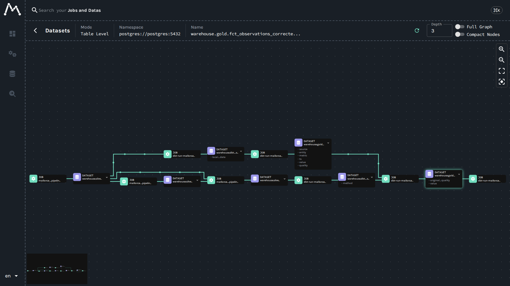

Real test (DAG with Open-Meteo and the EEA): 6 Airflow tasks and 75 dbt jobs in Marquez, and 12 columns with lineage
in `gold.fct_observations`.

Spark sends no events of its own. Its rows come from Python, not from a Spark read, so its integration would only
repeat what `ingest` already declares. Marquez has not published a release since March 2025 (0.51.1), but the events
are standard OpenLineage and any other backend accepts them by changing `OPENLINEAGE_URL`.

## Data quality

Reusable rules in `core/quality/`, configured from each connector's YAML:

| Rule | Type | What it detects |
|---|---|---|
| `not_null` | row | null values → `missing` |
| `source_qc` | row | values the source itself flags as doubtful (e.g. SOCIB's QC) → `suspect` |
| `range` | row | values outside the metric's physical range → `suspect` |
| `duplicate` | row | the same (source, entity, metric, ts) repeated → collapsed, keeping the non-null value |
| `gaps` | series | missing time steps according to the connector's `frequency` (not applied to event sources) |

Results per run in `quality.check_results`; in Grafana, the share of suspect values, the completeness of the series
table and the collapsed *Operación* row.

## Anomaly detection

Quality rules discard the impossible (a humidity of 140 %); the detectors in `core/anomaly/` look for the
improbable: possible values that do not fit their own series. They only **flag**: they write to `silver.anomalies`
(value, expected value, score, threshold, `run_id`) and never change `silver.observations`.

- **`Detector` interface**: scores all the series of one entity (a town, station or point) in pandas, so it is
  tested without Spark; the runner spreads it across entities with `groupBy().applyInPandas()`. Univariate detectors
  (`UnivariateDetector`) look at each metric on its own; multivariate ones, at how metrics move together.
- **`robust_zscore`**: Iglewicz and Hoaglin's modified z-score, `0.6745 · (x − median) / MAD` over a centred rolling
  window (7 days for hourly series, 31 for daily ones). The median and the MAD barely move with the spike they look
  for, unlike the mean and the standard deviation. A nearly constant window (MAD = 0) is not scored.
- **`isolation_forest`** (scikit-learn): one forest per entity over all its metrics at once. Each instant is
  described, per metric, by its value, its change, how many equal values in a row it has and its distance to the
  usual value at that hour, plus the hour itself. It isolates the rare instants (5 % of each entity,
  `contamination`) and blames the metric whose features are furthest from their median. It needs 48 complete
  instants: AEMET's daily series do not reach that.
- The DAG's `detect_anomalies` task runs after ingestion, even if a source failed. Each run rescores at least the
  last `rescore_days` (14) and replaces its result: data that arrives late (AEMET) or is recovered is judged with its
  neighbours, and the task is idempotent.
- Configuration in [config/anomaly.yaml](config/anomaly.yaml): each detector's parameters and what is not analysed
  (earthquakes, EMT and CTM timetables and the monthly statistics of Dataestur and water reserves; precipitation,
  sunshine and wave direction). By hand: `make detect DAYS=30`.

With 30 real days the z-score flags ~1 % of 104,000 values, mostly real episodes (the storm of 18-19 October, swell
in Alcúdia) and the night-time NO₂ peaks; the Isolation Forest, 732.

In Grafana, anomalies are drawn as annotations on the series: in the Weather and environment explorer (the chosen
metric and entities), on the stations' NO₂ (off by default, because there are nine) and on the before-and-after
chart of Operación. Consecutive anomalous hours of a series are one band, with the range of values and the expected
value, so a storm is one mark, not thirty. The Operación tables list them one by one.

### Measuring the detectors with injected faults

Real anomalies do not come labelled, so there is no way to know how many are missed. `make evaluate` creates that
ground truth: it takes recent Open-Meteo series (model data, complete and smooth), **injects known faults** with a
fixed seed and scores each clean and corrupted series (`core/anomaly/faults.py` and `evaluation.py`):

| Fault | What it simulates | Shape |
|---|---|---|
| `spike` | a wrong reading, a decimal comma | one value ± 4-8 robust σ |
| `frozen` | a frozen sensor, a repeated payload | 6-24 hours with the last good value |
| `drift` | a sensor going out of calibration | a ramp of 2-4 σ over 48-120 hours |
| `shift` | a wrong clock or time zone | 6-24 hours with the values of 12 hours earlier |

A flag on an injected value is a hit; a new flag on a clean value, a false alarm. What the detector already flagged
in the clean series (real episodes) is counted separately and not penalised. Gaps are not injected: a missing value
cannot be flagged, and the `gaps` rule already counts them. Results in `quality.anomaly_evaluations`; faults detected
(some value flagged) in 54 series from 6 towns, 30 days:

| Detector | Spikes | Drifts | Frozen | Shift | Precision |
|---|---|---|---|---|---|
| `robust_zscore` | 90 % | 22 % | 0 % | 6 % | 80 % |
| `isolation_forest` | 49 % | 11 % | 52 % | 6 % | 85 % |

They complement each other. The z-score sees what strays from its neighbours and is blind to what stays at a normal
level: a sensor frozen at 18 °C is close to the median. The forest sees that a series that always moves has stopped
(through the "equal values in a row" feature; a rolling spread is not enough, because near the daily maximum or
minimum there is hardly any spread anyway), but with its 5 % quota it misses half the spikes. The time shift escapes
both: in a smooth model, the values of 12 hours earlier look like a mild night. `contamination` moves the balance:
at 0.10 the forest reaches 73 % of spikes and 74 % of frozen sensors with 81 % precision.

## Corrections with support sources

The hourly stations (SOCIB and the EEA) have gaps: outages at the source, hours the network marks as invalid and
suspect values that fail a quality rule. `core/corrections/` **proposes** a value for those hours and stores it
separately, in `silver.corrections`, with the original value, the method, the support series, its bias and a
confidence from 0 to 1. `silver.observations` never changes: `gold.fct_observations_corrected` puts both values side
by side, and `value` is the corrected one where there is one and the original elsewhere.

- **What is corrected**: every hour without a valid value between two values of the station: missing, suspect or
  without a row. Values flagged by the anomaly detectors are left alone, because one in five is a real episode and
  correcting it would erase it.
- **Method 1, interpolation**: gaps of up to 3 hours are filled by interpolating in time between the station's own
  values. Confidence `exp(−hours / 6)`: 0.85 for one hour, 0.61 for three.
- **Method 2, support source**: for longer gaps, the best-correlated series of the same metric within 30 km, which
  can be another station of the same network or the Open-Meteo model point. It needs a week of hours in common and
  r ≥ 0.6. The support value is shifted by its bias, the median of "station minus support", calibrated **per hour of
  the day** with the previous 30 days. That way it captures the sea breeze, the altitude and the model's daily cycle.
  Confidence `r² · exp(−distance / 100 km) · exp(−hours / 7 days)`.
- The DAG's `correct_values` task runs after detection. Each run recomputes the last 14 days: a correction
  disappears when the real value arrives, and the task is idempotent. Configuration in
  [config/corrections.yaml](config/corrections.yaml); by hand, `make correct DAYS=30`.

`make evaluate-corrections` measures the corrections against a known truth. It hides clean station values in gaps of
1, 3, 6 and 24 hours, corrects them and compares. Results over 14 real days, as the mean absolute error (MAE) and,
for the support source, the error it would have without its bias:

| Series | 1 h | 3 h | 24 h (support) | 24 h without bias |
|---|---|---|---|---|
| Temperature (SOCIB) | 0.26 °C | 0.41 °C | 1.35 °C | 2.19 °C |
| Pressure (SOCIB) | 0.11 hPa | 0.23 hPa | 0.20 hPa | 14.0 hPa |
| Humidity (SOCIB) | 1.8 % | 2.7 % | 7.6 % | 9.6 % |
| Ozone (EEA) | 3.6 µg/m³ | 6.0 µg/m³ | 7.4 µg/m³ | 13.2 µg/m³ |
| NO₂ (EEA) | 1.6 µg/m³ | 2.0 µg/m³ | 1.1 µg/m³ (only 140 of 456 h) | 2.3 µg/m³ |

- **Pressure** shows what the bias is for. Parc Bit's is about 14 hPa lower than that of the bay buoy, its most
  similar series (r = 1.00). It looks like pressure at the station's height, not reduced to sea level: about 115 m.
  Without the bias, the support would be 14 hPa off; with it, 0.2.
- **NO₂** is very local: it comes from each street's traffic and almost no station has a support with r ≥ 0.6. Only
  S'Albufera and Sa Pobla lean on each other. The same goes for PM10, PM2.5 and CO. In those series, long gaps stay
  uncorrected instead of being filled with an unreliable value.
- **Wind gusts** are the one case where the bias does not help: 7.5 against 6.8 km/h in 6-hour gaps. A gust is a
  momentary maximum and keeps no stable difference with another station.

In Grafana, the Operación dashboard shows the corrections per day and method, a before-and-after chart of the chosen
series (variable *Serie corregida*) and the table of the latest corrections. That series' anomalies appear as bands
on the chart, as in the Weather and environment explorer, so it is clear what each part corrects. The API serves them
at `GET /v1/corrections`.

## Web front end

The island in figures, for people who want to see it rather than operate the platform: http://localhost:3002. A menu
on the left opens six dashboards and a series explorer. Each dashboard groups data that belongs together, like
Grafana's folders. The interface is in Spanish:

| Dashboard | What it shows |
|---|---|
| **Inicio** (Home) | Five key figures against what is normal for each month (reserves, rain, tourists, electricity and temperature) and the map of stations and model points |
| **Turismo y recursos** (Tourism and resources) | Tourists, airport and hotel occupancy; tourists against water reserves and electricity demand, and occupancy against spending, each series with its 12-month trend and its Pearson correlation (with and without the annual cycle) |
| **Clima y agua** (Climate and water) | Reserves against the month's mean, the 18 aquifers, accumulated rain of each hydrological year and the temperature anomaly |
| **Movilidad** (Mobility) | The island's population and service per 1,000 inhabitants; a map of the municipalities by density, service per inhabitant or 10-year growth; population since 1996; EMT and CTM scheduled service per day, a map of each stop's service and the busiest stops; a map of the bus, train and metro lines with their paths and departures |
| **Tiempo y entorno** (Weather and environment) | Temperature by zone (AEMET's 33 stations interpolated over the island), AEMET warnings per zone (now and in the next 72 h), each source's temperature, air quality now (European index) with the table of stations, waves, episodes, earthquakes and model error |
| **Explorador** (Explorer) | Any series of the platform day by day (source, metric and entity): mean, minimum and maximum, completeness, suspect values and days with anomalies; the selection stays in the address so it can be shared |
| **Operación** (Operations) | The state of each source against its SLA, data governance (owner, licence and access), failing quality rules, anomalies per day and the latest corrections |

Each figure shows its deviation in green or red when it is good or bad news, with its evolution over the last months.
The maps have layers that can be hidden, and clicking a point shows what it is.

| Tourism and resources | Climate and water |
|---|---|
| [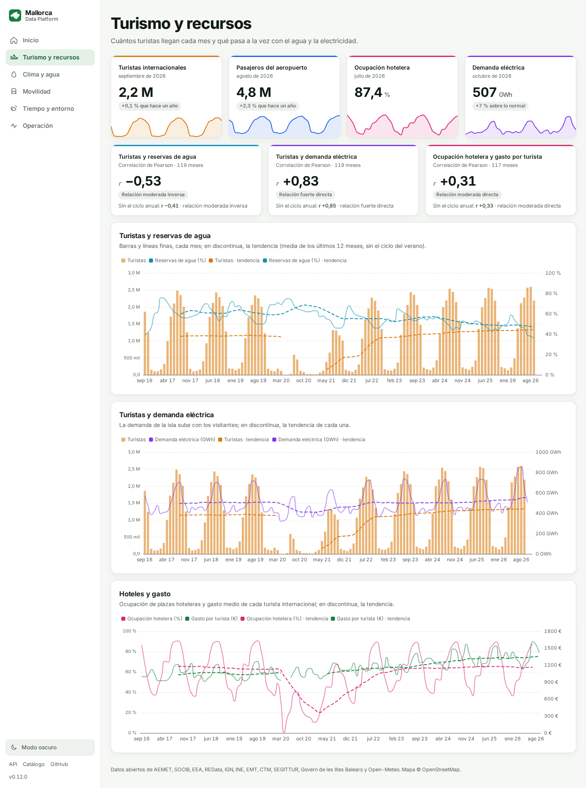](docs/img/web/turismo-y-recursos.png) | [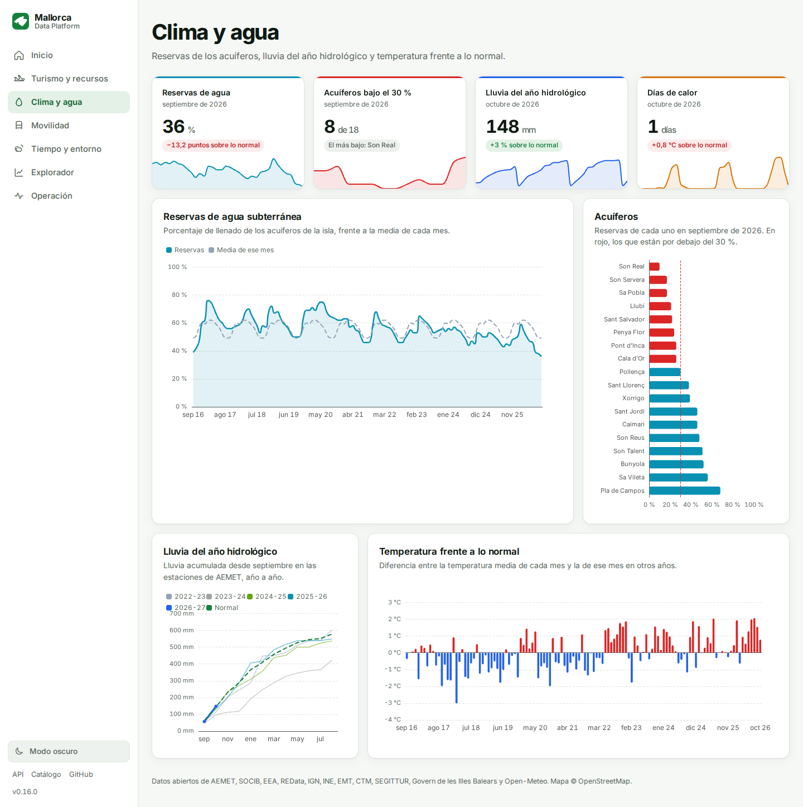](docs/img/web/clima-y-agua.png) |
| **Mobility** | **Weather and environment** |
| [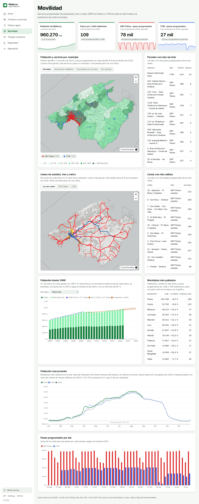](docs/img/web/movilidad.png) | [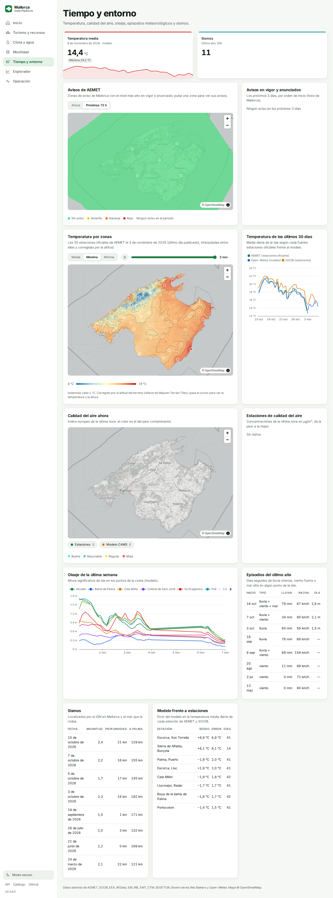](docs/img/web/tiempo-y-entorno.png) |
| **Explorer** | **Operations** |
| [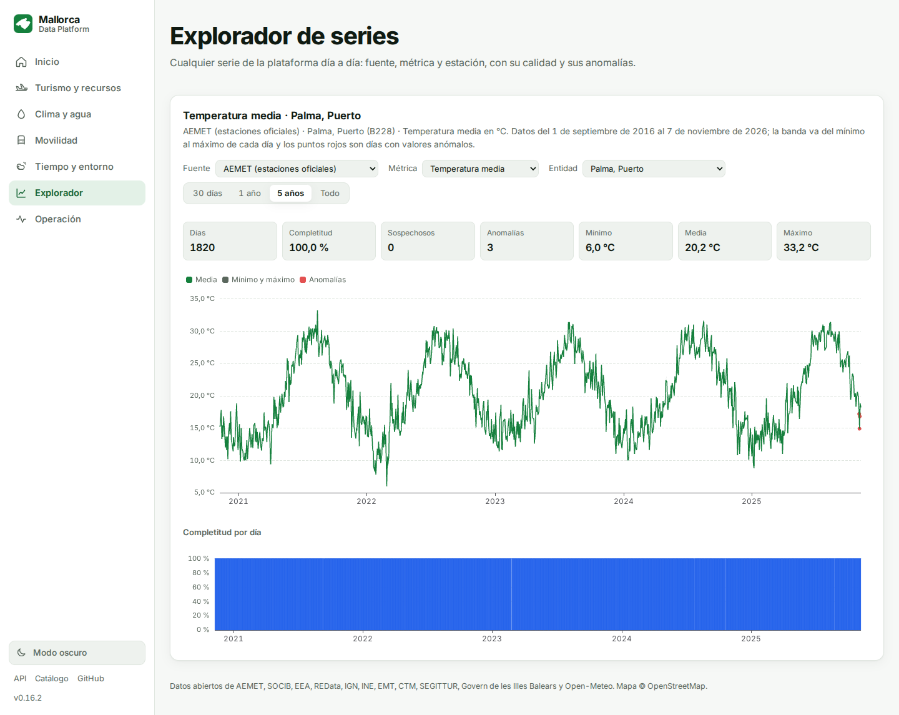](docs/img/web/explorador.png) | [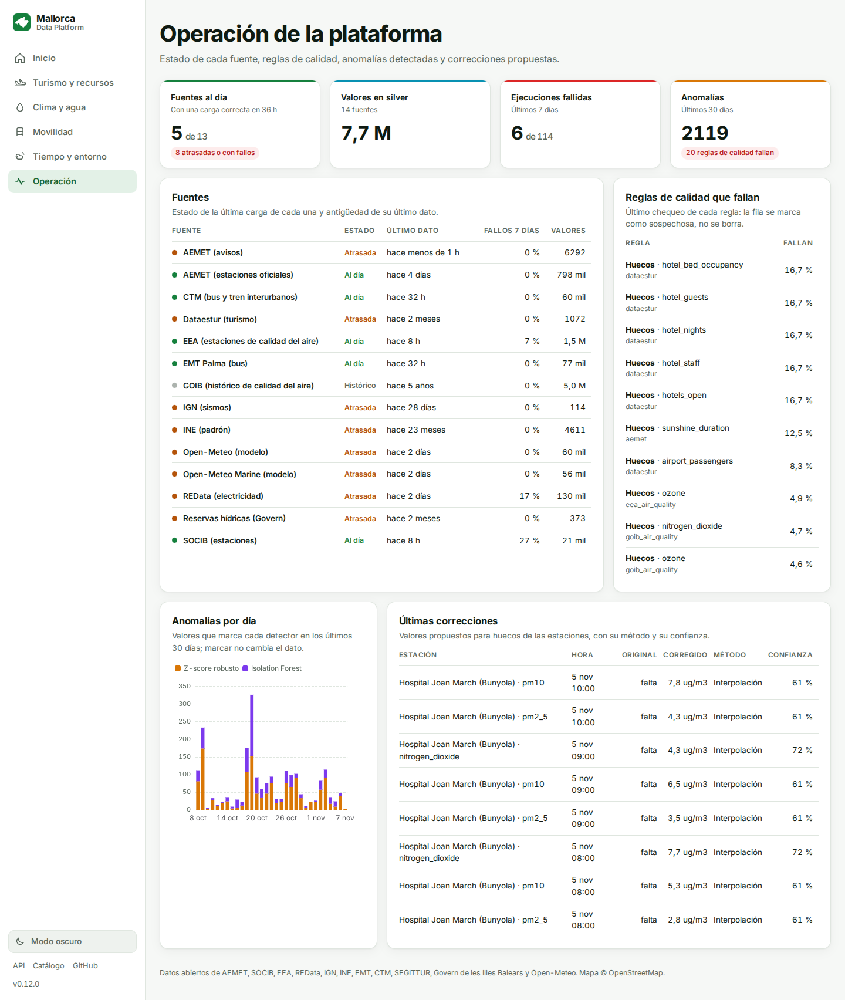](docs/img/web/operacion.png) |
| **Dark mode** | |
| [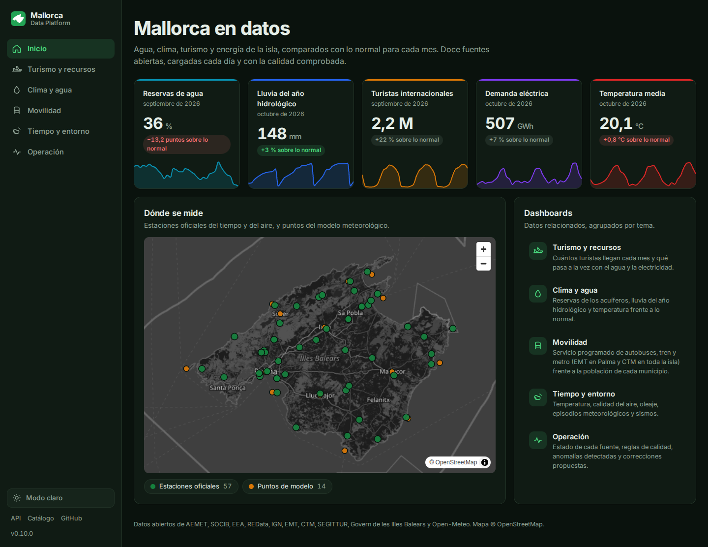](docs/img/web/inicio-oscuro.png) | |

It is built with React, TypeScript and Vite, with ECharts for the charts and MapLibre with OpenStreetMap tiles for
the maps. The logo is the island's outline. It has light and dark modes, with a button in the menu that the browser
remembers, and on a phone the menu becomes a drawer.

**It only reads the REST API**, never the warehouse. The `web` image is nginx with the built site, and it proxies
`/api` to the API, so the browser talks to a single origin. Grafana stays for operating the platform: alerts,
quality, anomalies and corrections. Why a web front end of its own instead of reworking Grafana:
[ADR 0019](docs/adr/0019-frontal-web-sobre-la-api.md).

```bash
cd web && npm install && npm run dev   # http://localhost:5173, with /api pointing at the stack's API (localhost:8000)
npm test                               # key figures and the state of the sources (Vitest)
```

## Grafana

Six dashboards in the *Mallorca Data Platform* folder (http://localhost:3000), linked to each other from the top bar.
Each one answers a question and reads its dbt marts (one exposure per dashboard):

| Dashboard | What it shows |
|---|---|
| **Inicio** (Home) | The last month of water reserves, rain of the hydrological year, temperature and tourists, and the map of every georeferenced source (air, waves, AEMET, SOCIB, earthquakes and bus service) |
| **Turismo y recursos** (Tourism and resources) | Tourists against water reserves and electricity demand; the anomalies against the same month, which remove seasonality; and a year-by-year evaluation (summer tourists against the fall of the reserves from March to September, with its correlation) |
| **Clima y agua** (Climate and water) | Reserves against the month's mean, monthly rain and the aquifers' response, a table per hydrological year, temperature anomaly, accumulated rain and the state of the 18 aquifers |
| **Movilidad** (Mobility) | EMT Palma and CTM scheduled service per day, a heat map per stop and the busiest stops |
| **Tiempo y entorno** (Weather and environment) | An explorer for any metric by source and entity, with its anomalies as annotations, air quality, waves, model error against the stations, weather episodes and earthquakes |
| **Operación** (Operations) | The health of each source and its SLA, detected anomalies, corrections (before and after), runs, quality rules and the completeness of each series |

| Home | Tourism and resources |
|---|---|
| [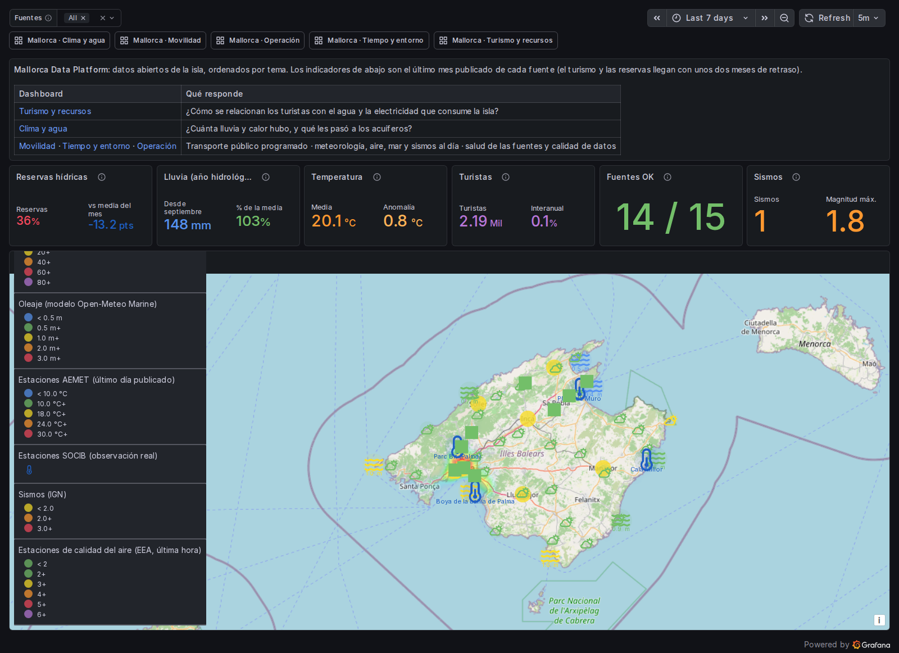](docs/img/grafana/inicio.png) | [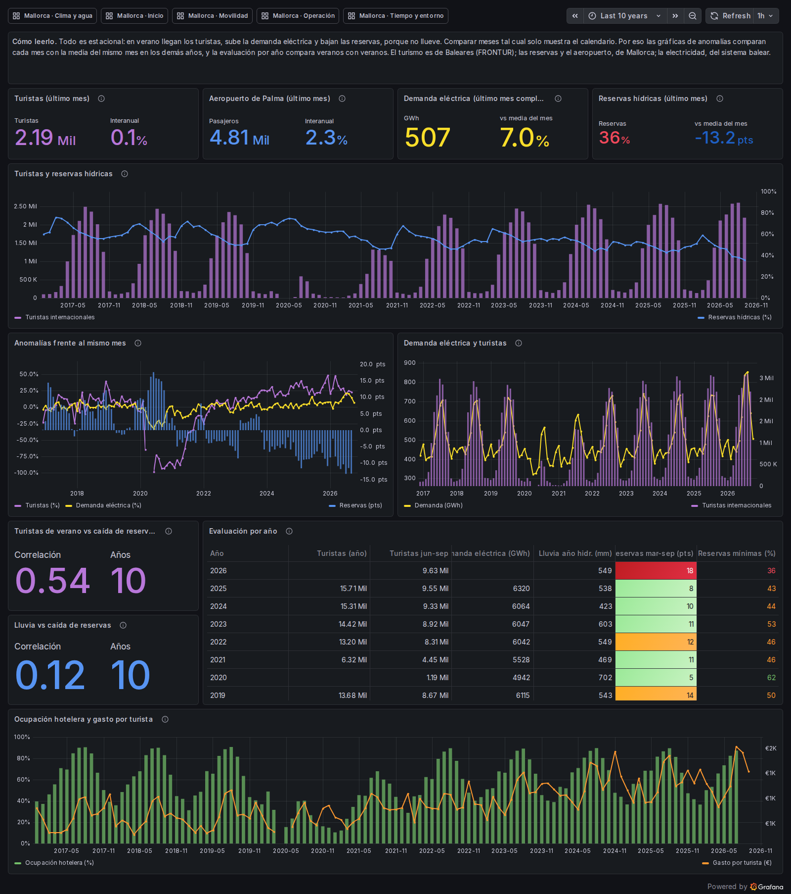](docs/img/grafana/turismo-y-recursos.png) |
| **Climate and water** | **Mobility** |
| [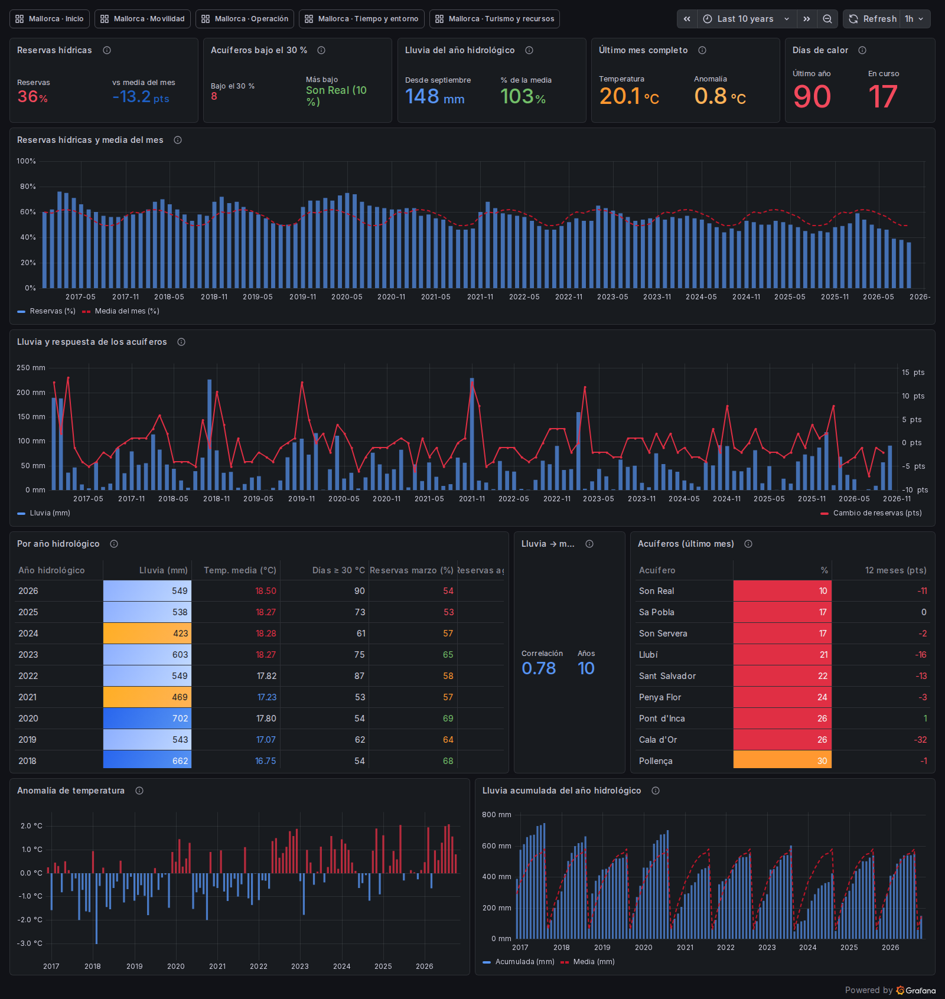](docs/img/grafana/clima-y-agua.png) | [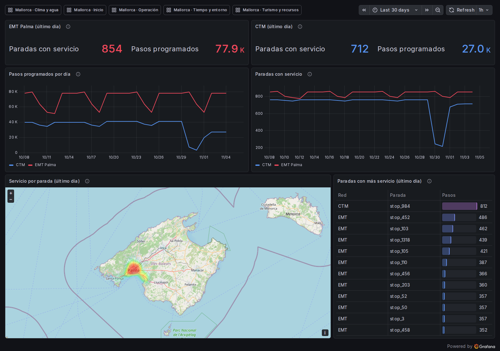](docs/img/grafana/movilidad.png) |
| **Weather and environment** | **Operations** |
| [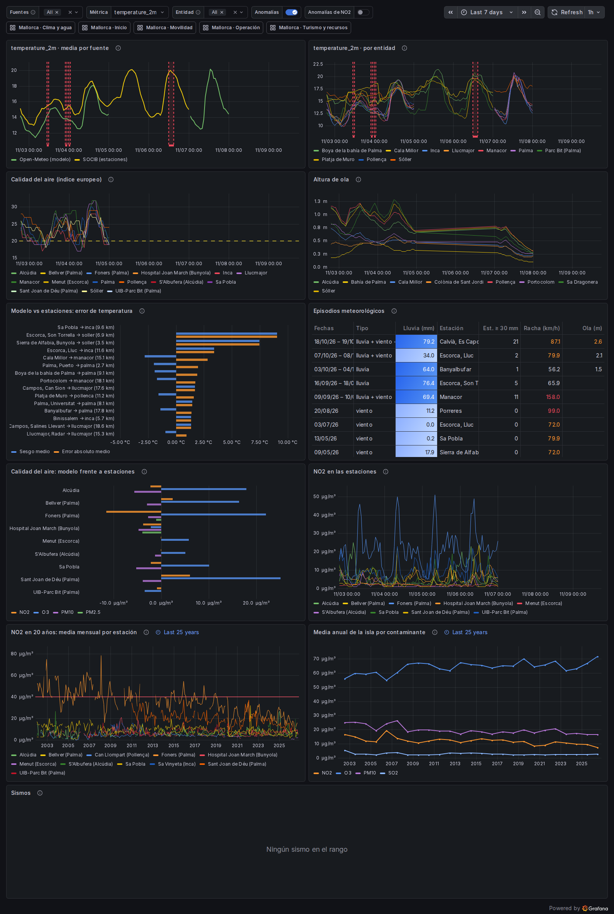](docs/img/grafana/tiempo-y-entorno.png) | [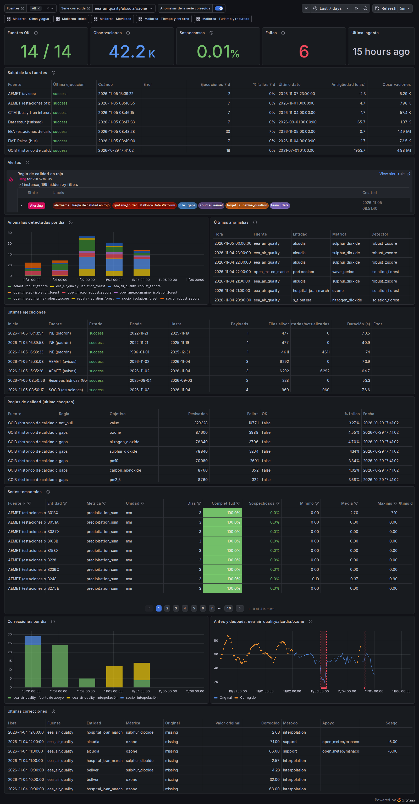](docs/img/grafana/operacion.png) |

The screenshots of the web and of Grafana are regenerated with `make screenshots` (Playwright in Docker against the
local stack).

The underlying question (does tourism strain the water?) needs care: tourism, heat, demand and reserves are all
seasonal at once, so comparing raw months only shows the calendar. The evaluation panels compare each month with the
mean of the same month and each summer with the other summers. With ten years of data (Pearson correlations, few
years, so only indicative):

- Rain from September to February explains March reserves well (r = 0.78 over 10 years).
- The summers with more tourists are the ones in which the aquifers fall most from March to September (r = 0.50 over
  9 years); the year's rain barely changes that fall (r = 0.20).
- Month by month, months with more tourists than usual have reserves below normal (r = −0.41), but over the decade
  tourism grows and reserves fall, and 2020 (no tourists and a rainy winter) weighs heavily: correlation, not
  causation.

### Alerts

Four alert rules provisioned from `dashboards/provisioning/alerting/alerting.yml`. They are evaluated every 5 minutes
and each source (or rule) is a separate alert. Three read only the operational tables (`ops.ingestion_runs`,
`quality.check_results`), so they fire even if dbt does not run. The SLA rule also reads the catalogue of sources
and `gold.source_health`:

| Alert | When it fires |
|---|---|
| **Ingesta fallida** (failed ingestion) | A source's last run ended as `failed` |
| **Fuente sin ejecución correcta** (no successful run) | An active source (with data from the last year) has had no successful run for more than 36 h. A history backfill does not count |
| **Fuente fuera de su SLA** (SLA breached) | An active source misses the SLA in its catalogue entry: its newest value is older than agreed, or it has fewer successful runs in 7 days than agreed ([data governance](docs/data-governance.md)) |
| **Regla de calidad en rojo** (quality rule turned red) | A rule passed in the previous check and fails in the latest. Rules that always fail (the gaps of a source with known outages) do not fire |

Firing alerts show in the *Alertas* panel of Operación. To receive them on **Telegram**, optionally:

1. Create a bot with [@BotFather](https://t.me/BotFather) and keep its token.
2. Send it any message and read your chat id at `https://api.telegram.org/bot<token>/getUpdates`
   (`message.chat.id`).
3. Set `TELEGRAM_BOT_TOKEN` and `TELEGRAM_CHAT_ID` in `.env` and restart Grafana (`docker compose up -d grafana`).

Grafana's entrypoint (`docker/grafana/entrypoint.sh`) provisions the contact point and the policy only when both
variables exist, and deletes them if they are removed. Without them everything works the same, for instance in the
end-to-end test. One message arrives per rule and source when an alert fires, another when it resolves, and it repeats
every 12 h while it is still firing.

The names of the sources come from dbt's `dim_sources` seed, which is also their governance record (owner, licence,
access and SLA). A test checks that every source in silver has its row.

## REST API

A read-only FastAPI API over the gold layer, in its own service (`api`, port 8000) and with its own small image: no
Airflow, Spark or Java. The OpenAPI documentation is at http://localhost:8000/docs (Swagger) and `/redoc`.

| Endpoint | What it returns |
|---|---|
| `GET /v1/health` | The state of the API and of its warehouse connection (503 if it is down) |
| `GET /v1/sources`, `/v1/sources/{source}` | Each source with its last run, share of failures in 7 days, age of its newest value, its governance record (owner, licence, access, personal data) and its SLA with whether it is met |
| `GET /v1/locations` | Each station, model point and stop with its coordinates, source and kind (the web map) |
| `GET /v1/mobility/daily`, `/v1/mobility/stops`, `/v1/mobility/routes` | EMT and CTM scheduled service per day, each stop's service on the latest day, and each line with its path (GeoJSON) and departures |
| `GET /v1/weather/daily`, `/v1/weather/stations`, `/v1/weather/episodes`, `/v1/weather/model-bias` | Daily weather of each source, rain, wind or sea episodes, and model error against each station; `stations`: every station on the latest published day |
| `GET /v1/air-quality/latest`, `/v1/sea/hourly`, `/v1/earthquakes` | The latest hour of air quality with its European index, hourly waves and earthquakes |
| `GET /v1/warnings`, `/v1/warnings/zones` | AEMET warnings in force or announced (by default, from now to 3 days ahead) and the warning zones with their polygons |
| `GET /v1/population`, `/v1/municipalities` | The population of each municipality per year (filterable with `from` and `to`) and the 53 municipalities with their area and boundary |
| `GET /v1/quality/rules`, `/v1/anomalies/daily` | The latest check of each quality rule and anomalies per day and detector |
| `GET /v1/series`, `/v1/series/daily` | A source's daily series (entity with its name, metric, unit and days covered) and one series day by day: minimum, mean, maximum, completeness, suspect values and anomalies (one year by default) |
| `GET /v1/observations` | A source's values filtered by metric, entity and time range (the last 7 days by default), paginated |
| `GET /v1/anomalies` | Values flagged by the detectors, filtered by source, detector and range, paginated |
| `GET /v1/corrections` | Values proposed for the stations' hours without a valid value, with the original, the method, the support, the bias and the confidence; filtered by source, station, method and range, paginated |
| `GET /v1/water/reserves`, `/v1/water/aquifers` | Monthly reserves with their anomaly and the 18 aquifers in the latest month |
| `GET /v1/climate/monthly`, `/v1/tourism/monthly`, `/v1/resources/monthly` | The dashboards' monthly marts, filterable with `from` and `to` |

```bash
curl "http://localhost:8000/v1/observations?source=aemet&metric=temperature_2m_max&entity=B278&limit=2"
```

Decisions:

- **Only contracted marts**: the API reads dbt tables with `contract: {enforced: true}`, so their columns and types
  cannot change without the build failing. In CI, the integration tests run every query against the freshly built
  marts.
- **Its own read-only role** (`api_reader`, `docker/postgres/init/02-api-reader.sh`): `SELECT` on gold and silver,
  read-only transactions and a 15 s limit per query. On an existing volume: `make api-role`.
- **Pagination** with `limit` (at most 1000) and `offset`: the response carries `next_offset`, computed by asking for
  one extra row. **Errors** with a single shape: `{"error": {"code": "not_found", "message": "..."}}`.
- **A replaceable data access layer** (`api/repository.py` over a `Database` protocol): the unit tests use a fake
  database and do not need Postgres. `make api-test`.

## AWS with Terraform

`infra/terraform` describes the same platform on AWS:
- S3 for bronze and silver;
- Glue Data Catalog and Athena to query silver with serverless SQL;
- two least-privilege IAM roles;
- a budget of 2 USD a month.

It is not deployed. CI validates it and tests it with `terraform test` against a mocked AWS provider, with no account
or cost (`make tf-check` locally). The local-versus-AWS diagram, the costs and what would be missing to run end to end
on AWS are in [infra/terraform/README.md](infra/terraform/README.md).

## Layout

```
├── core/                 # core: contract, registry, bronze, Spark, quality, warehouse, pipeline, CLI,
│                         # anomalies (core/anomaly) and corrections (core/corrections)
├── connectors/<source>/  # connector.yaml + extractor.py + tests/fixtures
├── config/               # regions (bbox and points), anomaly.yaml and corrections.yaml
├── dags/                 # Airflow DAG
├── dbt/                  # staging → intermediate → marts, tests and seeds (see dbt/README.md)
├── dashboards/           # Grafana provisioning and dashboards
├── api/                  # read-only REST API (FastAPI) and its tests
├── web/                  # web front end (React + Vite) that reads the API
├── docker/               # Dockerfiles for Airflow+Spark+dbt, the API and the web, Postgres init
├── infra/terraform/      # AWS: S3, IAM, Glue Catalog, Athena and budget, with tests against a mocked AWS
├── scripts/e2e.sh        # end-to-end test (CI)
└── docs/
```

## CI/CD

| Workflow | When | What it does |
|---|---|---|
| `ci.yml` | push to `main`/`develop`, PRs | ruff · pytest with PySpark (coverage of `core/` ≥ 80 %, branches included) · Terraform (`fmt`, `validate`, tflint and `terraform test` against a mocked AWS) · sqlfluff · dbt build on an empty Postgres (slim CI on PRs) · image build + DAG integrity test. Downloads are cached and retried, so a GitHub outage of a few minutes does not fail the run |
| `dbt-docs.yml` | push to `develop` | `dbt docs` on [GitHub Pages](https://alexandrecoll.github.io/MallorcaDataPlatform/), the [coverage report](https://alexandrecoll.github.io/MallorcaDataPlatform/coverage/) of that commit's CI with the README badge, and the `develop` manifest for slim CI |
| `e2e.yml` | PR to `main`, weekly | `docker compose up`, the DAG twice against the real APIs, checks bronze/silver/gold and idempotency |
| `release.yml` | tag `vX.Y.Z` (or by hand with an existing tag) | A release with notes from the CHANGELOG + the Airflow and REST API images on GHCR (`airflow:X.Y.Z` and `api:X.Y.Z`, also `X.Y`) |
| `pr-title.yml` | PRs | gitmoji + Conventional Commits in the title (`✨ feat(connector): ...`) |

Branches and releases: [docs/git-workflow.md](docs/git-workflow.md) · Architecture and decisions:
[docs/architecture.md](docs/architecture.md) · Full plan: [ROADMAP.md](ROADMAP.md) (all in Spanish)

## Licence

The code, MIT. The data belongs to its owners and is used under their licences: each source's licence is in
[docs/data-governance.md](docs/data-governance.md).
