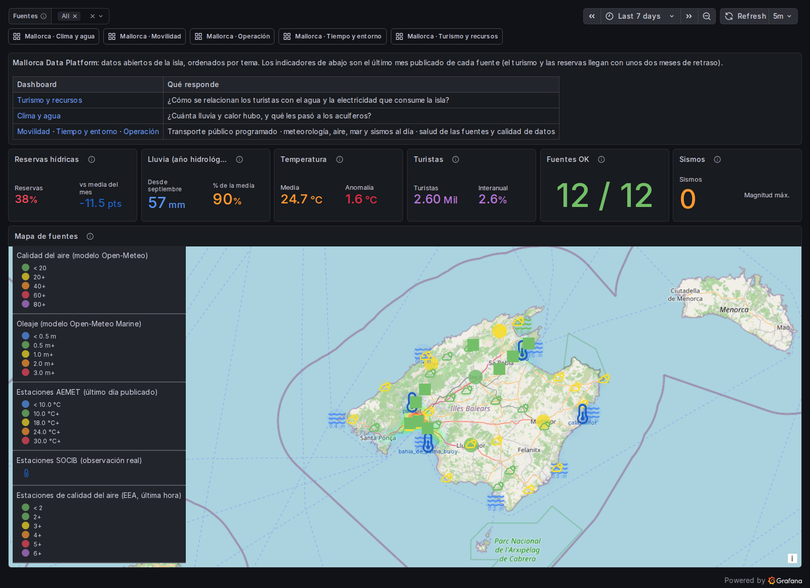
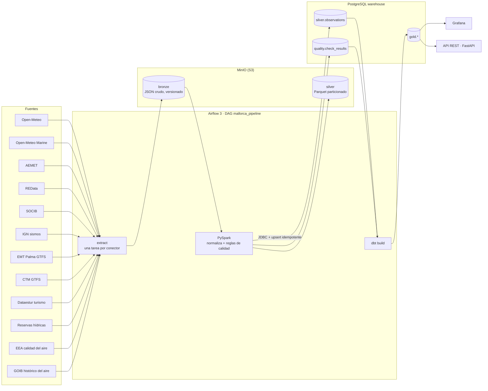
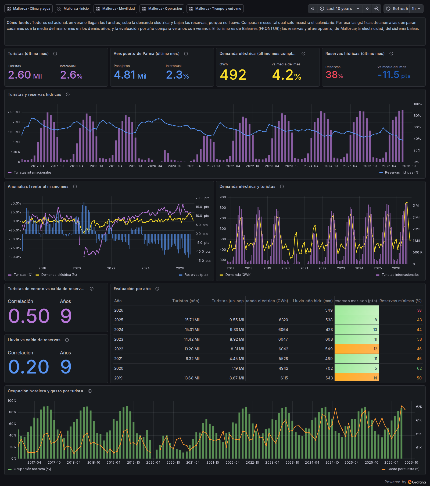
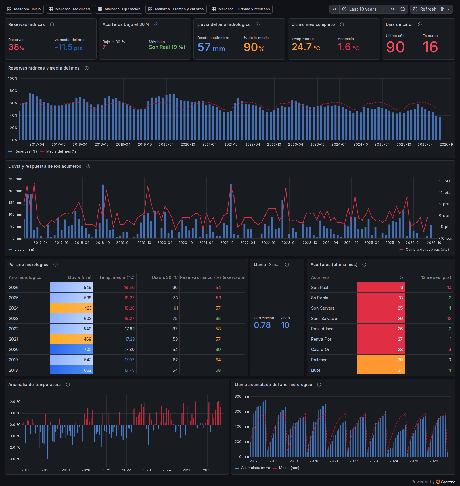
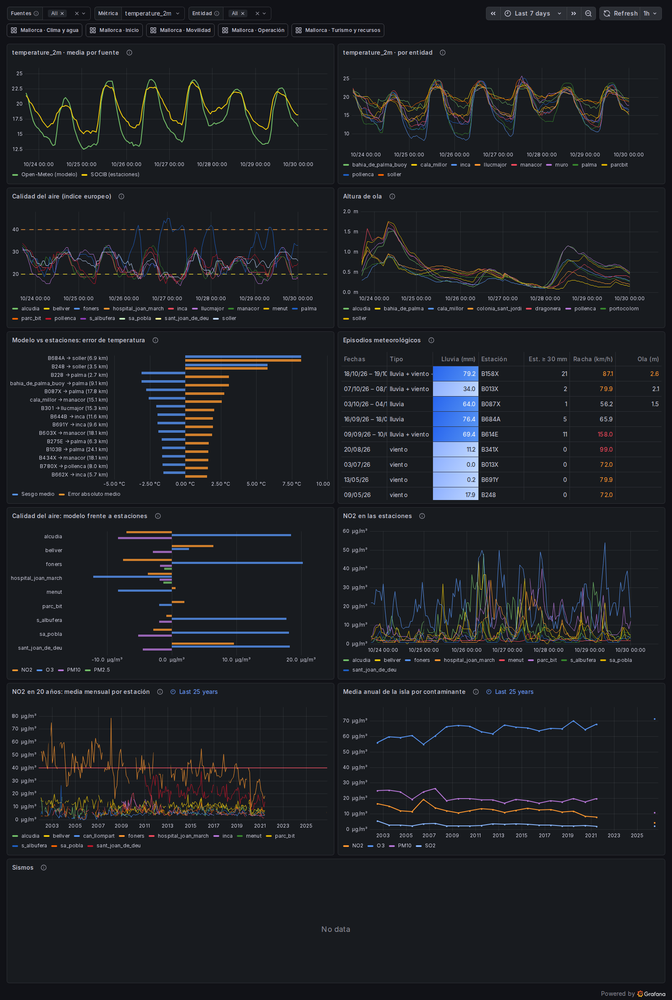
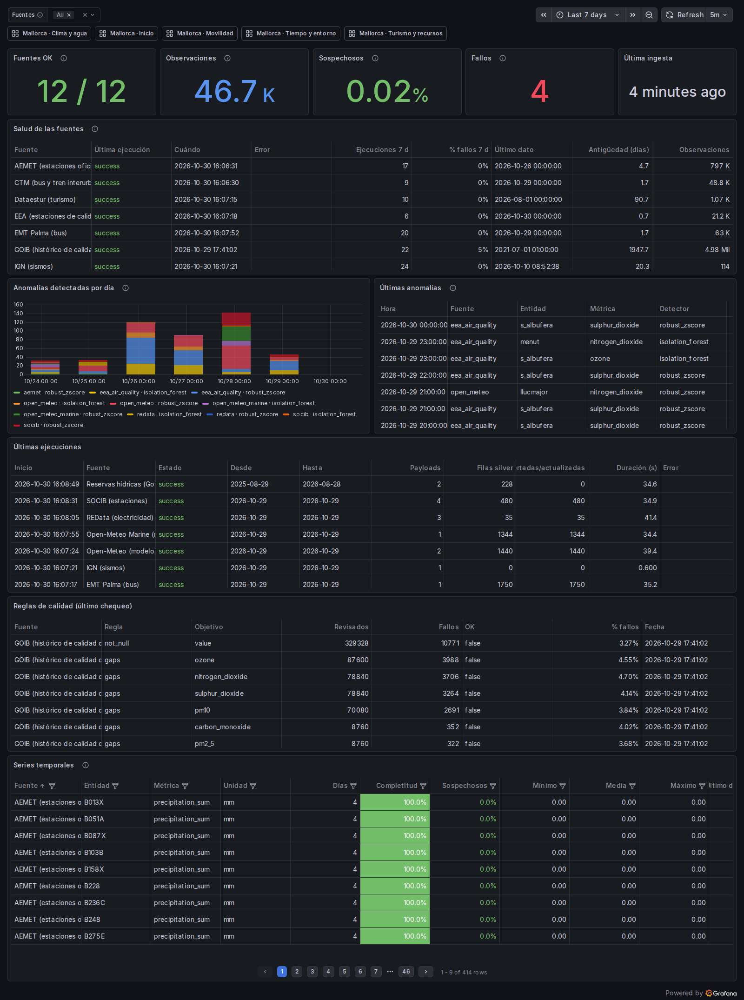
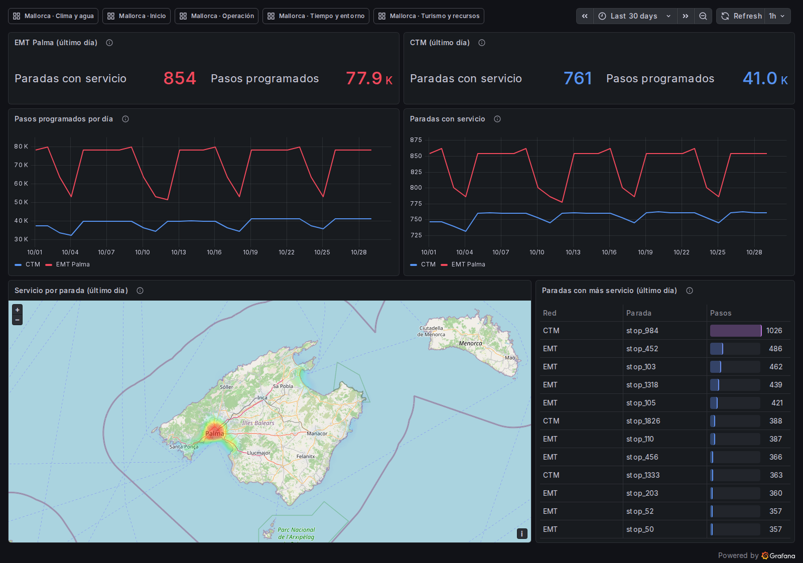

# Mallorca Data Platform

[](https://github.com/AlexandreColl/MallorcaDataPlatform/actions/workflows/ci.yml)
[](https://github.com/AlexandreColl/MallorcaDataPlatform/actions/workflows/e2e.yml)
[](https://alexandrecoll.github.io/MallorcaDataPlatform/coverage/)
[](https://alexandrecoll.github.io/MallorcaDataPlatform/)


Plataforma de datos **modular y 100 % local** sobre datos abiertos reales de Mallorca.
Un `docker compose up` levanta Airflow, PySpark, MinIO (S3), PostgreSQL, dbt y Grafana; un DAG con
parámetros extrae las fuentes elegidas, comprueba su calidad y lo deja todo listo para analizar.



```json
{"connectors": ["open_meteo"], "days": 30, "region": "mallorca"}
```

## Arquitectura



| Capa | Dónde | Contenido |
|---|---|---|
| **bronze** | `s3://bronze/<fuente>/<dataset>/window=<desde>_<hasta>/payload.json` | Respuesta de la API sin tocar. Clave determinista + versionado del bucket: relanzar no duplica y el crudo anterior se conserva |
| **silver** | `s3://silver/observations/source=…/date=…` y `silver.observations` | Esquema común: `source, entity, metric, ts, value, unit, quality, lat, lon` (+ `quality_reasons`, `run_id`, `ingested_at`) |
| **gold** | esquema `gold` (dbt: staging → intermediate → marts, [detalle](dbt/README.md)) | hechos incrementales (`fct_observations`, `agg_daily_metrics`), marts por dominio (tiempo diario, mar, electricidad, bus, calidad del aire, sismos) y salud de las fuentes |

### Decisiones de diseño

- **Núcleo fijo, conectores intercambiables.** El núcleo solo conoce `extract()` y `normalize()`.
  Un conector es una carpeta con su YAML, su extractor y sus tests con respuestas grabadas.
- **Idempotencia en todas las capas**: ventanas de días completos (siempre la misma petición), claves
  deterministas en bronze, `overwrite` dinámico de particiones en Parquet y `INSERT … ON CONFLICT … WHERE
  IS DISTINCT FROM` en Postgres. El E2E de CI lanza el DAG dos veces y comprueba que no cambia el número de filas.
- **Una fuente caída no para el resto.** Cada conector es una tarea independiente con reintentos (2, 4 y 8 min);
  si al final falla, dbt reconstruye gold con lo que sí cargó y el fallo queda en `ops.ingestion_runs` con el tipo de
  error. La siguiente ejecución de esa fuente **recupera los días perdidos**: su ventana empieza el día después de
  su última carga correcta (hasta `catch_up_days`). El E2E distingue una API caída (aviso) de un fallo real (error).
- **Marcar ≠ corregir.** Las reglas de calidad etiquetan (`ok` / `suspect` / `missing`) y explican
  (`quality_reasons`), pero nunca modifican el valor. Las correcciones irán en una capa propia (ver roadmap).
- **Local primero, nube después.** MinIO habla S3 y Spark usa S3A: pasar a AWS es cambiar el endpoint y las credenciales.

## Puesta en marcha

Requisitos: Docker Engine con Compose y ~8 GB de RAM libres (Linux, macOS o Windows con WSL2).
Guía para Windows con WSL2 + Debian: [docs/setup-windows.md](docs/setup-windows.md).

```bash
make up                                      # crea .env, construye la imagen y levanta todo
make run CONNECTORS=open_meteo DAYS=30       # dispara el DAG
make run-local CONNECTORS=open_meteo DAYS=1  # mismo pipeline sin Airflow
make backfill CONNECTORS=aemet START=2016-09-01 END=2026-10-25  # histórico, un run por año
```

| Servicio | URL | Acceso |
|---|---|---|
| Airflow | http://localhost:8080 | sin login (modo demo local) |
| Grafana | http://localhost:3000 | anónimo de lectura · admin/admin |
| MinIO | http://localhost:9001 | minioadmin/minioadmin |
| API REST | http://localhost:8000/docs | lectura pública (rol `api_reader`) |
| PostgreSQL | localhost:5432 | `make psql` |

Otros comandos: `make help`.

## Conectores

| Conector | Estado | Datos | Clave |
|---|---|---|---|
| [open_meteo](connectors/open_meteo/README.md) | ✅ | Calidad del aire (CAMS) y meteorología, horario, 6 localidades | No |
| [redata](connectors/redata/README.md) | ✅ v0.2.0 | Demanda eléctrica horaria, mix de generación y CO₂ diarios del sistema balear | No |
| [socib](connectors/socib/README.md) | ✅ v0.2.1 | Observaciones reales de 3 estaciones y 1 boya (temperatura, humedad, presión, viento), horarias con QC de la fuente | No |
| [ign](connectors/ign/README.md) | ✅ v0.2.2 | Sismos localizados por el IGN en Mallorca y el mar que la rodea (magnitud, profundidad, epicentro) | No |
| [emt_palma](connectors/emt_palma/README.md) | ✅ v0.2.3 | Autobuses programados y líneas por parada y día (875 paradas, GTFS estático) | No |
| [open_meteo_marine](connectors/open_meteo_marine/README.md) | ✅ v0.2.4 | Oleaje, temperatura del mar, corrientes y nivel del mar (modelo) en 8 puntos de la costa | No |
| [aemet](connectors/aemet/README.md) | ✅ v0.2.5 | Valores diarios oficiales de 33 estaciones de AEMET en Mallorca (temperatura, lluvia, humedad, viento, sol, presión) | Sí |
| [ctm](connectors/ctm/README.md) | ✅ | Autobuses TIB, tren SFM y metro programados por parada y día en toda la isla (763 paradas, GTFS estático) | No |
| [dataestur](connectors/dataestur/README.md) | ✅ | Turismo mensual de Baleares: turistas internacionales y gasto, ocupación hotelera y pasajeros del aeropuerto de Palma | No |
| [water_reserves](connectors/water_reserves/README.md) | ✅ | Reservas de agua subterránea de Mallorca por acuífero y de la isla, mensuales (10 años de la isla) | No |
| [goib_air_quality](connectors/goib_air_quality/README.md) | ✅ histórico | NO₂, O₃, PM10, PM2.5, SO₂ y CO horarios de 11 estaciones oficiales de Mallorca, de 2002 a junio de 2021 (catálogo del Govern). Solo con `make backfill` | No |
| [eea_air_quality](connectors/eea_air_quality/README.md) | ✅ | NO₂, O₃, PM10, PM2.5, SO₂ y CO horarios de 9 estaciones oficiales de Mallorca (red del Govern, vía la EEA) | No |

### Open-Meteo

Una petición por dataset con todas las localidades de la región. 10 métricas horarias
(PM10, PM2.5, NO₂, O₃, EAQI, temperatura, humedad, precipitación, viento, presión).
Con `DAYS=1` son 6 × 24 × 10 = 1.440 observaciones. Son datos de modelo, no de estación.

### Open-Meteo Marine

La misma API con modelos de oleaje y océano en 8 puntos de mar alrededor de la isla: altura, periodo y dirección de
ola, mar de fondo, temperatura del mar, corrientes y nivel del mar. Es una subclase del conector de Open-Meteo que
solo cambia los puntos consultados (las localidades de la región están en el interior). En Grafana, gotas en el mapa
con el color y la altura de ola; el resto de métricas, en el selector.

### AEMET

Valores climatológicos **diarios** de las estaciones oficiales de AEMET en Mallorca (temperatura media, mínima y
máxima, lluvia, humedad, viento, horas de sol y presión). Necesita una API key gratuita en `.env`
(`AEMET_API_KEY`); sin ella el conector queda fuera de la selección por defecto. La API es de dos pasos, acepta
hasta 25 estaciones por petición y publica con 2-3 días de retraso, por eso declara `lag_days: 3`. En Grafana,
iconos de sol y nube en el mapa con el último día publicado.

### REData

Red Eléctrica publica el sistema eléctrico balear completo (Mallorca es ~80 % de la demanda). Tres datasets
con granularidad distinta, cada uno con su propia `frequency` para la regla de huecos:

| Dataset | Granularidad | Métricas |
|---|---|---|
| Demanda | horaria (peticiones troceadas en bloques de 28 días) | `electricity_demand` (MWh) |
| Generación | diaria | `generation_<tecnología>` y `generation_total` (MWh) |
| Emisiones | diaria | `co2_emissions` (tCO2eq), `co2_intensity` (tCO2eq/MWh) |

Las series de la API se mapean a métricas en el YAML; una serie nueva (p. ej. una tecnología que aparece en el
mix) genera un aviso en lugar de perderse en silencio. En Grafana: demanda horaria e intensidad de CO₂ en
una gráfica, y el mix por tecnología en la tabla de series.

### SOCIB

Observaciones **reales** de estaciones meteorológicas (ParcBit, Cala Millor, Muro) y de la boya de la Bahía de
Palma, leídas del servidor THREDDS de SOCIB en CSV (sin clave). Los datos llegan cada 1-10 minutos con el QC de
SOCIB por variable; el conector los agrega por hora usando solo las muestras buenas y marca `suspect` las horas
con menos del 50 % de muestras válidas. Las métricas se llaman igual que en Open-Meteo, así que Grafana compara
estación real y modelo en la misma gráfica.

### IGN (sismos)

Sismos localizados por el Instituto Geográfico Nacional, leídos del servicio FDSN de EMSC (estándar, sin clave)
en la caja de la región ampliada 1° alrededor de la isla. Es la primera fuente de **eventos**: no hay muestreo
regular, así que su dataset declara `frequency: event` (sin regla de huecos) y una ventana sin sismos, lo habitual,
es una ejecución correcta con 0 filas. En gold, `fct_earthquakes` da una fila por sismo con su distancia a Palma; en
Grafana aparecen en el mapa (tamaño y color según la magnitud) y en un indicador. Prueba real: 57 sismos desde 2020, magnitud máxima 3,0.

### EMT Palma (autobús)

El GTFS estático de EMT Palma (abierto en su GitHub, sin clave) convertido en una **serie diaria por parada**: para
cada día se resuelven los servicios que circulan (calendario semanal más las excepciones de festivos) y se cuentan
los autobuses programados y las líneas distintas que pasan por cada una de las 875 paradas. EMT publica los viajes
por frecuencias (`frequencies.txt`: «cada 20 min de 07:15 a 20:35»), que el conector expande. Los días fuera de la
vigencia del feed no generan filas, así que la regla de huecos los señala. En Grafana es un mapa de calor del
servicio. Prueba real: unos 78.000 pasos de autobús en un día laborable, 52.800 en domingo.

### CTM (autobús, tren y metro de la isla)

El GTFS del Consorci de Transports de Mallorca (sin clave, CC BY 4.0) con la misma lógica que EMT, ahora en
`core/connectors/gtfs.py`: autobuses TIB, tren SFM y metro programados y líneas por parada y día en las 763
paradas de la isla. Sin `frequencies.txt`, cada viaje cuenta una vez por parada; los horarios de temporada se ven
como servicios que acaban el 31 de octubre. En gold, `fct_island_transit_daily`; en Grafana, la misma mancha de
calor que EMT. Prueba real: unos 41.000 pasos en un día laborable, 35.000 en domingo; la Estació Intermodal de
Palma tiene 1.028 al día.

### Calidad del aire (EEA)

Las medidas horarias de las 9 estaciones oficiales de Mallorca, desde el servicio de descarga de la Agencia Europea
de Medio Ambiente: una búsqueda JSON devuelve un Parquet por estación y contaminante, unas dos horas por detrás del
tiempo real. Se probaron antes OpenAQ y aqicn: republican las mismas estaciones, OpenAQ con solo un 30 % de las
horas y aqicn sin histórico y en subíndices AQI en lugar de concentraciones. Los
contaminantes se llaman como en Open-Meteo, y `fct_air_quality_model_bias_daily` compara cada estación con el modelo
CAMS. En Grafana, las estaciones aparecen en el mapa de Inicio y el error del modelo en Tiempo y entorno. Prueba
real: el modelo se queda corto de NO₂ junto al tráfico de Foners (−6 µg/m³) y se pasa de ozono en Palma (+20), que
es justo donde el NO del tráfico lo consume.

### Histórico de calidad del aire (GOIB)

El catálogo de datos abiertos del Govern (API CKAN) tiene las medidas horarias de 11 estaciones de Mallorca de 2002 a
junio de 2021, y nada más reciente. Es un conector de histórico: desactivado en la ejecución diaria y cargado una vez
con `make backfill`. Los ficheros llegan en tres formatos distintos (separador, orden de la fecha y cabecera), y la
hora se comprobó hora a hora contra los ficheros verificados de la EEA. Las estaciones se llaman igual que en
`eea_air_quality`, y `fct_air_quality_monthly` las une en una serie mensual por estación. Prueba real: casi 5 millones de valores horarios en unos 45 minutos de backfill. El NO₂ de Foners, junto al tráfico de Palma, baja de 52,7 µg/m³ de media anual en 2002 (por encima del límite de la UE, 40) a 31,6 en 2019 y 24 en 2020, el año del confinamiento; el ozono de la isla sube de 56 a 70 µg/m³.

### Reservas hídricas

Las reservas de agua subterránea que publica cada mes el Govern: los últimos 13 meses de las 18 masas de agua de
Mallorca y de la isla en una hoja ODS, y diez años de la isla en el gráfico PDF, cuyas etiquetas son texto. Los
ficheros cambian de nombre cada mes, así que el conector los busca en la página por el texto del enlace. Como las
reservas son estacionales, `fct_water_reserves_monthly` compara cada mes con la media del mismo mes de otros años.
Prueba real: agosto de 2026, 38 %, el agosto más bajo de los diez años (11,5 puntos por debajo de la media).

### Dataestur (turismo)

Cuatro tablas mensuales de la API de SEGITTUR (sin clave): turistas internacionales (FRONTUR) y su gasto (EGATUR)
en Baleares, ocupación hotelera (EOH) y pasajeros del aeropuerto de Palma (AENA). La API responde xlsx, que el
conector lee con la librería estándar, y un filtro mal escrito devuelve una hoja vacía con HTTP 200, que se trata
como error. Es la primera fuente mensual: el núcleo gana `frequency: 1mo` (huecos contados en meses naturales) y
`min_days`, para que la ejecución diaria relea siempre el último año y recoja las revisiones. En gold,
`fct_tourism_monthly` con el gasto por turista y la variación interanual; en Grafana, un panel con los últimos tres
años. Prueba real: diez años en un minuto; agosto de 2026, 2,6 M turistas (+2,6 %) y 4,8 M pasajeros en Palma.

Añadir una fuente: [docs/adding-a-connector.md](docs/adding-a-connector.md).

## Calidad de datos

Reglas reutilizables en `core/quality/`, configuradas desde el YAML de cada conector:

| Regla | Tipo | Qué detecta |
|---|---|---|
| `not_null` | fila | valores nulos → `missing` |
| `source_qc` | fila | valores que la propia fuente marca como dudosos (p. ej. QC de SOCIB) → `suspect` |
| `range` | fila | valores fuera del rango físico de la métrica → `suspect` |
| `duplicate` | fila | misma (fuente, entidad, métrica, ts) repetida → se colapsa conservando el valor no nulo |
| `gaps` | serie | pasos de tiempo ausentes según la `frequency` del conector (no se aplica a fuentes de eventos) |

Resultados por ejecución en `quality.check_results`; en Grafana, el % de sospechosos, la completitud de la tabla de
series y la fila plegada *Operación*.

## Detección de anomalías

Las reglas de calidad descartan lo imposible (una humedad del 140 %); los detectores de `core/anomaly/` buscan lo
improbable: valores posibles que no encajan con su propia serie. Solo **marcan**: escriben en `silver.anomalies`
(valor, valor esperado, puntuación, umbral, `run_id`) y nunca modifican `silver.observations`.

- **Interfaz `Detector`**: puntúa todas las series de una entidad (localidad, estación o punto) en pandas, así se
  prueba sin Spark; el runner la reparte por entidades con `groupBy().applyInPandas()`. Los detectores univariantes
  (`UnivariateDetector`) miran cada métrica por separado; los multivariantes, cómo se mueven juntas.
- **`robust_zscore`**: z-score modificado de Iglewicz y Hoaglin, `0,6745 · (x − mediana) / MAD` sobre una ventana
  móvil centrada (7 días en series horarias, 31 en diarias). La mediana y la MAD apenas se mueven con el pico que
  buscan, al contrario que la media y la desviación típica. Una ventana casi constante (MAD = 0) no se puntúa.
- **`isolation_forest`** (scikit-learn): un bosque por entidad sobre todas sus métricas a la vez. Cada instante se
  describe, por métrica, con su valor, su cambio, cuántos valores seguidos lleva igual y la distancia al valor
  habitual a esa hora, más la propia hora. Aísla los instantes raros (un 5 % de cada entidad, `contamination`) y
  culpa a la métrica cuyas variables más se alejan de su mediana. Necesita 48 instantes completos: las series
  diarias de AEMET no llegan.
- Tarea `detect_anomalies` del DAG tras la ingesta, también si alguna fuente falló. Cada ejecución vuelve a puntuar
  al menos los últimos `rescore_days` (14) y reemplaza su resultado: los datos que llegan tarde (AEMET) o se
  recuperan se juzgan con sus vecinos, y es idempotente.
- Configuración en [config/anomaly.yaml](config/anomaly.yaml): parámetros de cada detector y lo que no se analiza
  (sismos, horarios de EMT y CTM y estadísticas mensuales de Dataestur y de reservas hídricas; precipitación, insolación y dirección del
  oleaje). A mano: `make detect DAYS=30`.

Con 30 días reales el z-score marca ~1 % de 104 000 valores, sobre todo episodios de verdad (el temporal del 18-19
de octubre, mar de fondo en Alcúdia) y los picos nocturnos de NO₂; el Isolation Forest, 732.

### Medir los detectores con fallos inyectados

Las anomalías reales no vienen etiquetadas, así que no se puede saber cuántas se escapan. `make evaluate` crea esa
verdad: toma las series recientes de Open-Meteo (modelo, completas y suaves), les **inyecta fallos conocidos** con
una semilla fija y puntúa cada serie limpia y corrompida (`core/anomaly/faults.py` y `evaluation.py`):

| Fallo | Qué simula | Forma |
|---|---|---|
| `spike` | lectura errónea, coma decimal | un valor ± 4-8 σ robustas |
| `frozen` | sensor congelado, payload repetido | 6-24 horas con el último valor bueno |
| `drift` | sensor que se descalibra | rampa de 2-4 σ durante 48-120 horas |
| `shift` | reloj o zona horaria mal | 6-24 horas con los valores de 12 horas antes |

Un aviso sobre un valor inyectado es un acierto; uno nuevo sobre un valor limpio, una falsa alarma. Lo que el
detector ya marcaba en la serie limpia (episodios reales) se cuenta aparte y no penaliza. Los huecos no se inyectan:
un valor que falta no se puede marcar, y ya los cuenta la regla `gaps`. Resultados en
`quality.anomaly_evaluations`; fallos detectados (algún valor marcado) en 54 series de 6 localidades, 30 días:

| Detector | Picos | Derivas | Congelados | Desfase | Precisión |
|---|---|---|---|---|---|
| `robust_zscore` | 90 % | 22 % | 0 % | 6 % | 80 % |
| `isolation_forest` | 49 % | 11 % | 52 % | 6 % | 85 % |

Son complementarios. El z-score ve lo que se aleja de sus vecinos y es ciego a lo que se queda en un nivel normal:
un sensor congelado en 18 °C está cerca de la mediana. El bosque ve que una serie que siempre se mueve se ha
parado (con la variable "valores seguidos iguales"; una dispersión móvil no basta, porque cerca del máximo o el
mínimo diario casi no hay dispersión de todos modos), pero con su cupo del 5 % se deja la mitad de los picos. El
desfase horario se escapa a los dos: en un modelo suave, los valores de 12 horas antes parecen una noche templada.
`contamination` mueve el equilibrio: con 0,10 el bosque llega al 73 % de picos y 74 % de congelados con un 81 % de
precisión.

## Grafana

Seis dashboards en la carpeta *Mallorca Data Platform* (http://localhost:3000), enlazados entre sí desde la barra
superior. Cada uno responde a una pregunta y lee sus marts de dbt (un exposure por dashboard):

| Dashboard | Qué muestra |
|---|---|
| **Inicio** | El último mes de reservas hídricas, lluvia del año hidrológico, temperatura y turistas, y el mapa de todas las fuentes georreferenciadas (aire, oleaje, AEMET, SOCIB, sismos y servicio de bus) |
| **Turismo y recursos** | Turistas frente a reservas de agua y demanda eléctrica; las anomalías frente al mismo mes, que quitan la estacionalidad; y una evaluación año a año (turistas de verano frente a la caída de las reservas de marzo a septiembre, con su correlación) |
| **Clima y agua** | Reservas frente a la media del mes, lluvia mensual y respuesta de los acuíferos, tabla por año hidrológico, anomalía de temperatura, lluvia acumulada y el estado de los 18 acuíferos |
| **Movilidad** | Servicio programado de EMT Palma y CTM por día, mapa de calor por parada y paradas con más servicio |
| **Tiempo y entorno** | Explorador de cualquier métrica por fuente y entidad, calidad del aire, oleaje, error del modelo frente a las estaciones, episodios meteorológicos y sismos |
| **Operación** | Salud de cada fuente, anomalías detectadas, ejecuciones, reglas de calidad y completitud de cada serie |

| Turismo y recursos | Clima y agua |
|---|---|
| [](docs/img/turismo-y-recursos.png) | [](docs/img/clima-y-agua.png) |
| **Tiempo y entorno** | **Operación** |
| [](docs/img/tiempo-y-entorno.png) | [](docs/img/operacion.png) |

[](docs/img/movilidad.png)

Las capturas se regeneran con `make screenshots` (Playwright en Docker contra la pila local).

La pregunta de fondo (¿aprieta el turismo al agua?) necesita cuidado: turismo, calor, demanda y reservas son
estacionales a la vez, así que comparar meses tal cual solo enseña el calendario. Los paneles de evaluación comparan
cada mes con la media del mismo mes y cada verano con los demás veranos. Con diez años de datos (correlaciones de
Pearson, pocos años, así que orientativas):

- La lluvia de septiembre a febrero explica bien las reservas de marzo (r = 0,78 en 10 años).
- Los veranos con más turistas son los que más bajan los acuíferos de marzo a septiembre (r = 0,50 en 9 años); la
  lluvia del año apenas cambia esa caída (r = 0,20).
- Mes a mes, los meses con más turistas de lo normal tienen reservas por debajo de lo normal (r = −0,41), pero en la
  década crece el turismo y bajan las reservas, y 2020 (sin turistas y con un invierno lluvioso) pesa mucho:
  correlación, no causa.

### Alertas

Tres reglas de alerta provisionadas desde `dashboards/provisioning/alerting/alerting.yml`. Se evalúan cada 5 minutos
sobre las tablas operativas (`ops.ingestion_runs`, `quality.check_results`), así que avisan aunque dbt no corra,
y cada fuente (o regla) es una alerta aparte:

| Alerta | Cuándo salta |
|---|---|
| **Ingesta fallida** | La última ejecución de una fuente terminó en `failed` |
| **Fuente sin ejecución correcta** | Una fuente activa (con datos del último año) lleva más de 36 h sin una ejecución correcta. Un backfill de histórico no cuenta |
| **Regla de calidad en rojo** | Una regla pasó en el chequeo anterior y falla en el último. Las que fallan siempre (los huecos de una fuente con cortes conocidos) no avisan |

Las alertas activas aparecen en el panel *Alertas* de Operación. No hay punto de contacto configurado: para recibir
avisos basta con añadir uno (Slack, correo con SMTP) en Grafana o en el mismo fichero.

Los nombres de las fuentes salen del seed `dim_sources` de dbt; un test comprueba que toda fuente de silver tiene su
fila.

## API REST

Una API de solo lectura con FastAPI sobre la capa gold, en su propio servicio (`api`, puerto 8000) y con su propia
imagen, pequeña: sin Airflow, Spark ni Java. La documentación OpenAPI está en http://localhost:8000/docs (Swagger) y
`/redoc`.

| Endpoint | Qué devuelve |
|---|---|
| `GET /v1/health` | Estado de la API y de su conexión al warehouse (503 si está caído) |
| `GET /v1/sources`, `/v1/sources/{source}` | Cada fuente con su última ejecución, % de fallos en 7 días y antigüedad del último dato |
| `GET /v1/observations` | Valores de una fuente filtrados por métrica, entidad y rango de tiempo (por defecto, los últimos 7 días), paginados |
| `GET /v1/anomalies` | Valores marcados por los detectores, filtrados por fuente, detector y rango, paginados |
| `GET /v1/water/reserves`, `/v1/water/aquifers` | Reservas mensuales con su anomalía y los 18 acuíferos del último mes |
| `GET /v1/climate/monthly`, `/v1/tourism/monthly`, `/v1/resources/monthly` | Los marts mensuales de los dashboards, filtrables con `from` y `to` |

```bash
curl "http://localhost:8000/v1/observations?source=aemet&metric=temperature_2m_max&entity=B278&limit=2"
```

Decisiones:

- **Solo marts con contrato**: la API lee tablas de dbt con `contract: {enforced: true}`, así que sus columnas y tipos
  no cambian sin que falle el build. En CI, los tests de integración ejecutan cada consulta contra los marts recién
  construidos.
- **Rol propio de solo lectura** (`api_reader`, `docker/postgres/init/02-api-reader.sh`): `SELECT` sobre gold y silver,
  transacciones de solo lectura y un límite de 15 s por consulta. En un volumen ya creado: `make api-role`.
- **Paginación** con `limit` (como mucho 1000) y `offset`: la respuesta trae `next_offset`, que se calcula pidiendo una
  fila de más. **Errores** con una sola forma: `{"error": {"code": "not_found", "message": "..."}}`.
- **Capa de acceso a datos sustituible** (`api/repository.py` sobre un protocolo `Database`): los tests unitarios usan una
  base de datos falsa y no necesitan Postgres. `make api-test`.

## AWS con Terraform

`infra/terraform` describe la misma plataforma en AWS:
- S3 para bronze y silver;
- Glue Data Catalog y Athena para consultar silver con SQL sin servidor;
- dos roles de IAM de mínimo privilegio;
- un presupuesto de 2 USD al mes.

No se despliega. El CI lo valida y lo prueba con `terraform test` contra un proveedor de AWS simulado, sin cuenta
ni coste (`make tf-check` en local). El diagrama local frente a AWS, los costes y lo que faltaría para correr en
AWS de punta a punta están en [infra/terraform/README.md](infra/terraform/README.md).

## Estructura

```
├── core/                 # núcleo: contrato, registro, bronze, Spark, calidad, warehouse, pipeline, CLI
├── connectors/<fuente>/  # connector.yaml + extractor.py + tests/fixtures
├── config/regions/       # bbox y puntos de cada región
├── dags/                 # DAG de Airflow
├── dbt/                  # staging → intermediate → marts, tests y seeds (ver dbt/README.md)
├── dashboards/           # provisioning y dashboards de Grafana
├── api/                  # API REST de solo lectura (FastAPI) y sus tests
├── docker/               # Dockerfiles de Airflow+Spark+dbt y de la API, init de Postgres
├── infra/terraform/      # AWS: S3, IAM, Glue Catalog, Athena y presupuesto, con tests sobre un AWS simulado
├── scripts/e2e.sh        # prueba de punta a punta (CI)
└── docs/
```

## CI/CD

| Workflow | Cuándo | Qué hace |
|---|---|---|
| `ci.yml` | push a `main`/`develop`, PRs | ruff · pytest con PySpark (cobertura de `core/` ≥ 80 %, ramas incluidas) · Terraform (`fmt`, `validate`, tflint y `terraform test` contra un AWS simulado) · sqlfluff · dbt build sobre Postgres vacío (slim CI en PRs) · build de la imagen + test de integridad del DAG |
| `dbt-docs.yml` | push a `develop` | `dbt docs` en [GitHub Pages](https://alexandrecoll.github.io/MallorcaDataPlatform/), el [informe de cobertura](https://alexandrecoll.github.io/MallorcaDataPlatform/coverage/) del CI de ese commit con el badge del README, y manifest de `develop` para el slim CI |
| `e2e.yml` | PR a `main`, semanal | `docker compose up`, DAG dos veces con la API real, comprueba bronze/silver/gold e idempotencia |
| `release.yml` | tag `vX.Y.Z` (o a mano con un tag existente) | Release con notas del CHANGELOG + imágenes de Airflow y de la API REST en GHCR (`airflow:X.Y.Z` y `api:X.Y.Z`, también `X.Y`) |
| `pr-title.yml` | PRs | gitmoji + Conventional Commits en el título (`✨ feat(connector): ...`) |

Ramas y releases: [docs/git-workflow.md](docs/git-workflow.md) · Plan completo: [ROADMAP.md](ROADMAP.md)

## Licencia

MIT. Los datos pertenecen a sus proveedores (Open-Meteo: CC BY 4.0).
