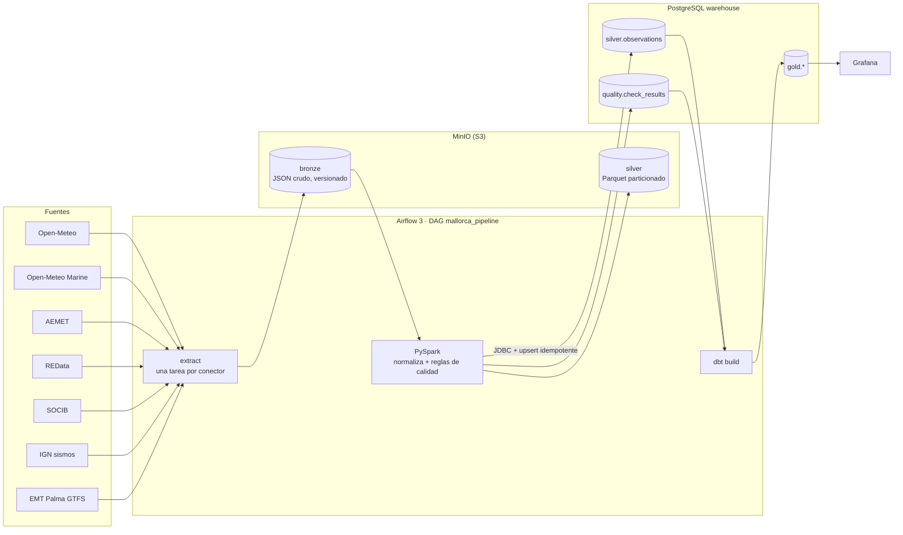

# Mallorca Data Platform

[](https://github.com/AlexandreColl/MallorcaDataPlatform/actions/workflows/ci.yml)
[](https://github.com/AlexandreColl/MallorcaDataPlatform/actions/workflows/e2e.yml)
[](https://alexandrecoll.github.io/MallorcaDataPlatform/)


Plataforma de datos **modular y 100 % local** sobre datos abiertos reales de Mallorca.
Un `docker compose up` levanta Airflow, PySpark, MinIO (S3), PostgreSQL, dbt y Grafana; un DAG con
parámetros extrae las fuentes elegidas, comprueba su calidad y lo deja todo listo para analizar.

```json
{"connectors": ["open_meteo"], "days": 30, "region": "mallorca"}
```

## Arquitectura



| Capa | Dónde | Contenido |
|---|---|---|
| **bronze** | `s3://bronze/<fuente>/<dataset>/window=<desde>_<hasta>/payload.json` | Respuesta de la API sin tocar. Clave determinista + versionado del bucket: relanzar no duplica y el crudo anterior se conserva |
| **silver** | `s3://silver/observations/source=…/date=…` y `silver.observations` | Esquema común: `source, entity, metric, ts, value, unit, quality, lat, lon` (+ `quality_reasons`, `run_id`, `ingested_at`) |
| **gold** | esquema `gold` (dbt: staging → intermediate → marts, [detalle](dbt/README.md)) | hechos incrementales (`fct_observations`, `agg_daily_metrics`), marts por dominio (tiempo diario, mar, electricidad, bus, calidad del aire, sismos) y salud de las fuentes |

### Decisiones de diseño

- **Núcleo fijo, conectores intercambiables.** El núcleo solo conoce `extract()` y `normalize()`.
  Un conector es una carpeta con su YAML, su extractor y sus tests con respuestas grabadas.
- **Idempotencia en todas las capas**: ventanas de días completos (siempre la misma petición), claves
  deterministas en bronze, `overwrite` dinámico de particiones en Parquet y `INSERT … ON CONFLICT … WHERE
  IS DISTINCT FROM` en Postgres. El E2E de CI lanza el DAG dos veces y comprueba que no cambia el número de filas.
- **Una fuente caída no para el resto.** Cada conector es una tarea independiente con reintentos (2, 4 y 8 min);
  si al final falla, dbt reconstruye gold con lo que sí cargó y el fallo queda en `ops.ingestion_runs` con el tipo de
  error. La siguiente ejecución de esa fuente **recupera los días perdidos**: su ventana empieza el día después de
  su última carga correcta (hasta `catch_up_days`). El E2E distingue una API caída (aviso) de un fallo real (error).
- **Marcar ≠ corregir.** Las reglas de calidad etiquetan (`ok` / `suspect` / `missing`) y explican
  (`quality_reasons`), pero nunca modifican el valor. Las correcciones irán en una capa propia (ver roadmap).
- **Local primero, nube después.** MinIO habla S3 y Spark usa S3A: pasar a AWS es cambiar el endpoint y las credenciales.

## Puesta en marcha

Requisitos: Docker Engine con Compose y ~8 GB de RAM libres (Linux, macOS o Windows con WSL2).
Guía para Windows con WSL2 + Debian: [docs/setup-windows.md](docs/setup-windows.md).

```bash
make up                                      # crea .env, construye la imagen y levanta todo
make run CONNECTORS=open_meteo DAYS=30       # dispara el DAG
make run-local CONNECTORS=open_meteo DAYS=1  # mismo pipeline sin Airflow
```

| Servicio | URL | Acceso |
|---|---|---|
| Airflow | http://localhost:8080 | sin login (modo demo local) |
| Grafana | http://localhost:3000 | anónimo de lectura · admin/admin |
| MinIO | http://localhost:9001 | minioadmin/minioadmin |
| PostgreSQL | localhost:5432 | `make psql` |

Otros comandos: `make help`.

## Conectores

| Conector | Estado | Datos | Clave |
|---|---|---|---|
| [open_meteo](connectors/open_meteo/README.md) | ✅ | Calidad del aire (CAMS) y meteorología, horario, 6 localidades | No |
| [redata](connectors/redata/README.md) | ✅ v0.2.0 | Demanda eléctrica horaria, mix de generación y CO₂ diarios del sistema balear | No |
| [socib](connectors/socib/README.md) | ✅ v0.2.1 | Observaciones reales de 3 estaciones y 1 boya (temperatura, humedad, presión, viento), horarias con QC de la fuente | No |
| [ign](connectors/ign/README.md) | ✅ v0.2.2 | Sismos localizados por el IGN en Mallorca y el mar que la rodea (magnitud, profundidad, epicentro) | No |
| [emt_palma](connectors/emt_palma/README.md) | ✅ v0.2.3 | Autobuses programados y líneas por parada y día (875 paradas, GTFS estático) | No |
| [open_meteo_marine](connectors/open_meteo_marine/README.md) | ✅ v0.2.4 | Oleaje, temperatura del mar, corrientes y nivel del mar (modelo) en 8 puntos de la costa | No |
| [aemet](connectors/aemet/README.md) | ✅ v0.2.5 | Valores diarios oficiales de 33 estaciones de AEMET en Mallorca (temperatura, lluvia, humedad, viento, sol, presión) | Sí |
| openaq | ⬜ v0.2.6 | Estaciones de calidad del aire | Sí |
| aqicn | ⬜ v0.2.7 | Estaciones de calidad del aire | Sí |

### Open-Meteo

Una petición por dataset con todas las localidades de la región. 10 métricas horarias
(PM10, PM2.5, NO₂, O₃, EAQI, temperatura, humedad, precipitación, viento, presión).
Con `DAYS=1` son 6 × 24 × 10 = 1.440 observaciones. Son datos de modelo, no de estación.

### Open-Meteo Marine

La misma API con modelos de oleaje y océano en 8 puntos de mar alrededor de la isla: altura, periodo y dirección de
ola, mar de fondo, temperatura del mar, corrientes y nivel del mar. Es una subclase del conector de Open-Meteo que
solo cambia los puntos consultados (las localidades de la región están en el interior). En Grafana, gotas en el mapa
con el color y la altura de ola; el resto de métricas, en el selector.

### AEMET

Valores climatológicos **diarios** de las estaciones oficiales de AEMET en Mallorca (temperatura media, mínima y
máxima, lluvia, humedad, viento, horas de sol y presión). Necesita una API key gratuita en `.env`
(`AEMET_API_KEY`); sin ella el conector queda fuera de la selección por defecto. La API es de dos pasos, acepta
hasta 25 estaciones por petición y publica con 2-3 días de retraso, por eso declara `lag_days: 3`. En Grafana,
iconos de sol y nube en el mapa con el último día publicado.

### REData

Red Eléctrica publica el sistema eléctrico balear completo (Mallorca es ~80 % de la demanda). Tres datasets
con granularidad distinta, cada uno con su propia `frequency` para la regla de huecos:

| Dataset | Granularidad | Métricas |
|---|---|---|
| Demanda | horaria (peticiones troceadas en bloques de 28 días) | `electricity_demand` (MWh) |
| Generación | diaria | `generation_<tecnología>` y `generation_total` (MWh) |
| Emisiones | diaria | `co2_emissions` (tCO2eq), `co2_intensity` (tCO2eq/MWh) |

Las series de la API se mapean a métricas en el YAML; una serie nueva (p. ej. una tecnología que aparece en el
mix) genera un aviso en lugar de perderse en silencio. En Grafana: demanda horaria e intensidad de CO₂ en
una gráfica, y el mix por tecnología en la tabla de series.

### SOCIB

Observaciones **reales** de estaciones meteorológicas (ParcBit, Cala Millor, Muro) y de la boya de la Bahía de
Palma, leídas del servidor THREDDS de SOCIB en CSV (sin clave). Los datos llegan cada 1-10 minutos con el QC de
SOCIB por variable; el conector los agrega por hora usando solo las muestras buenas y marca `suspect` las horas
con menos del 50 % de muestras válidas. Las métricas se llaman igual que en Open-Meteo, así que Grafana compara
estación real y modelo en la misma gráfica.

### IGN (sismos)

Sismos localizados por el Instituto Geográfico Nacional, leídos del servicio FDSN de EMSC (estándar, sin clave)
en la caja de la región ampliada 1° alrededor de la isla. Es la primera fuente de **eventos**: no hay muestreo
regular, así que su dataset declara `frequency: event` (sin regla de huecos) y una ventana sin sismos, lo habitual,
es una ejecución correcta con 0 filas. En gold, `fct_earthquakes` da una fila por sismo con su distancia a Palma; en
Grafana aparecen en el mapa (tamaño y color según la magnitud) y en un indicador. Prueba real: 57 sismos desde 2020, magnitud máxima 3,0.

### EMT Palma (autobús)

El GTFS estático de EMT Palma (abierto en su GitHub, sin clave) convertido en una **serie diaria por parada**: para
cada día se resuelven los servicios que circulan (calendario semanal más las excepciones de festivos) y se cuentan
los autobuses programados y las líneas distintas que pasan por cada una de las 875 paradas. EMT publica los viajes
por frecuencias (`frequencies.txt`: «cada 20 min de 07:15 a 20:35»), que el conector expande. Los días fuera de la
vigencia del feed no generan filas, así que la regla de huecos los señala. En Grafana es un mapa de calor del
servicio. Prueba real: unos 78.000 pasos de autobús en un día laborable, 52.800 en domingo.

Añadir una fuente: [docs/adding-a-connector.md](docs/adding-a-connector.md).

## Calidad de datos

Reglas reutilizables en `core/quality/`, configuradas desde el YAML de cada conector:

| Regla | Tipo | Qué detecta |
|---|---|---|
| `not_null` | fila | valores nulos → `missing` |
| `source_qc` | fila | valores que la propia fuente marca como dudosos (p. ej. QC de SOCIB) → `suspect` |
| `range` | fila | valores fuera del rango físico de la métrica → `suspect` |
| `duplicate` | fila | misma (fuente, entidad, métrica, ts) repetida → se colapsa conservando el valor no nulo |
| `gaps` | serie | pasos de tiempo ausentes según la `frequency` del conector (no se aplica a fuentes de eventos) |

Resultados por ejecución en `quality.check_results`; en Grafana, el % de sospechosos, la completitud de la tabla de
series y la fila plegada *Operación*.

## Grafana

Un único dashboard, *Mallorca · Visión general* (http://localhost:3000), con un selector de **una o varias fuentes**
que filtra todo lo demás, más los selectores de métrica y entidad:

1. **Indicadores**: fuentes al día, observaciones, % sospechosos, ejecuciones fallidas, última ingesta y sismos.
2. **Mapa**: calidad del aire de Open-Meteo (puntos con el color del índice europeo), oleaje de Open-Meteo Marine
   (gotas con la altura de ola), estaciones AEMET (sol y nube, último día publicado), estaciones SOCIB (termómetros
   con su última hora), sismos del IGN (ondas según la magnitud) y un mapa de calor del servicio de EMT Palma.
3. **Gráficas**: la métrica elegida como media por fuente (con temperatura compara estación real y modelo) y por
   entidad (la demanda y el CO₂ de Baleares se eligen ahí como métricas de REData), y dos vistas de los marts de dbt:
   el error del modelo de Open-Meteo frente a cada estación de AEMET y SOCIB, y los episodios de lluvia fuerte,
   viento u oleaje.
4. **Tabla de series temporales**: una fila por fuente, entidad y métrica con días, completitud, % sospechosos y
   estadísticos; las fuentes con muchas entidades (las 875 paradas de EMT) se resumen en una fila por métrica.

Las ejecuciones y las reglas de calidad están en una fila plegada al final. Los nombres de las fuentes salen del
seed `dim_sources` de dbt; un test comprueba que toda fuente de silver tiene su fila.

## Estructura

```
├── core/                 # núcleo: contrato, registro, bronze, Spark, calidad, warehouse, pipeline, CLI
├── connectors/<fuente>/  # connector.yaml + extractor.py + tests/fixtures
├── config/regions/       # bbox y puntos de cada región
├── dags/                 # DAG de Airflow
├── dbt/                  # staging → intermediate → marts, tests y seeds (ver dbt/README.md)
├── dashboards/           # provisioning y dashboards de Grafana
├── docker/               # Dockerfile de Airflow+Spark+dbt, init de Postgres
├── scripts/e2e.sh        # prueba de punta a punta (CI)
└── docs/
```

## CI/CD

| Workflow | Cuándo | Qué hace |
|---|---|---|
| `ci.yml` | push a `main`/`develop`, PRs | ruff · pytest con PySpark · sqlfluff · dbt build sobre Postgres vacío (slim CI en PRs) · build de la imagen + test de integridad del DAG |
| `dbt-docs.yml` | push a `develop` | `dbt docs` en [GitHub Pages](https://alexandrecoll.github.io/MallorcaDataPlatform/) y manifest de `develop` para el slim CI |
| `e2e.yml` | PR a `main`, semanal | `docker compose up`, DAG dos veces con la API real, comprueba bronze/silver/gold e idempotencia |
| `release.yml` | tag `vX.Y.Z` | Release con notas del CHANGELOG + imagen en GHCR |
| `pr-title.yml` | PRs | gitmoji + Conventional Commits en el título (`✨ feat(connector): ...`) |

Ramas y releases: [docs/git-workflow.md](docs/git-workflow.md) · Plan completo: [ROADMAP.md](ROADMAP.md)

## Licencia

MIT. Los datos pertenecen a sus proveedores (Open-Meteo: CC BY 4.0).
