# Mallorca Data Platform

[](https://github.com/AlexandreColl/MallorcaDataPlatform/actions/workflows/ci.yml)
[](https://github.com/AlexandreColl/MallorcaDataPlatform/actions/workflows/e2e.yml)
[](https://alexandrecoll.github.io/MallorcaDataPlatform/coverage/)
[](https://alexandrecoll.github.io/MallorcaDataPlatform/)


[English](README.en.md) · **Español**

Plataforma de datos **modular y 100 % local** sobre datos abiertos reales de Mallorca.
Un `docker compose up` levanta Airflow, PySpark, MinIO (S3), PostgreSQL, dbt y Grafana; un DAG con
parámetros extrae las fuentes elegidas, comprueba su calidad y lo deja todo listo para analizar.

<picture>
  <source media="(prefers-color-scheme: dark)" srcset="docs/img/web/inicio-oscuro.png">
  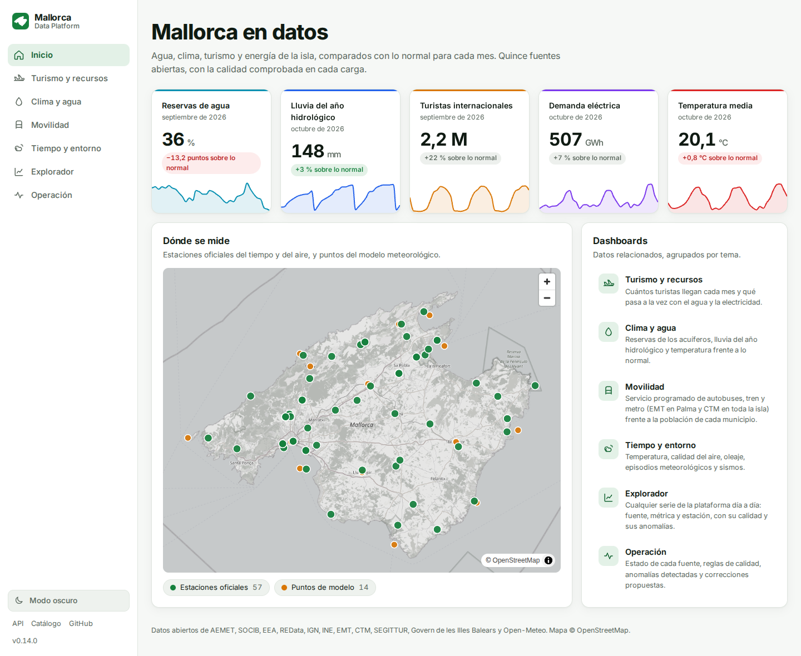
</picture>

```json
{"connectors": ["open_meteo"], "days": 30, "region": "mallorca"}
```

## Arquitectura

<picture>
  <source media="(prefers-color-scheme: dark)" srcset="docs/img/architecture-dark.svg">
  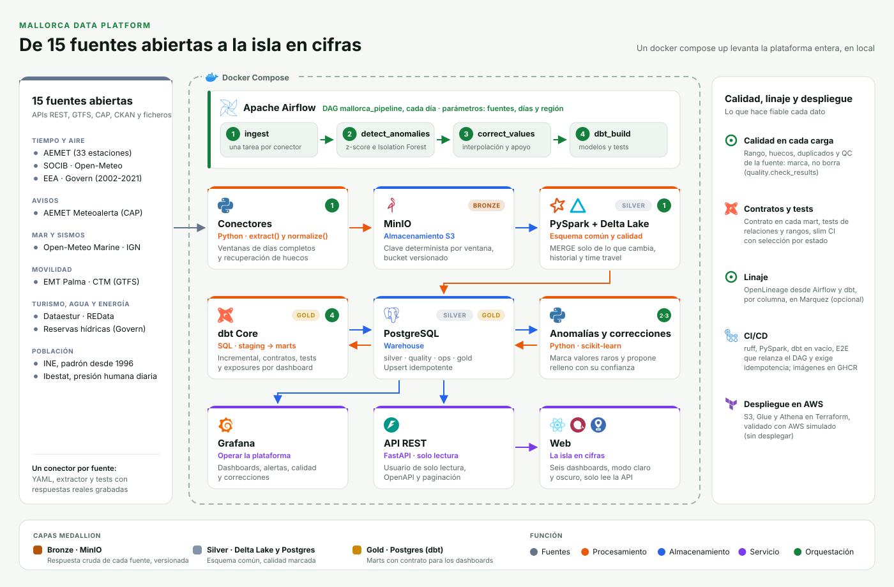
</picture>

El diagrama se genera con `node scripts/architecture/diagram.mjs` (versión clara y oscura, logos de Simple Icons).

Airflow orquesta cada flecha con el DAG `mallorca_pipeline`: una tarea `ingest` por conector, y después
`detect_anomalies`, `correct_values` y `dbt_build`. Bronze vive en MinIO; silver, en una tabla Delta de MinIO y en
Postgres; gold, en Postgres.

| Capa | Dónde | Contenido |
|---|---|---|
| **bronze** | `s3://bronze/<fuente>/<dataset>/window=<desde>_<hasta>/payload.json` | Respuesta de la API sin tocar. Clave determinista + versionado del bucket: relanzar no duplica y el crudo anterior se conserva |
| **silver** | tabla Delta `s3://silver/observations` (una partición por fuente, `source=…`) y `silver.observations` | Esquema común: `source, entity, metric, ts, value, unit, quality, lat, lon` (+ `quality_reasons`, `run_id`, `ingested_at`). Cada carga es una versión de la tabla Delta: historial y *time travel* ([abajo](#silver-en-delta-lake)) |
| **gold** | esquema `gold` (dbt: staging → intermediate → marts, [detalle](dbt/README.md)) | hechos incrementales (`fct_observations`, `agg_daily_metrics`), marts por dominio (tiempo diario, mar, electricidad, bus, calidad del aire, sismos) y salud de las fuentes |

### Decisiones de diseño

El caso completo, con el contexto, las restricciones, cada decisión con su porqué, lo que se descartó y lo que cuesta:
[docs/architecture.md](docs/architecture.md). Allí está también qué se rompe primero a 10× y 100× y cuánto costaría
en AWS ([trade-offs, costes y escalado](docs/architecture.md#5-trade-offs-costes-y-escalado)). Cada decisión tiene
su ADR en [docs/adr](docs/adr/README.md), incluidas las que se sustituyeron o se rechazaron. El modelo de datos (silver,
la estrella de gold, el grano de cada hecho y los contratos) está en [docs/data-model.md](docs/data-model.md). El
dueño, la licencia, el acceso y el SLA de cada fuente están en [docs/data-governance.md](docs/data-governance.md). En
resumen:

- **Núcleo fijo, conectores intercambiables.** El núcleo solo conoce `extract()` y `normalize()` (y el opcional `describe()`, que pone nombre a las paradas y estaciones).
  Un conector es una carpeta con su YAML, su extractor y sus tests con respuestas grabadas.
- **Idempotencia en todas las capas**: ventanas de días completos (siempre la misma petición), claves
  deterministas en bronze, `MERGE` en la tabla Delta de silver y `INSERT … ON CONFLICT … WHERE IS DISTINCT FROM`
  en Postgres: las filas que no cambian no se reescriben. El E2E de CI lanza el DAG dos veces y comprueba que no cambia el número de filas.
- **Una fuente caída no para el resto.** Cada conector es una tarea independiente con reintentos (2, 4 y 8 min);
  si al final falla, dbt reconstruye gold con lo que sí cargó y el fallo queda en `ops.ingestion_runs` con el tipo de
  error. Si lo que falla es la fuente (no responde, da 5xx o aún no ha publicado), la tarea se omite en vez de fallar
  y la ejecución queda como `unavailable`, aparte de los fallos propios (`failed`)
  ([ADR 0022](docs/adr/0022-fuente-caida-no-es-un-fallo.md)).
  La siguiente ejecución de esa fuente **recupera los días perdidos**: su ventana empieza el día después de
  su última carga correcta (hasta `catch_up_days`; un hueco más largo, en ejecuciones extra hasta `recover_days`
  donde la API guarda histórico), y no vuelve a pedir los días que ya cargó (`only_missing`). El E2E distingue una API caída o una fuente que ha dejado de
  publicar (`SourceNotUpdatedError`: aviso) de un fallo real (error).
- **Marcar ≠ corregir.** Las reglas de calidad etiquetan (`ok` / `suspect` / `missing`) y explican
  (`quality_reasons`), pero nunca modifican el valor. Las correcciones van aparte, en `silver.corrections`, y gold
  muestra los dos valores ([abajo](#correcciones-con-fuentes-de-apoyo)).
- **Local primero, nube después.** MinIO habla S3 y Spark usa S3A: pasar a AWS es cambiar el endpoint y las credenciales.
  Con `S3_CREDENTIALS=role`, bronze y Spark escriben con credenciales temporales de un rol de privilegio mínimo,
  también en local contra el STS de MinIO ([detalle](infra/terraform/README.md)).

## Puesta en marcha

Requisitos: Docker Engine con Compose y ~8 GB de RAM libres (Linux, macOS o Windows con WSL2).
Guía para Windows con WSL2 + Debian: [docs/setup-windows.md](docs/setup-windows.md).

```bash
make up                                      # crea .env, construye la imagen y levanta todo
make run CONNECTORS=open_meteo DAYS=30       # dispara el DAG (solo los días que faltan; ONLY_MISSING=false: todos)
make run-local CONNECTORS=open_meteo DAYS=1  # mismo pipeline sin Airflow
make backfill CONNECTORS=aemet START=2016-09-01 END=2026-10-25  # histórico, un run por año
```

| Servicio | URL | Acceso |
|---|---|---|
| **Web** | http://localhost:3002 | la isla en cifras: KPIs, mapa y estado de las fuentes ([abajo](#frontal-web)) |
| Airflow | http://localhost:8080 | sin login (modo demo local) |
| Grafana | http://localhost:3000 | anónimo de lectura · admin/admin |
| MinIO | http://localhost:9001 | minioadmin/minioadmin |
| API REST | http://localhost:8000/docs | lectura pública (rol `api_reader`) |
| PostgreSQL | localhost:5432 | `make psql` |
| Marquez (opcional) | http://localhost:3001 | linaje OpenLineage, con `COMPOSE_PROFILES=lineage` ([abajo](#linaje-con-openlineage)) |

Otros comandos: `make help`.

**Al reiniciar el PC no se pierde ni se repite nada.** Postgres, MinIO, Grafana y los logs viven en volúmenes de
Docker (`make down` los conserva; solo `make clean` los borra). El DAG corre solo cada día (`MDP_SCHEDULE=@daily`):
si el PC estaba apagado, Airflow lanza la ejecución pendiente al arrancar, una vez. Cada conector descarga solo los
días que ninguna carga correcta ha cubierto, desde el primero que falta, y si no falta ninguno ni llama a la fuente
([ADR 0021](docs/adr/0021-solo-los-dias-que-faltan.md)).

## Conectores

| Conector | Estado | Datos | Clave |
|---|---|---|---|
| [open_meteo](connectors/open_meteo/README.md) | ✅ | Calidad del aire (CAMS) y meteorología, horario, 6 localidades | No |
| [redata](connectors/redata/README.md) | ✅ v0.2.0 | Demanda eléctrica horaria, mix de generación y CO₂ diarios del sistema balear | No |
| [socib](connectors/socib/README.md) | ✅ v0.2.1 | Observaciones reales de 3 estaciones y 1 boya (temperatura, humedad, presión, viento), horarias con QC de la fuente | No |
| [ign](connectors/ign/README.md) | ✅ v0.2.2 | Sismos localizados por el IGN en Mallorca y el mar que la rodea (magnitud, profundidad, epicentro) | No |
| [emt_palma](connectors/emt_palma/README.md) | ✅ v0.2.3 | Autobuses programados y líneas por parada y día (875 paradas, GTFS estático) | No |
| [open_meteo_marine](connectors/open_meteo_marine/README.md) | ✅ v0.2.4 | Oleaje, temperatura del mar, corrientes y nivel del mar (modelo) en 8 puntos de la costa | No |
| [aemet](connectors/aemet/README.md) | ✅ v0.2.5 | Valores diarios oficiales de 33 estaciones de AEMET en Mallorca (temperatura, lluvia, humedad, viento, sol, presión) | Sí |
| [ctm](connectors/ctm/README.md) | ✅ | Autobuses TIB, tren SFM y metro programados por parada y día en toda la isla (763 paradas, GTFS estático) | No |
| [dataestur](connectors/dataestur/README.md) | ✅ | Turismo mensual de Baleares: turistas internacionales y gasto, ocupación hotelera y pasajeros del aeropuerto de Palma | No |
| [water_reserves](connectors/water_reserves/README.md) | ✅ | Reservas de agua subterránea de Mallorca por acuífero y de la isla, mensuales (10 años de la isla) | No |
| [goib_air_quality](connectors/goib_air_quality/README.md) | ✅ histórico | NO₂, O₃, PM10, PM2.5, SO₂ y CO horarios de 11 estaciones oficiales de Mallorca, de 2002 a junio de 2021 (catálogo del Govern). Solo con `make backfill` | No |
| [eea_air_quality](connectors/eea_air_quality/README.md) | ✅ | NO₂, O₃, PM10, PM2.5, SO₂ y CO horarios de 9 estaciones oficiales de Mallorca (red del Govern, vía la EEA), verificados desde 2013 | No |
| [aemet_warnings](connectors/aemet_warnings/README.md) | ✅ | Avisos meteorológicos de AEMET (lluvias, tormentas, viento, costeros…) por zona de Mallorca y hora, del nivel 0 al 3 | Sí |
| [ine_population](connectors/ine_population/README.md) | ✅ | Población de los 53 municipios de Mallorca a 1 de enero, por sexo, del padrón del INE (desde 1996) | No |
| [ibestat_iph](connectors/ibestat_iph/README.md) | ✅ | Personas presentes en Mallorca cada día, residentes más visitantes (Indicador de Presión Humana del Ibestat, desde 1997) | No |

### Open-Meteo

Una petición por dataset con todas las localidades de la región. 10 métricas horarias
(PM10, PM2.5, NO₂, O₃, EAQI, temperatura, humedad, precipitación, viento, presión).
Con `DAYS=1` son 6 × 24 × 10 = 1.440 observaciones. Son datos de modelo, no de estación.

### Open-Meteo Marine

La misma API con modelos de oleaje y océano en 8 puntos de mar alrededor de la isla: altura, periodo y dirección de
ola, mar de fondo, temperatura del mar, corrientes y nivel del mar. Es una subclase del conector de Open-Meteo que
solo cambia los puntos consultados (las localidades de la región están en el interior). En Grafana, gotas en el mapa
con el color y la altura de ola; el resto de métricas, en el selector.

### AEMET

Valores climatológicos **diarios** de las estaciones oficiales de AEMET en Mallorca (temperatura media, mínima y
máxima, lluvia, humedad, viento, horas de sol y presión). Necesita una API key gratuita en `.env`
(`AEMET_API_KEY`); sin ella el conector queda fuera de la selección por defecto. La API es de dos pasos, acepta
hasta 25 estaciones por petición y publica con 2-3 días de retraso, por eso declara `lag_days: 3`. En Grafana,
iconos de sol y nube en el mapa con el último día publicado.

### AEMET (avisos)

Los avisos de AEMET (Meteoalerta) de las nueve zonas de Mallorca (cinco de tierra y cuatro de aguas costeras),
hora a hora y por fenómeno: lluvias, tormentas, viento, costeros, temperaturas, nieblas, rissagas… El valor es
el nivel: 0 sin riesgo, 1 amarillo, 2 naranja y 3 rojo. Usa la misma clave que `aemet`. Cada emisión de AEMET es
una foto de los avisos en vigor: un aviso que deja de aparecer se ha retirado, sin `Cancel`. Por eso cada hora toma
el nivel de la foto que estaba en vigor. El archivo da las horas pasadas y la última emisión las de hoy y los próximos
días. En gold, `fct_weather_warnings` da un periodo por aviso; en la web, un mapa con las zonas coloreadas por nivel.
[Detalle y pruebas reales](connectors/aemet_warnings/README.md).

### INE (población)

La población de cada municipio de Mallorca a 1 de enero, por sexo, del padrón continuo del INE (tabla 2860, desde
1996; en 1997 no hubo padrón). Es la primera fuente anual: el núcleo gana `frequency: 1y` (huecos contados en años
naturales). Cada ejecución relee los tres últimos años, porque el INE revisa las cifras una vez, y la ventana acaba
350 días antes de ayer, porque las cifras de un año salen a mediados de diciembre. El seed `dim_municipalities`
guarda el límite de cada municipio (IGN, simplificado a unos 150 m). En gold, `fct_population_yearly` añade la
densidad y el cambio frente al padrón anterior; el total de la isla es la suma de sus municipios. En la web, el
dashboard de Movilidad cruza la población con las paradas de cada municipio: Palma tiene 186 pasos programados por
cada 1.000 habitantes en un día laborable y Manacor, 27.
[Detalle y pruebas reales](connectors/ine_population/README.md).

### Ibestat (presión humana)

Las personas presentes en Mallorca cada día: los empadronados, más los visitantes que llegan por puerto o aeropuerto,
menos los residentes que están fuera (Indicador de Presión Humana, conjunto `000011A_000002` de la API eDatos del
Ibestat, desde 1997). La API devuelve un cubo plano. El conector pide solo Mallorca y los días de la ventana, sin
metadatos, en peticiones de un año como máximo. Los días recientes son estimaciones y se revisan, así que cada
ejecución relee 120 días. La ventana acaba 95 días antes de ayer, porque un mes sale a principios del tercer mes
siguiente. En gold, `fct_human_pressure_daily` lo compara con el padrón: el 11 de agosto de 2026 había 1.517.631
personas en la isla, 1,58 por residente. En la web, Movilidad superpone los tres últimos años frente a los
empadronados.
[Detalle y pruebas reales](connectors/ibestat_iph/README.md).

### REData

Red Eléctrica publica el sistema eléctrico balear completo (Mallorca es ~80 % de la demanda). Tres datasets
con granularidad distinta, cada uno con su propia `frequency` para la regla de huecos:

| Dataset | Granularidad | Métricas |
|---|---|---|
| Demanda | horaria (peticiones troceadas en bloques de 28 días) | `electricity_demand` (MWh) |
| Generación | diaria | `generation_<tecnología>` y `generation_total` (MWh) |
| Emisiones | diaria | `co2_emissions` (tCO2eq), `co2_intensity` (tCO2eq/MWh) |

Las series de la API se mapean a métricas en el YAML; una serie nueva (p. ej. una tecnología que aparece en el
mix) genera un aviso en lugar de perderse en silencio. En Grafana: demanda horaria e intensidad de CO₂ en
una gráfica, y el mix por tecnología en la tabla de series.

### SOCIB

Observaciones **reales** de estaciones meteorológicas (ParcBit, Cala Millor, Muro) y de la boya de la Bahía de
Palma, leídas del servidor THREDDS de SOCIB en CSV (sin clave). Los datos llegan cada 1-10 minutos con el QC de
SOCIB por variable; el conector los agrega por hora usando solo las muestras buenas y marca `suspect` las horas
con menos del 50 % de muestras válidas. Las métricas se llaman igual que en Open-Meteo, así que Grafana compara
estación real y modelo en la misma gráfica.

### IGN (sismos)

Sismos localizados por el Instituto Geográfico Nacional, leídos del servicio FDSN de EMSC (estándar, sin clave)
en la caja de la región ampliada 1° alrededor de la isla. Es la primera fuente de **eventos**: no hay muestreo
regular, así que su dataset declara `frequency: event` (sin regla de huecos) y una ventana sin sismos, lo habitual,
es una ejecución correcta con 0 filas. En gold, `fct_earthquakes` da una fila por sismo con su distancia a Palma; en
Grafana aparecen en el mapa (tamaño y color según la magnitud) y en un indicador. Prueba real: 57 sismos desde 2020, magnitud máxima 3,0.

### EMT Palma (autobús)

El GTFS estático de EMT Palma (abierto en su GitHub, sin clave) convertido en una **serie diaria por parada**: para
cada día se resuelven los servicios que circulan (calendario semanal más las excepciones de festivos) y se cuentan
los autobuses programados y las líneas distintas que pasan por cada una de las 875 paradas. EMT publica los viajes
por frecuencias (`frequencies.txt`: «cada 20 min de 07:15 a 20:35»), que el conector expande. Los días fuera de la
vigencia del feed no generan filas, así que la regla de huecos los señala. En Grafana es un mapa de calor del
servicio. Prueba real: unos 78.000 pasos de autobús en un día laborable, 52.800 en domingo.

### CTM (autobús, tren y metro de la isla)

El GTFS del Consorci de Transports de Mallorca (sin clave, CC BY 4.0) con la misma lógica que EMT, ahora en
`core/connectors/gtfs.py`: autobuses TIB, tren SFM y metro programados y líneas por parada y día en las 763
paradas de la isla. Sin `frequencies.txt`, cada viaje cuenta una vez por parada; los horarios de temporada se ven
como servicios que acaban el 31 de octubre. En gold, `fct_island_transit_daily`; en Grafana, la misma mancha de
calor que EMT. Prueba real: unos 41.000 pasos en un día laborable, 35.000 en domingo; la Estació Intermodal de
Palma tiene 1.028 al día.

### Calidad del aire (EEA)

Las medidas horarias de las 9 estaciones oficiales de Mallorca, desde el servicio de descarga de la Agencia Europea
de Medio Ambiente: una búsqueda JSON devuelve un Parquet por estación y contaminante, unas dos horas por detrás del
tiempo real. Se probaron antes OpenAQ y aqicn: republican las mismas estaciones, OpenAQ con solo un 30 % de las
horas y aqicn sin histórico y en subíndices AQI en lugar de concentraciones. Los
contaminantes se llaman como en Open-Meteo, y `fct_air_quality_model_bias_daily` compara cada estación con el modelo
CAMS. En Grafana, las estaciones aparecen en el mapa de Inicio y el error del modelo en Tiempo y entorno. Prueba
real: el modelo se queda corto de NO₂ junto al tráfico de Foners (−6 µg/m³) y se pasa de ozono en Palma (+20), que
es justo donde el NO del tráfico lo consume.

Los años anteriores salen de los ficheros verificados de la EEA (E1a, desde 2013), porque los *up-to-date* solo
traen el año en curso: el conector parte la ventana por años y busca cada parte en su conjunto. Un backfill de julio
de 2021 a 2025 (1,38 millones de valores horarios en 19 tramos, unos 10 minutos) une el histórico de la GOIB con los
datos actuales, y `fct_air_quality_monthly` queda continuo desde 2002. El NO₂ de Foners se queda en torno a 22 µg/m³
tras el confinamiento (21,6 en 2025), sin volver a los 31,6 de 2019.

### Histórico de calidad del aire (GOIB)

El catálogo de datos abiertos del Govern (API CKAN) tiene las medidas horarias de 11 estaciones de Mallorca de 2002 a
junio de 2021, y nada más reciente. Es un conector de histórico: desactivado en la ejecución diaria y cargado una vez
con `make backfill`. Los ficheros llegan en tres formatos distintos (separador, orden de la fecha y cabecera), y la
hora se comprobó hora a hora contra los ficheros verificados de la EEA. Las estaciones se llaman igual que en
`eea_air_quality`, y `fct_air_quality_monthly` las une en una serie mensual por estación. Prueba real: casi 5 millones de valores horarios en unos 45 minutos de backfill. El NO₂ de Foners, junto al tráfico de Palma, baja de 52,7 µg/m³ de media anual en 2002 (por encima del límite de la UE, 40) a 31,6 en 2019 y 24 en 2020, el año del confinamiento; el ozono de la isla sube de 56 a 70 µg/m³.

### Reservas hídricas

Las reservas de agua subterránea que publica cada mes el Govern: los últimos 13 meses de las 18 masas de agua de
Mallorca y de la isla en una hoja ODS, y diez años de la isla en el gráfico PDF, cuyas etiquetas son texto. Los
ficheros cambian de nombre cada mes, así que el conector los busca en la página por el texto del enlace. Como las
reservas son estacionales, `fct_water_reserves_monthly` compara cada mes con la media del mismo mes de otros años.
Prueba real: agosto de 2026, 38 %, el agosto más bajo de los diez años (11,5 puntos por debajo de la media).

### Dataestur (turismo)

Cuatro tablas mensuales de la API de SEGITTUR (sin clave): turistas internacionales (FRONTUR) y su gasto (EGATUR)
en Baleares, ocupación hotelera (EOH) y pasajeros del aeropuerto de Palma (AENA). La API responde xlsx, que el
conector lee con la librería estándar, y un filtro mal escrito devuelve una hoja vacía con HTTP 200, que se trata
como error. Es la primera fuente mensual: el núcleo gana `frequency: 1mo` (huecos contados en meses naturales) y
`min_days`, para que la ejecución diaria relea siempre el último año y recoja las revisiones. En gold,
`fct_tourism_monthly` con el gasto por turista y la variación interanual; en Grafana, un panel con los últimos tres
años. Prueba real: diez años en un minuto; agosto de 2026, 2,6 M turistas (+2,6 %) y 4,8 M pasajeros en Palma.

Añadir una fuente: [docs/adding-a-connector.md](docs/adding-a-connector.md).

## Silver en Delta Lake

El lake de silver (`s3://silver/observations`) es una tabla [Delta Lake](https://delta.io/): ficheros Parquet con
una partición por fuente (`source=…`), más un `_delta_log` con un commit JSON por escritura que dice qué ficheros
forman cada versión ([core/lake.py](core/lake.py)).

- **`MERGE` en lugar de sobrescribir particiones.** Cada ejecución de un conector hace un `MERGE` por la clave
  (fuente, entidad, métrica, hora). Las filas nuevas se insertan, las que cambian se actualizan y las que no cambian
  se descartan antes, porque Delta reescribe todo fichero que tenga una fila coincidente. Así, relanzar una ventana
  sin cambios no escribe nada ni crea versión, igual que el upsert de Postgres no toca esas filas. La condición
  nombra la fuente y los días de la ventana, y las estadísticas de cada fichero (mínimo y máximo de `ts` y `date`)
  dejan fuera los que no tienen esos días.
- **Historial, *time travel* y cambios.** Cada commit es una versión. `make silver-history` las lista con sus filas
  insertadas y actualizadas, y la tabla se puede leer tal como estaba en una versión o una hora. `make silver-changes
  VERSION=n` lista las filas que aparecieron, desaparecieron o cambiaron de valor o de calidad desde la versión `n`.
  Lo hace con el *Change Data Feed*, que guarda las filas que tocó cada commit, en lugar de comparar dos copias de
  9 millones de filas: esa comparación se quedaba sin memoria con 1 GB.
- **Pocos ficheros grandes.** El lake Parquet tenía una partición por fuente y día: 16.973 particiones de unos
  17 KB, en 67.000 ficheros, cuando Delta y Athena trabajan mejor con ficheros de decenas de MB. La primera ejecución
  lo convierte en su sitio (`CONVERT TO DELTA`, que solo escribe el log) y lo reescribe una vez por fuente: quedan
  29 ficheros. `make silver-maintain` compacta cada fuente en ficheros de hasta 32 MB ordenados por hora
  (`OPTIMIZE … ZORDER BY (ts)`) y borra los que ya no forman parte de ninguna versión de los últimos 7 días
  (`VACUUM`). El *time travel* llega hasta donde llegan esos ficheros. Entre medias, la *auto compaction* de Delta
  junta el fichero nuevo de cada ejecución con los de su fuente: en el pipeline queda un fichero por fuente (8-25 s
  más por ejecución, dentro del *lock*).
- **Un escritor a la vez.** Delta en S3 no tiene un "escribir si no existe" atómico desde Spark, y el DAG ejecuta dos
  conectores a la vez, es decir, dos *drivers* de Spark. Un *advisory lock* de Postgres serializa los commits, en el
  papel que en AWS haría DynamoDB.
- **Sin paquete de Python.** `delta-spark` fija una versión de PySpark anterior a la del proyecto. La imagen trae
  solo los jars de Delta 4.4 para Spark 4.2, y el código usa SQL (`MERGE INTO`, `DESCRIBE HISTORY`,
  `readChangeFeed`).

Prueba real (2 de noviembre de 2026, 9,1 millones de filas):

| Paso | Resultado |
|---|---|
| Conversión del lake Parquet | 67.326 ficheros (288 MiB), 8 min, una sola vez |
| Reescritura por fuente | 16.960 ficheros → 29, 2,5 min, una sola vez |
| `OPTIMIZE … ZORDER BY (ts)` | 29 → 12 ficheros, 2,7 min (25 min con la partición por día, que dejaba 16.828) |
| Open-Meteo, 2 días nuevos | 4.320 filas insertadas, versión nueva |
| Relanzar la misma ventana | 0 filas, sin versión, 44 s |

En AWS, Athena lee la tabla con su log ([infra/terraform](infra/terraform/README.md)).

## Linaje con OpenLineage

Cada ejecución del DAG puede contar qué leyó y qué escribió cada paso, en el formato abierto
[OpenLineage](https://openlineage.io/). Los eventos los guarda y dibuja [Marquez](https://marquezproject.ai/), su
implementación de referencia. Es opcional: se activa con dos líneas del `.env` y, sin ellas, no se envía nada.

```bash
COMPOSE_PROFILES=lineage           # arranca Marquez: interfaz en http://localhost:3001, API en :5000
OPENLINEAGE_URL=http://marquez:5000
```

- **Airflow.** Las tareas declaran como *assets* los datos que leen y escriben, y el proveedor de OpenLineage los
  envía con cada ejecución:
  - `ingest` escribe bronze, la tabla Delta de silver y `silver.observations`;
  - `detect_anomalies` lee `silver.observations` y escribe `silver.anomalies`;
  - `correct_values` lee las dos y escribe `silver.corrections`.

  Los mismos *assets* aparecen en la vista *Assets* de Airflow.
- **dbt.** Con `OPENLINEAGE_URL`, `dbt_build` ejecuta `dbt-ol` en lugar de `dbt`. Cada modelo y cada test es un job
  con sus entradas, su salida y el **linaje por columna** (`gold.fct_observations.value` ← `stg_silver__observations.value`).
  Todos cuelgan de la ejecución de `dbt_build`.
- **Un solo grafo.** Las tablas tienen el mismo nombre en los dos lados (`postgres://postgres:5432`,
  `warehouse.silver.observations`). Así, el grafo une las tareas de Airflow con los modelos de dbt: de la ingesta a
  gold, pasando por anomalías y correcciones.

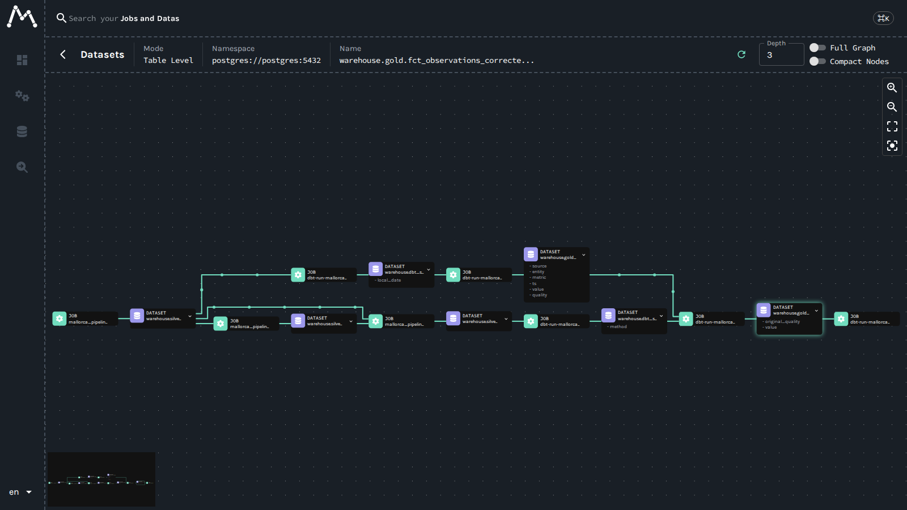

Prueba real (DAG con Open-Meteo y la EEA): 6 tareas de Airflow y 75 jobs de dbt en Marquez, y 12 columnas con linaje
en `gold.fct_observations`.

Spark no envía eventos propios. Sus filas salen de Python, no de una lectura de Spark, así que su integración solo
repetiría lo que ya declara `ingest`. Marquez no publica versión desde marzo de 2025 (0.51.1), pero los eventos son
OpenLineage estándar y cualquier otro *backend* los acepta cambiando `OPENLINEAGE_URL`.

## Calidad de datos

Reglas reutilizables en `core/quality/`, configuradas desde el YAML de cada conector:

| Regla | Tipo | Qué detecta |
|---|---|---|
| `not_null` | fila | valores nulos → `missing` |
| `source_qc` | fila | valores que la propia fuente marca como dudosos (p. ej. QC de SOCIB) → `suspect` |
| `range` | fila | valores fuera del rango físico de la métrica → `suspect` |
| `duplicate` | fila | misma (fuente, entidad, métrica, ts) repetida → se colapsa conservando el valor no nulo |
| `gaps` | serie | pasos de tiempo ausentes según la `frequency` del conector (no se aplica a fuentes de eventos) |

Resultados por ejecución en `quality.check_results`; en Grafana, el % de sospechosos, la completitud de la tabla de
series y la fila plegada *Operación*.

## Detección de anomalías

Las reglas de calidad descartan lo imposible (una humedad del 140 %); los detectores de `core/anomaly/` buscan lo
improbable: valores posibles que no encajan con su propia serie. Solo **marcan**: escriben en `silver.anomalies`
(valor, valor esperado, puntuación, umbral, `run_id`) y nunca modifican `silver.observations`.

- **Interfaz `Detector`**: puntúa todas las series de una entidad (localidad, estación o punto) en pandas, así se
  prueba sin Spark; el runner la reparte por entidades con `groupBy().applyInPandas()`. Los detectores univariantes
  (`UnivariateDetector`) miran cada métrica por separado; los multivariantes, cómo se mueven juntas.
- **`robust_zscore`**: z-score modificado de Iglewicz y Hoaglin, `0,6745 · (x − mediana) / MAD` sobre una ventana
  móvil centrada (7 días en series horarias, 31 en diarias). La mediana y la MAD apenas se mueven con el pico que
  buscan, al contrario que la media y la desviación típica. Una ventana casi constante (MAD = 0) no se puntúa.
- **`isolation_forest`** (scikit-learn): un bosque por entidad sobre todas sus métricas a la vez. Cada instante se
  describe, por métrica, con su valor, su cambio, cuántos valores seguidos lleva igual y la distancia al valor
  habitual a esa hora, más la propia hora. Aísla los instantes raros (un 5 % de cada entidad, `contamination`) y
  culpa a la métrica cuyas variables más se alejan de su mediana. Necesita 48 instantes completos: las series
  diarias de AEMET no llegan.
- Tarea `detect_anomalies` del DAG tras la ingesta, también si alguna fuente falló. Cada ejecución vuelve a puntuar
  al menos los últimos `rescore_days` (14) y reemplaza su resultado: los datos que llegan tarde (AEMET) o se
  recuperan se juzgan con sus vecinos, y es idempotente.
- Configuración en [config/anomaly.yaml](config/anomaly.yaml): parámetros de cada detector y lo que no se analiza
  (sismos, horarios de EMT y CTM y estadísticas mensuales de Dataestur y de reservas hídricas; precipitación, insolación y dirección del
  oleaje). A mano: `make detect DAYS=30`.

Con 30 días reales el z-score marca ~1 % de 104 000 valores, sobre todo episodios de verdad (el temporal del 18-19
de octubre, mar de fondo en Alcúdia) y los picos nocturnos de NO₂; el Isolation Forest, 732.

En Grafana, las anomalías se dibujan como anotaciones sobre las series: en el explorador de Tiempo y entorno (la
métrica y las entidades elegidas), en el NO₂ de las estaciones (desactivada por defecto, porque son nueve) y en el
antes y después de Operación. Las horas anómalas seguidas de una serie son una sola banda, con el rango de valores y
el valor esperado, así que un temporal es una marca y no treinta. Las tablas de Operación las listan una a una.

### Medir los detectores con fallos inyectados

Las anomalías reales no vienen etiquetadas, así que no se puede saber cuántas se escapan. `make evaluate` crea esa
verdad: toma las series recientes de Open-Meteo (modelo, completas y suaves), les **inyecta fallos conocidos** con
una semilla fija y puntúa cada serie limpia y corrompida (`core/anomaly/faults.py` y `evaluation.py`):

| Fallo | Qué simula | Forma |
|---|---|---|
| `spike` | lectura errónea, coma decimal | un valor ± 4-8 σ robustas |
| `frozen` | sensor congelado, payload repetido | 6-24 horas con el último valor bueno |
| `drift` | sensor que se descalibra | rampa de 2-4 σ durante 48-120 horas |
| `shift` | reloj o zona horaria mal | 6-24 horas con los valores de 12 horas antes |

Un aviso sobre un valor inyectado es un acierto; uno nuevo sobre un valor limpio, una falsa alarma. Lo que el
detector ya marcaba en la serie limpia (episodios reales) se cuenta aparte y no penaliza. Los huecos no se inyectan:
un valor que falta no se puede marcar, y ya los cuenta la regla `gaps`. Resultados en
`quality.anomaly_evaluations`; fallos detectados (algún valor marcado) en 54 series de 6 localidades, 30 días:

| Detector | Picos | Derivas | Congelados | Desfase | Precisión |
|---|---|---|---|---|---|
| `robust_zscore` | 90 % | 22 % | 0 % | 6 % | 80 % |
| `isolation_forest` | 49 % | 11 % | 52 % | 6 % | 85 % |

Son complementarios. El z-score ve lo que se aleja de sus vecinos y es ciego a lo que se queda en un nivel normal:
un sensor congelado en 18 °C está cerca de la mediana. El bosque ve que una serie que siempre se mueve se ha
parado (con la variable "valores seguidos iguales"; una dispersión móvil no basta, porque cerca del máximo o el
mínimo diario casi no hay dispersión de todos modos), pero con su cupo del 5 % se deja la mitad de los picos. El
desfase horario se escapa a los dos: en un modelo suave, los valores de 12 horas antes parecen una noche templada.
`contamination` mueve el equilibrio: con 0,10 el bosque llega al 73 % de picos y 74 % de congelados con un 81 % de
precisión.

## Correcciones con fuentes de apoyo

Las estaciones horarias (SOCIB y la EEA) tienen huecos: cortes de la fuente, horas que la red marca como no
válidas y valores sospechosos que fallan una regla de calidad. `core/corrections/` **propone** un valor para esas
horas y lo guarda aparte, en `silver.corrections`, con el valor original, el método, la serie de apoyo, su sesgo y
una confianza de 0 a 1. `silver.observations` nunca cambia: `gold.fct_observations_corrected` pone los dos valores
lado a lado, y `value` es el corregido donde lo hay y el original en el resto.

- **Qué se corrige**: cada hora sin valor válido entre dos valores de la estación: falta, es sospechosa o no tiene
  fila. Los valores que marcan los detectores de anomalías no se tocan, porque uno de cada cinco es un episodio real
  y corregirlo lo borraría.
- **Método 1, interpolación**: los huecos de hasta 3 horas se rellenan interpolando en el tiempo entre los valores de
  la propia estación. Confianza `exp(−horas / 6)`: 0,85 con una hora, 0,61 con tres.
- **Método 2, fuente de apoyo**: en los huecos más largos, la serie de la misma métrica mejor correlacionada a menos
  de 30 km, que puede ser otra estación de la misma red o el punto del modelo de Open-Meteo. Hacen falta una semana
  de horas en común y una r ≥ 0,6. El valor de apoyo se desplaza con su sesgo, la mediana de "estación menos apoyo",
  calibrado **por hora del día** con los 30 días anteriores. Así recoge la brisa, la altitud y el ciclo diario del
  modelo. Confianza `r² · exp(−distancia / 100 km) · exp(−horas / 7 días)`.
- Tarea `correct_values` del DAG tras la detección. Cada ejecución recalcula los últimos 14 días: una corrección
  desaparece cuando llega el valor real, y es idempotente. Configuración en
  [config/corrections.yaml](config/corrections.yaml); a mano, `make correct DAYS=30`.

`make evaluate-corrections` mide las correcciones con una verdad conocida. Esconde valores limpios de las
estaciones en huecos de 1, 3, 6 y 24 horas, los corrige y compara. Resultado de 14 días reales, con el error medio
absoluto (MAE) y, para la fuente de apoyo, el que tendría sin su sesgo:

| Serie | 1 h | 3 h | 24 h (apoyo) | 24 h sin sesgo |
|---|---|---|---|---|
| Temperatura (SOCIB) | 0,26 °C | 0,41 °C | 1,35 °C | 2,19 °C |
| Presión (SOCIB) | 0,11 hPa | 0,23 hPa | 0,20 hPa | 14,0 hPa |
| Humedad (SOCIB) | 1,8 % | 2,7 % | 7,6 % | 9,6 % |
| Ozono (EEA) | 3,6 µg/m³ | 6,0 µg/m³ | 7,4 µg/m³ | 13,2 µg/m³ |
| NO₂ (EEA) | 1,6 µg/m³ | 2,0 µg/m³ | 1,1 µg/m³ (solo 140 de 456 h) | 2,3 µg/m³ |

- **La presión** muestra para qué sirve el sesgo. La de Parc Bit es unos 14 hPa más baja que la de la boya de la
  bahía, que es la que más se le parece (r = 1,00). Parece presión a la altura de la estación, sin reducir al nivel
  del mar: unos 115 m. Sin el sesgo, el apoyo se equivocaría en 14 hPa; con él, en 0,2.
- **El NO₂** es muy local: viene del tráfico de cada calle y casi ninguna estación tiene un apoyo con r ≥ 0,6. Solo
  S'Albufera y Sa Pobla se apoyan la una en la otra. Lo mismo pasa con PM10, PM2.5 y CO. En esas series, los huecos
  largos se quedan sin corregir en lugar de rellenarse con un valor poco fiable.
- **Las rachas de viento** son el único caso en el que el sesgo no ayuda: 7,5 frente a 6,8 km/h en huecos de 6
  horas. Una racha es un máximo puntual y no guarda una diferencia estable con otra estación.

En Grafana, el tablero Operación muestra las correcciones por día y método, una gráfica de antes y después de la
serie elegida (variable *Serie corregida*) y la tabla de las últimas correcciones. Las anomalías de esa serie aparecen
como bandas sobre la gráfica, igual que en el explorador de Tiempo y entorno: así se ve qué corrige cada parte. La
API las sirve en `GET /v1/corrections`.

## Frontal web

La isla en cifras, para quien quiere verla y no operar la plataforma: http://localhost:3002. Un menú a la izquierda
abre seis dashboards y un explorador de series. Cada dashboard agrupa datos que van juntos, igual que las carpetas de
Grafana:

| Dashboard | Qué enseña |
|---|---|
| **Inicio** | Cinco cifras clave frente a lo normal de cada mes (reservas, lluvia, turistas, electricidad y temperatura) y el mapa de estaciones y puntos de modelo |
| **Turismo y recursos** | Turistas, aeropuerto y ocupación hotelera; turistas frente a reservas de agua y a demanda eléctrica, y ocupación frente a gasto, cada serie con su tendencia de 12 meses y su correlación de Pearson (con y sin el ciclo anual) |
| **Clima y agua** | Reservas frente a la media del mes, los 18 acuíferos, lluvia acumulada de cada año hidrológico y anomalía de temperatura |
| **Movilidad** | Población de la isla y servicio por cada 1.000 habitantes; mapa de los municipios por densidad, servicio por habitante o crecimiento en 10 años; población desde 1996; servicio programado de EMT y CTM por día, mapa del servicio de cada parada y paradas con más servicio; mapa de las líneas de autobús, tren y metro con su recorrido y sus salidas |
| **Tiempo y entorno** | Temperatura por zonas (las 33 estaciones de AEMET interpoladas sobre la isla), avisos de AEMET por zona (ahora y en las próximas 72 h), temperatura de cada fuente, calidad del aire ahora (índice europeo) con la tabla de estaciones, oleaje, episodios, sismos y error del modelo |
| **Explorador** | Cualquier serie de la plataforma día a día (fuente, métrica y entidad): media, mínimo y máximo, completitud, valores sospechosos y días con anomalías; la selección queda en la dirección para compartirla |
| **Operación** | Estado de cada fuente frente a su SLA, gobierno del dato (dueño, licencia y acceso), reglas de calidad que fallan, anomalías por día y últimas correcciones |

En cada cifra, la desviación sale en verde o en rojo cuando es buena o mala noticia, junto con la evolución de los
últimos meses. Los mapas tienen capas que se pueden ocultar, y al pulsar un punto se ve qué es.

| Turismo y recursos | Clima y agua |
|---|---|
| [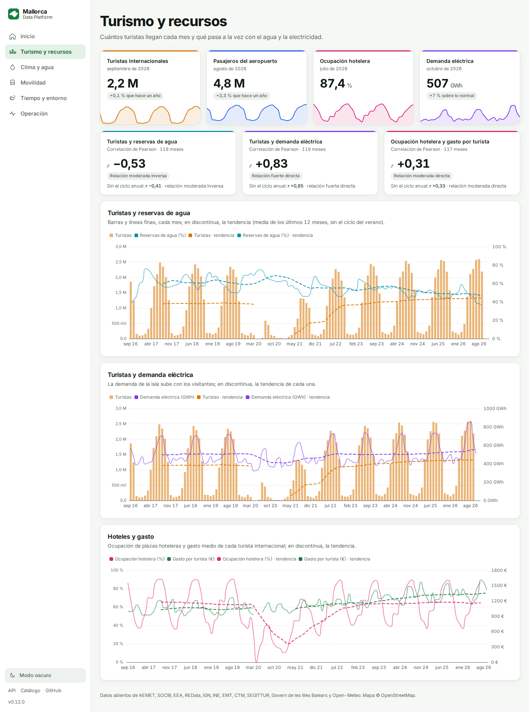](docs/img/web/turismo-y-recursos.png) | [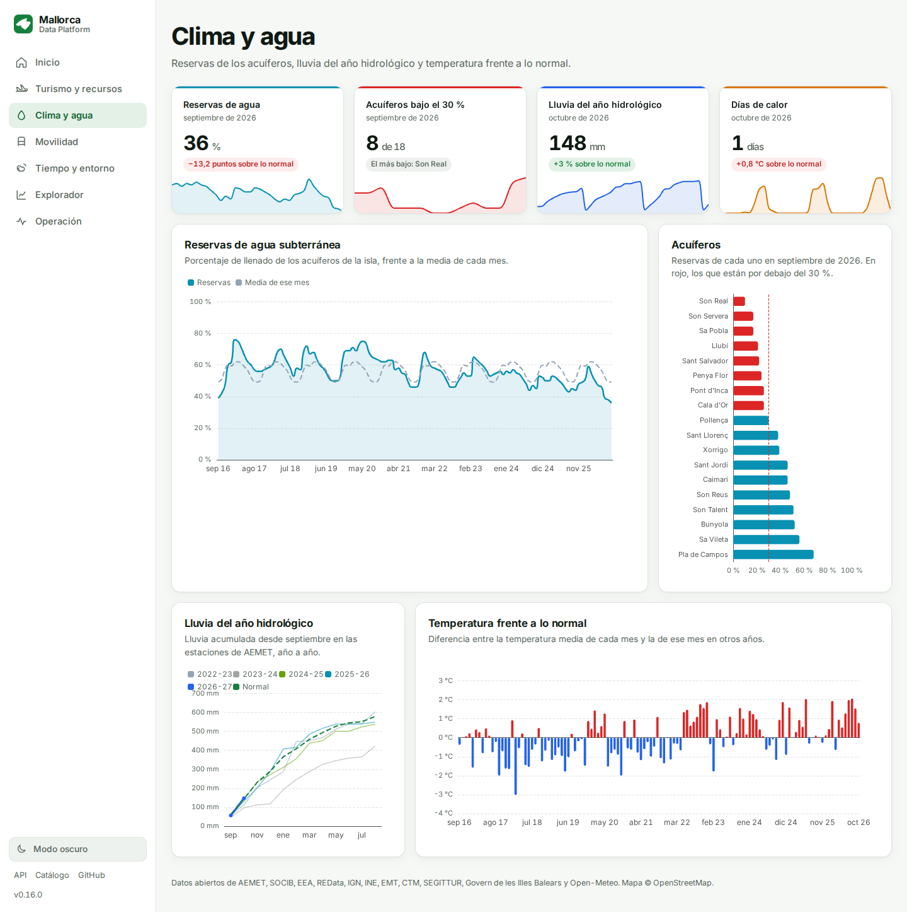](docs/img/web/clima-y-agua.png) |
| **Movilidad** | **Tiempo y entorno** |
| [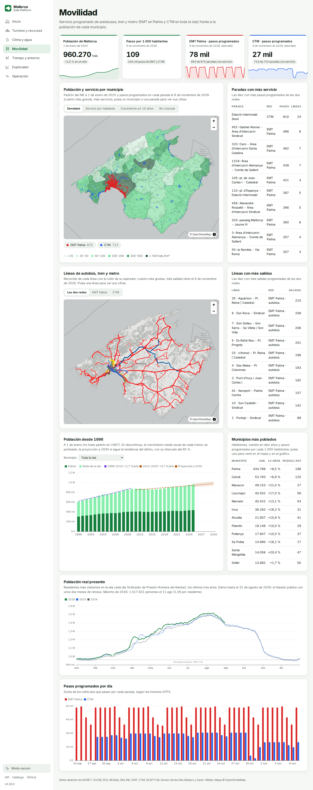](docs/img/web/movilidad.png) | [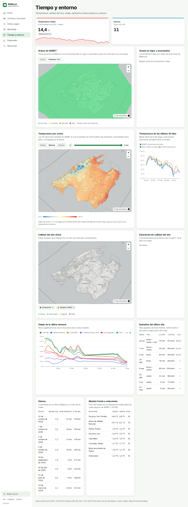](docs/img/web/tiempo-y-entorno.png) |
| **Explorador** | **Operación** |
| [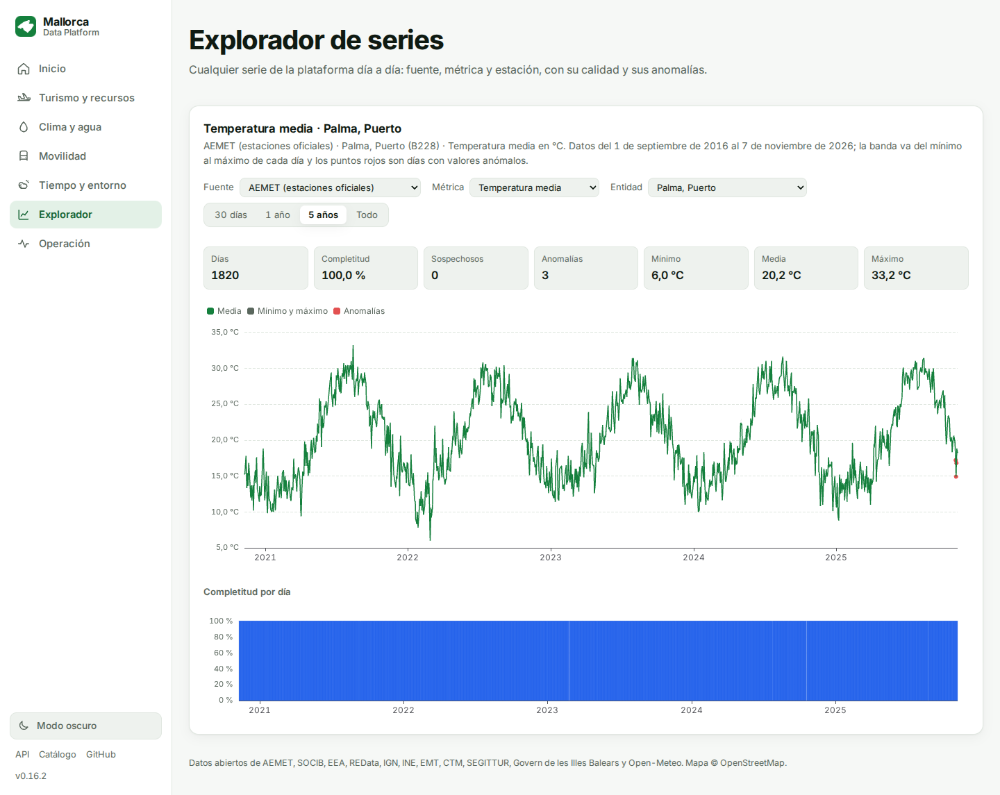](docs/img/web/explorador.png) | [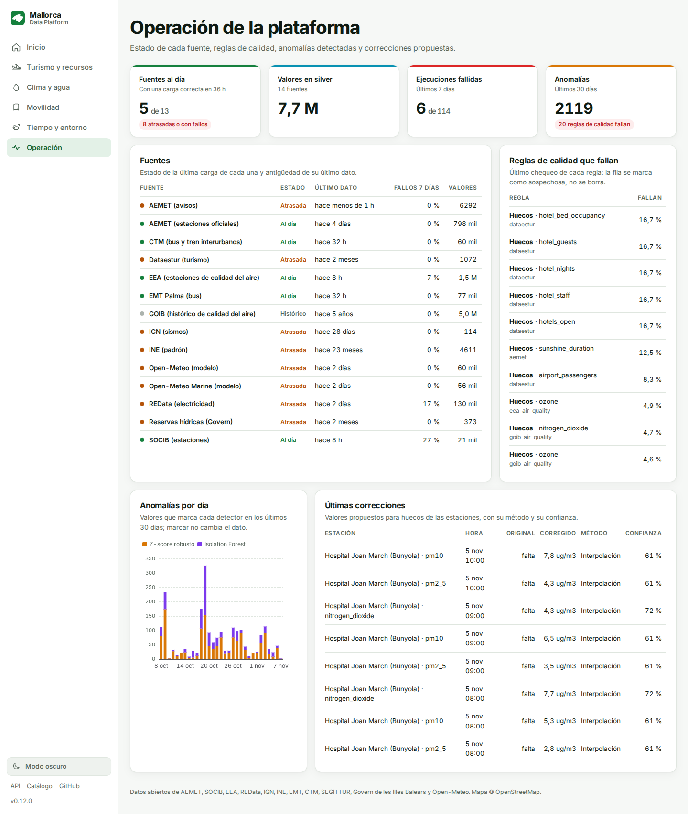](docs/img/web/operacion.png) |
| **Modo oscuro** | |
| [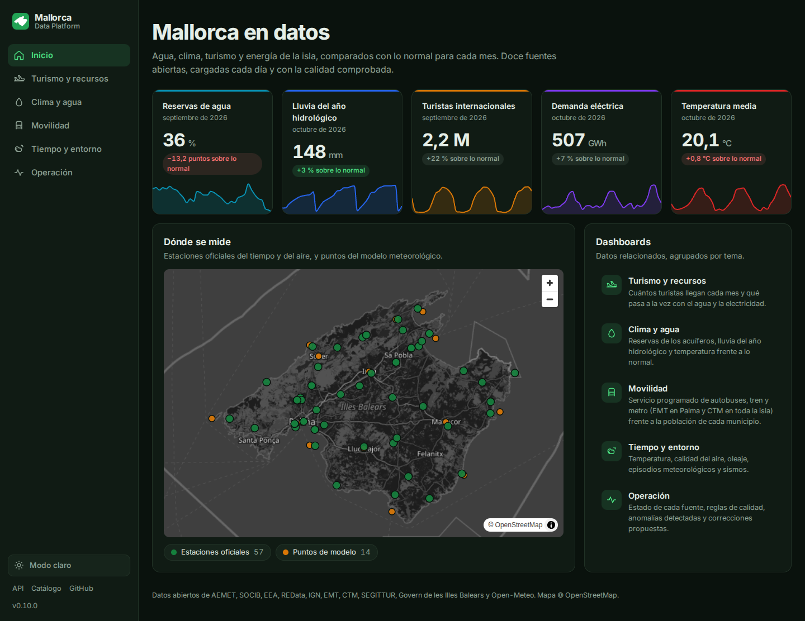](docs/img/web/inicio-oscuro.png) | |

Está hecha con React, TypeScript y Vite, con ECharts para los gráficos y MapLibre con teselas de OpenStreetMap para
los mapas. El logo es la silueta de la isla. Tiene modo claro y oscuro, con un botón en el menú que se recuerda en el
navegador, y en el móvil el menú pasa a ser un cajón.

**Solo lee la API REST**, nunca el warehouse. La imagen `web` es nginx con la web ya construida, y hace de proxy de
`/api` hacia la API, así que el navegador habla con un único origen. Grafana se queda para operar la plataforma:
alertas, calidad, anomalías y correcciones. Por qué una web propia y no rehacer Grafana:
[ADR 0019](docs/adr/0019-frontal-web-sobre-la-api.md).

Sus tipos salen del OpenAPI de la API (`web/src/api.gen.ts`, generado con `make web-types`), y un test falla si el
fichero no coincide con lo que sirve la API. Un campo que cambia en `api/schemas.py` aparece así en el `tsc` de la web
y no en una página rota.

```bash
cd web && npm install && npm run dev   # http://localhost:5173, con /api hacia la API del stack (localhost:8000)
npm test                               # cifras clave y estado de las fuentes (Vitest)
```

## Grafana

Seis dashboards en la carpeta *Mallorca Data Platform* (http://localhost:3000), enlazados entre sí desde la barra
superior. Cada uno responde a una pregunta y lee sus marts de dbt (un exposure por dashboard):

| Dashboard | Qué muestra |
|---|---|
| **Inicio** | El último mes de reservas hídricas, lluvia del año hidrológico, temperatura y turistas, y el mapa de todas las fuentes georreferenciadas (aire, oleaje, AEMET, SOCIB, sismos y servicio de bus) |
| **Turismo y recursos** | Turistas frente a reservas de agua y demanda eléctrica; las anomalías frente al mismo mes, que quitan la estacionalidad; y una evaluación año a año (turistas de verano frente a la caída de las reservas de marzo a septiembre, con su correlación) |
| **Clima y agua** | Reservas frente a la media del mes, lluvia mensual y respuesta de los acuíferos, tabla por año hidrológico, anomalía de temperatura, lluvia acumulada y el estado de los 18 acuíferos |
| **Movilidad** | Servicio programado de EMT Palma y CTM por día, mapa de calor por parada y paradas con más servicio |
| **Tiempo y entorno** | Explorador de cualquier métrica por fuente y entidad, con sus anomalías como anotaciones, calidad del aire, oleaje, error del modelo frente a las estaciones, episodios meteorológicos y sismos |
| **Operación** | Salud de cada fuente, anomalías detectadas, correcciones (antes y después), ejecuciones, reglas de calidad y completitud de cada serie |

| Inicio | Turismo y recursos |
|---|---|
| [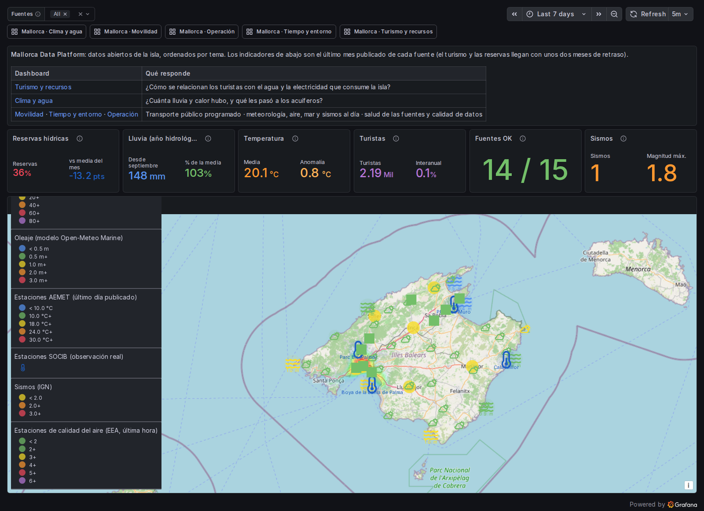](docs/img/grafana/inicio.png) | [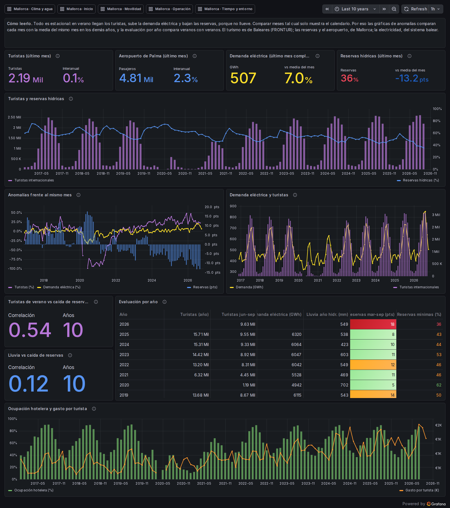](docs/img/grafana/turismo-y-recursos.png) |
| **Clima y agua** | **Movilidad** |
| [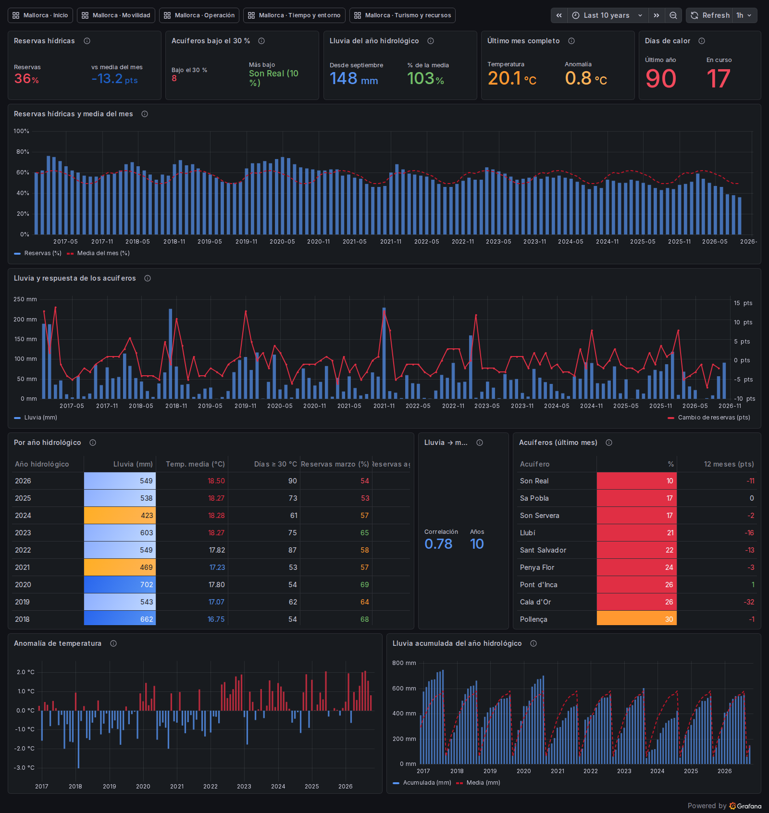](docs/img/grafana/clima-y-agua.png) | [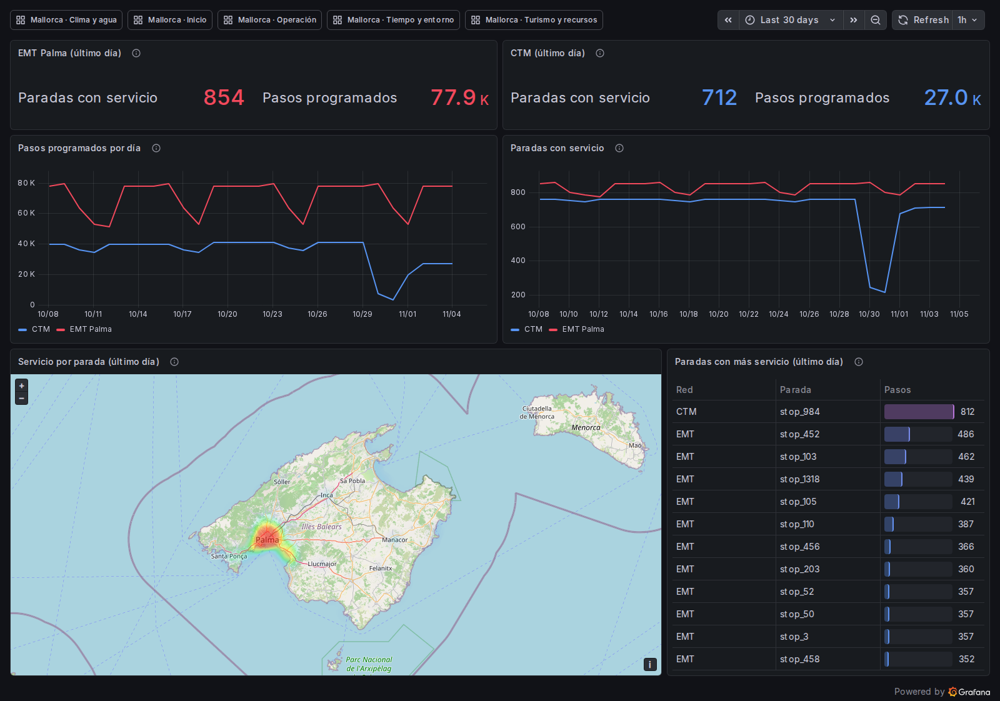](docs/img/grafana/movilidad.png) |
| **Tiempo y entorno** | **Operación** |
| [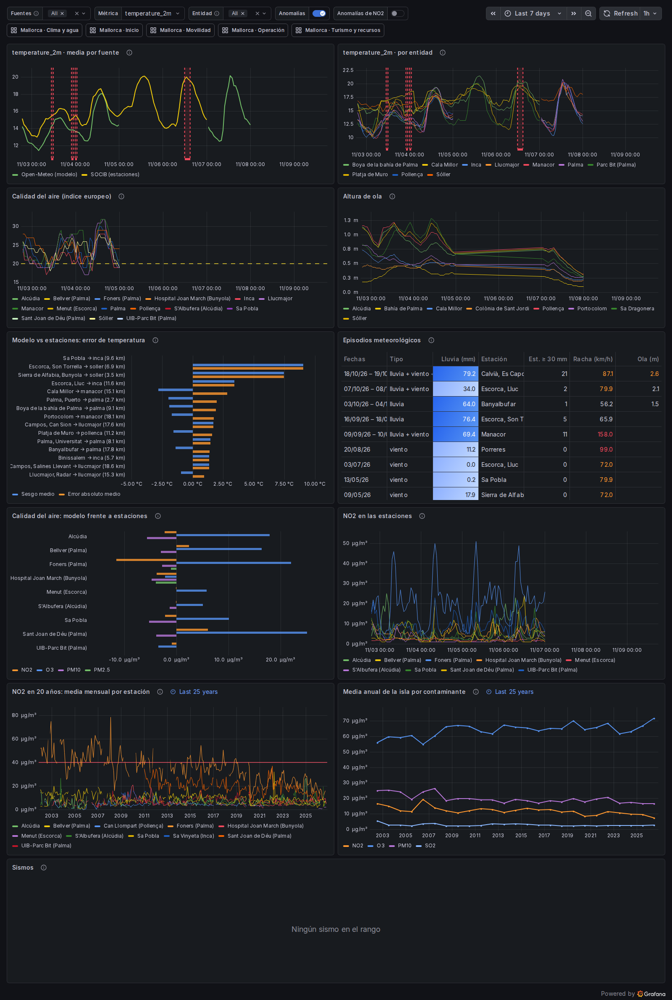](docs/img/grafana/tiempo-y-entorno.png) | [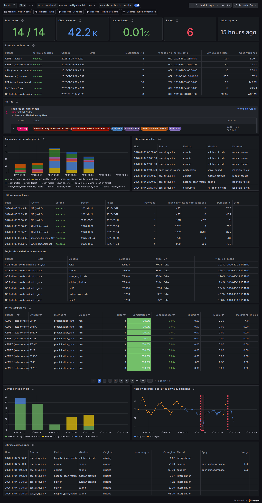](docs/img/grafana/operacion.png) |

Las capturas de la web y de Grafana se regeneran con `make screenshots` (Playwright en Docker contra la pila local).

La pregunta de fondo (¿aprieta el turismo al agua?) necesita cuidado: turismo, calor, demanda y reservas son
estacionales a la vez, así que comparar meses tal cual solo enseña el calendario. Los paneles de evaluación comparan
cada mes con la media del mismo mes y cada verano con los demás veranos. Con diez años de datos (correlaciones de
Pearson, pocos años, así que orientativas):

- La lluvia de septiembre a febrero explica bien las reservas de marzo (r = 0,78 en 10 años).
- Los veranos con más turistas son los que más bajan los acuíferos de marzo a septiembre (r = 0,50 en 9 años); la
  lluvia del año apenas cambia esa caída (r = 0,20).
- Mes a mes, los meses con más turistas de lo normal tienen reservas por debajo de lo normal (r = −0,41), pero en la
  década crece el turismo y bajan las reservas, y 2020 (sin turistas y con un invierno lluvioso) pesa mucho:
  correlación, no causa.

### Alertas

Cuatro reglas de alerta provisionadas desde `dashboards/provisioning/alerting/alerting.yml`. Se evalúan cada 5
minutos y cada fuente (o regla) es una alerta aparte. Tres leen solo las tablas operativas (`ops.ingestion_runs`,
`quality.check_results`), así que avisan aunque dbt no corra. La del SLA lee además el catálogo de fuentes y
`gold.source_health`:

| Alerta | Cuándo salta |
|---|---|
| **Ingesta fallida** | La última ejecución de una fuente terminó en `failed` |
| **Fuente sin ejecución correcta** | Una fuente activa (con datos del último año) lleva más de 36 h sin una ejecución correcta. Un backfill de histórico no cuenta |
| **Fuente fuera de su SLA** | Una fuente activa no cumple el SLA de su ficha: su último dato es más antiguo de lo acordado o tiene menos cargas correctas en 7 días de las acordadas ([gobierno del dato](docs/data-governance.md)) |
| **Regla de calidad en rojo** | Una regla pasó en el chequeo anterior y falla en el último. Las que fallan siempre (los huecos de una fuente con cortes conocidos) no avisan |

Las alertas activas aparecen en el panel *Alertas* de Operación. Para recibirlas en **Telegram**, opcional:

1. Crea un bot con [@BotFather](https://t.me/BotFather) y guarda su token.
2. Escríbele cualquier mensaje y lee tu chat id en `https://api.telegram.org/bot<token>/getUpdates`
   (`message.chat.id`).
3. Pon `TELEGRAM_BOT_TOKEN` y `TELEGRAM_CHAT_ID` en el `.env` y reinicia Grafana (`docker compose up -d grafana`).

El entrypoint de Grafana (`docker/grafana/entrypoint.sh`) provisiona el punto de contacto y la política solo cuando
las dos variables existen, y los borra si se quitan. Sin ellas todo funciona igual, por ejemplo en el E2E. Llega
un mensaje por regla y fuente cuando salta una alerta, otro cuando se resuelve, y se repite cada 12 h mientras siga
activa.

Los nombres de las fuentes salen del seed `dim_sources` de dbt, que es también su ficha de gobierno (dueño, licencia,
acceso y SLA). Un test comprueba que toda fuente de silver tiene su fila.

## API REST

Una API de solo lectura con FastAPI sobre la capa gold, en su propio servicio (`api`, puerto 8000) y con su propia
imagen, pequeña: sin Airflow, Spark ni Java. La documentación OpenAPI está en http://localhost:8000/docs (Swagger) y
`/redoc`.

| Endpoint | Qué devuelve |
|---|---|
| `GET /v1/health` | Estado de la API y de su conexión al warehouse (503 si está caído) |
| `GET /v1/sources`, `/v1/sources/{source}` | Cada fuente con su última ejecución, % de fallos en 7 días, antigüedad del último dato, su ficha de gobierno (dueño, licencia, acceso, datos personales) y su SLA con si se cumple |
| `GET /v1/locations` | Cada estación, punto de modelo y parada con coordenadas, su fuente y su tipo (el mapa de la web) |
| `GET /v1/mobility/daily`, `/v1/mobility/stops`, `/v1/mobility/routes` | Servicio programado de EMT y CTM por día, el de cada parada en el último día y cada línea con su recorrido (GeoJSON) y sus salidas |
| `GET /v1/weather/daily`, `/v1/weather/stations`, `/v1/weather/episodes`, `/v1/weather/model-bias` | Tiempo diario de cada fuente, episodios de lluvia, viento o mar, y error del modelo frente a cada estación; `stations`: cada estación en el último día publicado |
| `GET /v1/air-quality/latest`, `/v1/sea/hourly`, `/v1/earthquakes` | Última hora de calidad del aire con su índice europeo, oleaje por hora y sismos |
| `GET /v1/warnings`, `/v1/warnings/zones` | Avisos de AEMET en vigor o anunciados (por defecto, de ahora a 3 días) y las zonas de aviso con su polígono |
| `GET /v1/population`, `/v1/municipalities` | Población de cada municipio por año (filtrable con `from` y `to`) y los 53 municipios con su superficie y su límite |
| `GET /v1/quality/rules`, `/v1/anomalies/daily` | Último chequeo de cada regla de calidad y anomalías por día y detector |
| `GET /v1/series`, `/v1/series/daily` | Las series diarias de una fuente (entidad con su nombre, métrica, unidad y días que cubre) y una serie día a día: mínimo, media, máximo, completitud, sospechosos y anomalías (por defecto, un año) |
| `GET /v1/observations` | Valores de una fuente filtrados por métrica, entidad y rango de tiempo (por defecto, los últimos 7 días), paginados |
| `GET /v1/anomalies` | Valores marcados por los detectores, filtrados por fuente, detector y rango, paginados |
| `GET /v1/corrections` | Valores propuestos para las horas sin valor válido de las estaciones, con el original, el método, el apoyo, el sesgo y la confianza; filtrados por fuente, estación, método y rango, paginados |
| `GET /v1/water/reserves`, `/v1/water/aquifers` | Reservas mensuales con su anomalía y los 18 acuíferos del último mes |
| `GET /v1/climate/monthly`, `/v1/tourism/monthly`, `/v1/resources/monthly` | Los marts mensuales de los dashboards, filtrables con `from` y `to` |

```bash
curl "http://localhost:8000/v1/observations?source=aemet&metric=temperature_2m_max&entity=B278&limit=2"
```

Decisiones:

- **Solo marts con contrato**: la API lee tablas de dbt con `contract: {enforced: true}`, así que sus columnas y tipos
  no cambian sin que falle el build. En CI, los tests de integración ejecutan cada consulta contra los marts recién
  construidos.
- **Rol propio de solo lectura** (`api_reader`, `docker/postgres/init/02-api-reader.sh`): `SELECT` sobre gold y silver,
  transacciones de solo lectura y un límite de 15 s por consulta. En un volumen ya creado: `make api-role`.
- **Paginación** con `limit` (como mucho 1000) y `offset`: la respuesta trae `next_offset`, que se calcula pidiendo una
  fila de más. **Errores** con una sola forma: `{"error": {"code": "not_found", "message": "..."}}`.
- **Capa de acceso a datos sustituible** (`api/repository.py` sobre un protocolo `Database`): los tests unitarios usan una
  base de datos falsa y no necesitan Postgres. `make api-test`.

## AWS con Terraform

`infra/terraform` describe la misma plataforma en AWS:
- S3 para bronze y silver;
- Glue Data Catalog y Athena para consultar silver con SQL sin servidor;
- dos roles de IAM de mínimo privilegio;
- un presupuesto de 2 USD al mes.

No se despliega. El CI lo valida y lo prueba con `terraform test` contra un proveedor de AWS simulado, sin cuenta
ni coste (`make tf-check` en local). El diagrama local frente a AWS, los costes y lo que faltaría para correr en
AWS de punta a punta están en [infra/terraform/README.md](infra/terraform/README.md).

## Estructura

```
├── core/                 # núcleo: contrato, registro, bronze, Spark, calidad, warehouse, pipeline, CLI,
│                         # anomalías (core/anomaly) y correcciones (core/corrections)
├── connectors/<fuente>/  # connector.yaml + extractor.py + tests/fixtures
├── config/               # regiones (bbox y puntos), anomaly.yaml y corrections.yaml
├── dags/                 # DAG de Airflow
├── dbt/                  # staging → intermediate → marts, tests y seeds (ver dbt/README.md)
├── dashboards/           # provisioning y dashboards de Grafana
├── api/                  # API REST de solo lectura (FastAPI) y sus tests
├── web/                  # frontal web (React + Vite) que lee la API
├── docker/               # Dockerfiles de Airflow+Spark+dbt, de la API y de la web, init de Postgres
├── infra/terraform/      # AWS: S3, IAM, Glue Catalog, Athena y presupuesto, con tests sobre un AWS simulado
├── scripts/e2e.sh        # prueba de punta a punta (CI)
└── docs/
```

## CI/CD

| Workflow | Cuándo | Qué hace |
|---|---|---|
| `ci.yml` | push a `main`/`develop`, PRs | ruff · pytest con PySpark (cobertura de `core/` ≥ 80 %, ramas incluidas) · Terraform (`fmt`, `validate`, tflint y `terraform test` contra un AWS simulado) · sqlfluff · dbt build sobre Postgres vacío (slim CI en PRs) · build de la imagen + test de integridad del DAG. Las descargas van con caché y reintentos, así que una caída de GitHub de unos minutos no tumba la ejecución |
| `dbt-docs.yml` | push a `develop` | `dbt docs` en [GitHub Pages](https://alexandrecoll.github.io/MallorcaDataPlatform/), el [informe de cobertura](https://alexandrecoll.github.io/MallorcaDataPlatform/coverage/) del CI de ese commit con el badge del README, y manifest de `develop` para el slim CI |
| `e2e.yml` | PR a `main`, semanal | `docker compose up`, DAG dos veces con la API real, comprueba bronze/silver/gold e idempotencia |
| `release.yml` | tag `vX.Y.Z` (o a mano con un tag existente) | Release con notas del CHANGELOG + imágenes de Airflow y de la API REST en GHCR (`airflow:X.Y.Z` y `api:X.Y.Z`, también `X.Y`) |
| `pr-title.yml` | PRs | gitmoji + Conventional Commits en el título (`✨ feat(connector): ...`) |

Ramas y releases: [docs/git-workflow.md](docs/git-workflow.md) · Arquitectura y decisiones:
[docs/architecture.md](docs/architecture.md) · Plan completo: [ROADMAP.md](ROADMAP.md)

## Licencia

El código, MIT. Los datos pertenecen a sus dueños y se usan con sus licencias: la de cada fuente está en
[docs/data-governance.md](docs/data-governance.md).
