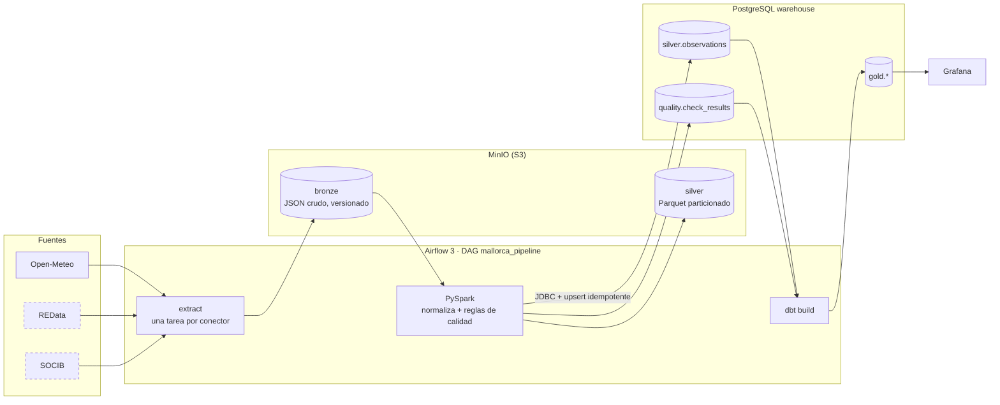

# Mallorca Data Platform

[](https://github.com/OWNER/MallorcaDataPlatform/actions/workflows/ci.yml)
[](https://github.com/OWNER/MallorcaDataPlatform/actions/workflows/e2e.yml)


Plataforma de datos **modular y 100 % local** sobre datos abiertos reales de Mallorca.
Un `docker compose up` levanta Airflow, PySpark, MinIO (S3), PostgreSQL, dbt y Grafana; un DAG con
parámetros extrae las fuentes elegidas, comprueba su calidad y lo deja todo listo para analizar.

```json
{"connectors": ["open_meteo"], "days": 30, "region": "mallorca"}
```

## Arquitectura



| Capa | Dónde | Contenido |
|---|---|---|
| **bronze** | `s3://bronze/<fuente>/<dataset>/window=<desde>_<hasta>/payload.json` | Respuesta de la API sin tocar. Clave determinista + versionado del bucket: relanzar no duplica y el crudo anterior se conserva |
| **silver** | `s3://silver/observations/source=…/date=…` y `silver.observations` | Esquema común: `source, entity, metric, ts, value, unit, quality, lat, lon` (+ `quality_reasons`, `run_id`, `ingested_at`) |
| **gold** | esquema `gold` (dbt) | `fct_observations`, `agg_daily_metrics`, `air_quality_hourly` (índice europeo EAQI), `dim_locations`, `data_quality_summary` |

### Decisiones de diseño

- **Núcleo fijo, conectores intercambiables.** El núcleo solo conoce `extract()` y `normalize()`.
  Un conector es una carpeta con su YAML, su extractor y sus tests con respuestas grabadas.
- **Idempotencia en todas las capas**: ventanas de días completos (siempre la misma petición), claves
  deterministas en bronze, `overwrite` dinámico de particiones en Parquet y `INSERT … ON CONFLICT … WHERE
  IS DISTINCT FROM` en Postgres. El E2E de CI lanza el DAG dos veces y comprueba que no cambia el número de filas.
- **Marcar ≠ corregir.** Las reglas de calidad etiquetan (`ok` / `suspect` / `missing`) y explican
  (`quality_reasons`), pero nunca modifican el valor. Las correcciones irán en una capa propia (ver roadmap).
- **Local primero, nube después.** MinIO habla S3 y Spark usa S3A: pasar a AWS es cambiar el endpoint y las credenciales.

## Puesta en marcha

Requisitos: Docker Engine con Compose y ~8 GB de RAM libres (Linux, macOS o Windows con WSL2).
Guía para Windows con WSL2 + Debian: [docs/setup-windows.md](docs/setup-windows.md).

```bash
make up                                      # crea .env, construye la imagen y levanta todo
make run CONNECTORS=open_meteo DAYS=30       # dispara el DAG
make run-local CONNECTORS=open_meteo DAYS=1  # mismo pipeline sin Airflow
```

| Servicio | URL | Acceso |
|---|---|---|
| Airflow | http://localhost:8080 | sin login (modo demo local) |
| Grafana | http://localhost:3000 | anónimo de lectura · admin/admin |
| MinIO | http://localhost:9001 | minioadmin/minioadmin |
| PostgreSQL | localhost:5432 | `make psql` |

Otros comandos: `make help`.

## Conectores

| Conector | Estado | Datos | Clave |
|---|---|---|---|
| [open_meteo](connectors/open_meteo/README.md) | ✅ | Calidad del aire (CAMS) y meteorología, horario, 6 localidades | No |
| redata | ⬜ v0.2.0 | Demanda eléctrica de Baleares (diaria) | No |
| socib | ⬜ v0.2.1 | Estaciones meteorológicas y boyas reales | No |
| ign_sismicidad | ⬜ v0.2.2 | Terremotos (sustituye a USGS: 0 eventos en la zona) | No |
| openaq | ⬜ v0.2.3 | Estaciones de calidad del aire | Sí |
| aqicn | ⬜ v0.2.4 | Estaciones de calidad del aire | Sí |
| emt_palma | ⬜ v0.2.5 | GTFS estático de autobuses | No |

### Open-Meteo

Una petición por dataset con todas las localidades de la región. 10 métricas horarias
(PM10, PM2.5, NO₂, O₃, EAQI, temperatura, humedad, precipitación, viento, presión).
Con `DAYS=1` son 6 × 24 × 10 = 1.440 observaciones. Son datos de modelo, no de estación.

Añadir una fuente: [docs/adding-a-connector.md](docs/adding-a-connector.md).

## Calidad de datos

Reglas reutilizables en `core/quality/`, configuradas desde el YAML de cada conector:

| Regla | Tipo | Qué detecta |
|---|---|---|
| `not_null` | fila | valores nulos → `missing` |
| `range` | fila | valores fuera del rango físico de la métrica → `suspect` |
| `duplicate` | fila | misma (fuente, entidad, métrica, ts) repetida → se colapsa conservando el valor no nulo |
| `gaps` | serie | pasos de tiempo ausentes según la `frequency` del conector |

Resultados por ejecución en `quality.check_results` y en el panel *Calidad de datos* de Grafana.

## Estructura

```
├── core/                 # núcleo: contrato, registro, bronze, Spark, calidad, warehouse, pipeline, CLI
├── connectors/<fuente>/  # connector.yaml + extractor.py + tests/fixtures
├── config/regions/       # bbox y puntos de cada región
├── dags/                 # DAG de Airflow
├── dbt/                  # modelos gold y tests
├── dashboards/           # provisioning y dashboards de Grafana
├── docker/               # Dockerfile de Airflow+Spark+dbt, init de Postgres
├── scripts/e2e.sh        # prueba de punta a punta (CI)
└── docs/
```

## CI/CD

| Workflow | Cuándo | Qué hace |
|---|---|---|
| `ci.yml` | push a `main`/`develop`, PRs | ruff · pytest con PySpark · dbt build sobre Postgres vacío · build de la imagen + test de integridad del DAG |
| `e2e.yml` | PR a `main`, semanal | `docker compose up`, DAG dos veces con la API real, comprueba bronze/silver/gold e idempotencia |
| `release.yml` | tag `vX.Y.Z` | Release con notas del CHANGELOG + imagen en GHCR |
| `pr-title.yml` | PRs | Conventional Commits en el título |

Ramas y releases: [docs/git-workflow.md](docs/git-workflow.md) · Plan completo: [ROADMAP.md](ROADMAP.md)

## Licencia

MIT. Los datos pertenecen a sus proveedores (Open-Meteo: CC BY 4.0).
