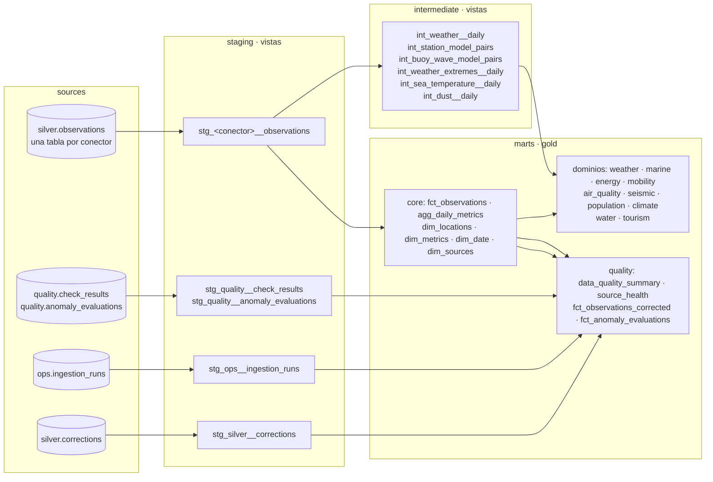

# dbt: de silver a gold

El pipeline de Python deja en PostgreSQL las observaciones limpias (`silver.observations`), los resultados de las
reglas de calidad (`quality.check_results`), el benchmark de los detectores de anomalías
(`quality.anomaly_evaluations`), la auditoría de ejecuciones (`ops.ingestion_runs`) y las correcciones propuestas
para las estaciones (`silver.corrections`). dbt construye encima, en tres capas, todo lo que leen Grafana, la
API REST y la web. La metodología (Kimball, dimensiones conformadas, claves naturales) y las convenciones de nombres
están en [docs/data-model.md](../docs/data-model.md).



| Capa | Materialización | Esquema | Qué hace |
|---|---|---|---|
| `staging` | vista | `dbt_staging` | Un modelo por tabla de origen y conector: la misma proyección (macro `staging_observations`), día local y marcas de dato ausente o sospechoso. |
| `intermediate` | vista | `dbt_intermediate` | Lógica que reutilizan varios marts. `int_weather__daily` pone en las mismas columnas el tiempo diario de AEMET (diario de origen), SOCIB y Open-Meteo (horarios agregados al día local). `int_station_model_pairs` e `int_buoy_wave_model_pairs` emparejan cada estación o boya con el punto del modelo más cercano, e `int_weather_extremes__daily` saca los extremos de cada día. `int_sea_temperature__daily` deja un valor de NOAA OISST por punto y día: el definitivo si ya se publicó, el provisional mientras tanto. `int_dust__daily` resume el polvo sahariano de la isla por día (la media de los puntos del modelo) y marca los días de polvo. |
| `marts` | tabla / incremental | `gold` | Lo que se consulta, por dominio. |

## Marts

| Dominio | Modelo | Grano |
|---|---|---|
| core | `fct_observations` (**incremental, merge**) | fuente, entidad, métrica, hora |
| core | `agg_daily_metrics` (**incremental, delete+insert**) | serie y día local |
| core | `dim_locations`, `dim_metrics`, `dim_date` (con contrato), `dim_sources` y `dim_source_texts` (seeds); snapshot `snap_locations` (SCD2) | fuente y entidad / fuente y métrica / día / fuente / fuente e idioma. El modelo dimensional completo está en [docs/data-model.md](../docs/data-model.md) |
| weather | `fct_weather_daily` | estación o punto de modelo y día: observación real junto al modelo |
| weather | `fct_model_bias_daily`, `agg_model_bias_by_station` (contrato) | estación y día / estación: error del modelo |
| weather | `fct_weather_episodes` (contrato) | episodio de lluvia, viento o mar |
| weather | `fct_weather_warnings` (contrato), `dim_warning_zones` (seed) | aviso de AEMET: zona, fenómeno y periodo seguido al mismo nivel / zona de aviso |
| marine | `fct_sea_conditions_hourly` | punto de costa y hora |
| marine | `fct_wave_model_comparison_hourly`, `agg_wave_model_bias_by_buoy` (contrato) | boya y hora / boya: la ola de las boyas de SOCIB frente a Open-Meteo Marine |
| marine | `dim_sea_temperature_climatology` (contrato) | punto de costa y día del año: la temperatura habitual del mar en 1991-2020 y su percentil 90 (ventana de 11 días y media móvil de 31, Hobday et al., 2016) |
| marine | `fct_sea_temperature_daily`, `fct_marine_heatwaves` (contrato) | punto de costa y día / ola de calor: la temperatura del mar por satélite desde 1981, su anomalía y las olas de calor marinas (5 días o más sobre el percentil 90) |
| marine | `fct_sea_temperature_monthly` (contrato) | mes: temperatura media del mar, anomalía frente a 1991-2020 y días de ola de calor marina |
| marine | `fct_sst_model_comparison_daily`, `agg_sst_model_bias_by_point` (contrato) | punto y día / punto: la temperatura del mar de Open-Meteo Marine frente al satélite |
| energy | `fct_electricity_daily` | día: demanda, mix, % renovable, CO₂ e importación por el enlace con la península |
| mobility | `fct_bus_network_daily` (EMT), `fct_island_transit_daily` (CTM) | día: paradas con servicio, pasos programados, parada con más servicio |
| mobility | `dim_routes` (contrato) | línea de bus, tren o metro, con su recorrido |
| mobility | `fct_bike_stations_hourly` (contrato, incremental), `fct_bike_stations_daily` (contrato) | estación de BiciPalma y hora o día: bicis, eléctricas y anclajes libres (media, mínimo y máximo), ocupación y horas en que se vació o se llenó |
| population | `fct_population_yearly` (contrato), `dim_municipalities` (seed) | municipio y año: padrón, densidad y cambio / municipio, con su límite |
| population | `fct_human_pressure_daily` (contrato) | día: personas presentes en la isla frente a las empadronadas |
| core | `fct_resources_monthly` (contrato) | mes: turismo, reservas, lluvia, temperatura, demanda eléctrica y paro registrado, cada una con su anomalía frente al mismo mes |
| climate | `fct_climate_monthly` (contrato) | mes: lluvia y temperatura de las estaciones de AEMET, anomalía frente al mismo mes, días calurosos y lluvia acumulada del año hidrológico |
| water | `fct_water_reserves_monthly` (contrato), `dim_aquifers` (seed) | mes: reservas de la isla, variación y anomalía frente al mismo mes de otros años, acuíferos bajo el 30 % |
| water | `fct_bathing_water_seasons`, `fct_bathing_water_island_yearly` (contrato) | agua de baño y temporada / temporada: muestras de Náyade, peores resultados, restricciones y clase de la directiva 2006/7/CE (percentiles de los logaritmos de cuatro temporadas), y el porcentaje de excelentes de la isla |
| tourism | `fct_tourism_monthly` (contrato) | mes: turistas internacionales, gasto, ocupación hotelera, pasajeros del aeropuerto e interanual |
| tourism | `fct_tourist_dwellings` (contrato) | municipio y mes de referencia: viviendas turísticas, plazas, por habitante y cambio frente al recuento anterior |
| labour | `fct_unemployment_monthly`, `fct_unemployment_island_monthly` (contrato) | municipio y mes / mes: paro registrado del SEPE por sexo y edad y por sector, por 1.000 habitantes, interanual y anomalía frente al mismo mes; los «<5» quedan nulos y marcados |
| labour | `agg_unemployment_seasonality` (contrato) | zona (Mallorca o municipio) y año: paro medio de invierno (noviembre-febrero) frente al de verano (junio-septiembre) |
| air_quality | `fct_air_quality_monthly` (contrato) | estación, contaminante y mes: media, máximo y cobertura del histórico de la GOIB (2002-2021) y de la EEA, con los meses representativos (≥ 75 % de horas) |
| air_quality | `fct_air_quality_model_bias_daily` (contrato) | estación, contaminante y día: media de la estación oficial (EEA) junto al modelo CAMS y su diferencia |
| air_quality | `air_quality_hourly` | localidad y hora, con la banda del índice europeo |
| air_quality | `fct_pollen_dust_daily` (contrato) | punto del modelo y día: polen de olivo y gramíneas (media, máximo y nivel de la Red Española de Aerobiología), polvo sahariano y UV máximo de CAMS |
| air_quality | `fct_dust_episodes` (contrato) | episodio de polvo sahariano: días seguidos con la media de polvo de la isla ≥ 25 µg/m³ (islas y huecos), con el PM10 de las estaciones de la EEA frente a los días sin polvo de alrededor y el sesgo del PM10 de CAMS |
| air_quality | `agg_dust_pm10_by_station` (contrato) | estación de la EEA: PM10 los días con polvo y el resto, y el sesgo de CAMS en cada caso |
| seismic | `fct_earthquakes` | sismo |
| quality | `data_quality_summary`, `source_health` | regla / fuente |
| quality | `fct_anomaly_evaluations` (contrato) | ejecución, fuente, detector y tipo de fallo del benchmark de anomalías (`make evaluate`): fallos inyectados, detectados y precisión, con la ejecución más reciente de cada fuente marcada |
| quality | `fct_observations_corrected` | serie y hora de las estaciones desde la primera corrección: valor original, corregido y `value` (el corregido donde lo hay), con método, apoyo, sesgo y confianza |

## Incrementales

Silver guarda `updated_at`, que cambia al insertar una fila o al cambiar su contenido. Es la marca de agua:

- `fct_observations` hace **merge** solo de las filas de silver con `updated_at` posterior al último build (menos
  `incremental_lookback`, 1 h, por las filas que se confirmaron mientras dbt leía). Un valor que pasa a ausente se
  actualiza y lo borra el post-hook, así que la tabla nunca guarda un valor obsoleto.
- `agg_daily_metrics` detecta los días de cada serie tocados desde el último build y los **recalcula enteros**
  (delete+insert), así que una hora que llega tarde corrige su día en vez de añadir una fila.
- Los datos que llegan tarde (AEMET publica con 3 días de retraso) no necesitan nada especial: llegan con un
  `updated_at` nuevo.

`make dbt-full-refresh` reconstruye todo desde cero (necesario una vez al actualizar desde una versión anterior,
cuyas tablas gold no tenían las columnas nuevas).

## Freshness por conector

Las fuentes de silver se declaran una vez por conector sobre la misma tabla (`identifier` + `filter`), así que
`dbt source freshness` mide cada una con su ritmo: 36 h para las horarias y diarias, 5 días para AEMET, ninguno
para IGN (sin sismos no hay filas). El DAG lo ejecuta antes del build y solo **avisa**: una fuente atrasada aparece
en los logs y en `gold.source_health`, pero no bloquea la construcción de gold.

## Modelos de negocio

**Estación frente a modelo.** `int_station_model_pairs` empareja cada estación real (AEMET, SOCIB) con el punto de
Open-Meteo más cercano (macro `haversine_km`, máximo `model_pairing_max_km`). `fct_model_bias_daily` compara cada
día completo (modelo menos observación) y `agg_model_bias_by_station` resume por estación: sesgo, MAE y RMSE de la
temperatura media, sesgo de lluvia y acierto en días de lluvia. Con datos reales (30 días): frente a AEMET el modelo
apenas tiene sesgo (+0,03 °C, MAE 1,3 °C) y acierta el 90 % de los días de lluvia, pero en las estaciones de montaña
(Alfabia, 1.030 m; Son Torrella, 842 m) se pasa unos 6 °C: el punto del modelo está a nivel del mar, y el gradiente
térmico es de unos 6,5 °C por km. Es la base de la fase de correcciones (ajuste por altitud).

**Episodios meteorológicos.** `int_weather_extremes__daily` saca los extremos de cada día en toda la isla (la
estación AEMET con más lluvia, la racha más fuerte, la ola más alta) y los compara con los umbrales de `vars`.
`fct_weather_episodes` agrupa los días seguidos en episodios con *gaps and islands* (fecha menos número de fila =
mismo grupo). Con datos reales salen 3 episodios en 30 días; el del 18-19 de octubre con lluvia, viento y mar a la
vez: 79,2 mm en Es Capdellà, 20 estaciones por encima de 30 mm, rachas de 87 km/h y olas de 2,6 m.

## Snapshot (SCD tipo 2)

`snapshots/snap_locations.yml` guarda el historial de coordenadas de cada estación, punto de modelo y parada
(`strategy: check` sobre `lat`/`lon`, `hard_deletes: invalidate`): si AEMET reubica una estación o EMT mueve una
parada, la versión anterior se cierra (`dbt_valid_to`) y se abre una nueva. Esquema `snapshots`.

## Paquetes

`dbt_utils` (1.4.1) y `dbt_expectations` (0.10.10, el fork mantenido por Metaplane), fijados en
`package-lock.yml`. Se instalan en la imagen (`/opt/dbt/packages`, variable `DBT_PACKAGES_INSTALL_PATH`) porque el
proyecto se monta en solo lectura; en CI, con `dbt deps`. Se usan para `date_spine` (`dim_date`),
`generate_surrogate_key` (`episode_id`), `recency` y `expression_is_true`, y los tests de rangos y de pares de
columnas de `dbt_expectations`.

## Contratos

Las dimensiones compartidas y los marts que se consumen fuera tienen `contract: {enforced: true}`: nombres y tipos de
columna fijos, `not_null` y clave primaria creados en PostgreSQL. Un cambio que rompa el contrato falla en el build,
no en Grafana ni en la API. `tests/test_data_model_docs.py` comprueba que esta lista es la de `_marts.yml`:

- Dimensiones: `dim_date`, `dim_locations`, `dim_metrics`, `dim_routes`.
- Tiempo y mar: `agg_model_bias_by_station`, `fct_weather_episodes`, `fct_weather_warnings`,
  `agg_wave_model_bias_by_buoy`.
- Temperatura del mar: `dim_sea_temperature_climatology`, `fct_marine_heatwaves`, `fct_sea_temperature_monthly`,
  `agg_sst_model_bias_by_point`.
- Calidad del aire: `fct_air_quality_model_bias_daily`, `fct_air_quality_monthly`, `fct_pollen_dust_daily`,
  `fct_dust_episodes`, `agg_dust_pm10_by_station`.
- Energía y movilidad: `fct_electricity_daily`, `fct_bus_network_daily`, `fct_island_transit_daily`,
  `fct_bike_stations_hourly`, `fct_bike_stations_daily`.
- Población: `fct_population_yearly`, `fct_human_pressure_daily`.
- Mensuales: `fct_tourism_monthly`, `fct_water_reserves_monthly`, `fct_climate_monthly`, `fct_resources_monthly`.
- Turismo por municipio: `fct_tourist_dwellings`.
- Paro registrado: `fct_unemployment_monthly`, `fct_unemployment_island_monthly`, `agg_unemployment_seasonality`.
- Aguas de baño: `fct_bathing_water_seasons`, `fct_bathing_water_island_yearly`.
- Calidad: `fct_anomaly_evaluations`.

## Tests

- Genéricos de dbt: `not_null`, `unique`, `accepted_values`, `relationships`.
- Genéricos propios (`tests/generic/`): `unique_combination` (el grano de cada modelo) y `value_between` (rangos
  físicos y de porcentajes).
- De paquetes: `dbt_utils.recency` (aviso si no hay datos de los últimos 4 días), `dbt_utils.expression_is_true`,
  `dbt_expectations.expect_column_values_to_be_between` y `expect_column_pair_values_A_to_be_greater_than_B`.
- Singulares: completitud entre 0 y 1, que toda fuente de silver tenga su fila en `dim_sources` y que toda fuente
  tenga sus textos en cada idioma de `dim_source_texts`.
- **Unit tests** de dbt (datos de entrada fijos y salida esperada, sin depender del warehouse):
  - `eaqi_band_is_the_worst_pollutant`: la banda del índice europeo es la del peor contaminante.
  - `earthquake_distance_and_latest_revision`: distancia Haversine (1° de latitud = 111,2 km) y que un sismo
    revisado conserve solo su última versión.
  - `consecutive_episode_days_form_one_episode`: un día tranquilo separa dos episodios.
  - `pollen_level_follows_the_rea_thresholds`: el nivel de polen es el de la media del día, no el de la hora punta,
    con los umbrales de cada polen, y un valor sospechoso no cuenta.
  - `dust_episode_pm10_excess_is_against_the_calm_days_around_it`: un día sin polvo separa dos episodios, y el PM10
    extra de cada uno se mide frente a los días sin polvo de alrededor, nunca frente al otro episodio.
  - `marine_heatwave_needs_five_days_and_joins_short_gaps`: una ola de calor marina necesita 5 días seguidos sobre
    el percentil 90, y dos separadas por 2 días o menos son una sola, con el hueco dentro.
  - `tourism_change_is_against_the_same_month_a_year_earlier`: el interanual compara con el mismo mes del año
    anterior.
  - `cruise_passengers_per_call_and_change`: cruceristas por escala e interanual de los cruceristas; un mes sin
    escalas (2020) no da cociente, en lugar de dividir entre cero.
  - `tourist_dwellings_change_is_against_the_previous_count`: el cambio de las viviendas
    turísticas es frente al recuento anterior, esté a la distancia que esté, y un recuento sin su padrón publicado
    usa el último padrón anterior.
  - `bathing_water_class_follows_the_directive_percentiles`: 16 muestras limpias en dos temporadas dan un agua
    excelente y 16 de 1.000 *E. coli* una insuficiente; una primera temporada sola no tiene clase aunque sus
    varios puntos sumen 16 muestras. `bathing_water_island_share_counts_classified_only`: el porcentaje de
    excelentes es sobre las aguas clasificadas.
  - `unemployment_seasonality_needs_whole_seasons`: el cociente invierno/verano del paro solo sale con los
    cuatro meses de verano y al menos tres de invierno (el año en curso aún no los tiene), y en un municipio
    solo sin totales «<5» ese año.
  - `water_reserve_anomaly_is_against_the_same_calendar_month`: la anomalía de las reservas es frente al mismo mes
    de otros años.
  - `climate_month_needs_a_complete_station`: un mes solo cuenta con estaciones que informan casi todos sus días.
  - `model_bias_is_compared_at_the_height_of_the_station`: el sesgo del modelo se corrige por la altura de la
    estación.
  - `anomaly_benchmark_latest_run_per_source`: cada fuente conserva su ejecución más reciente del benchmark, aunque
    una posterior no la incluya.
  - `bike_station_hour_pivots_its_metrics_and_flags_an_empty_moment`: cada métrica de una hora de BiciPalma es una
    columna, y un mínimo de 0 bicis marca la hora como vacía aunque la media sea mayor.

```bash
make dbt                # source freshness (avisos) + dbt build
make dbt-full-refresh   # reconstruye también los incrementales
```

## Exposures

`models/exposures.yml` declara quién consume los marts: un exposure por dashboard de Grafana (`grafana_home`,
`grafana_tourism_resources`, `grafana_climate_water`, `grafana_mobility`, `grafana_weather_environment`,
`grafana_operations`), la API REST (`rest_api`), el frontal web (`web`) y la fase de correcciones (`corrections_phase`). Aparecen en el grafo de linaje de la
documentación y se pueden seleccionar: `dbt build --select +exposure:grafana_climate_water` reconstruye y prueba
todo lo que lee ese dashboard.

## Documentación publicada

El workflow `dbt-docs.yml` genera `dbt docs` (modelos, columnas, tests y el grafo de linaje con las exposures) en
cada push a `develop` y lo publica en GitHub Pages:
**<https://alexandrecoll.github.io/MallorcaDataPlatform/>**. También guarda el `manifest.json` de `develop`, que
usa el slim CI.

## CI de dbt

- **sqlfluff** con el templater de dbt (compila cada modelo con dbt: refs, macros, paquetes e incrementales). Los
  avisos salen como anotaciones en el PR. Reglas en `.sqlfluff`; se excluyen ST06 (orden de columnas) y ST07
  (`USING`), que son decisiones de estilo del proyecto.
  En local, con la pila levantada, `make sqlfluff` hace lo mismo desde la imagen de desarrollo, con las versiones
  de CI (`requirements/dbt.txt`). `make sqlfluff SQL=models/marts/x.sql` revisa un solo modelo, y `make sqlfluff-fix`
  aplica las correcciones que sqlfluff sabe hacer.
- **Slim CI**: en un PR, `dbt build --select +state:modified+ --state state` construye solo lo que cambia, sus
  hijos y, como el warehouse de CI está vacío, sus padres. El estado de referencia es el manifest de `develop`. Si no
  existe (primera vez o artefacto caducado), se construye todo.
- El build se ejecuta dos veces para que también corra el camino incremental.
