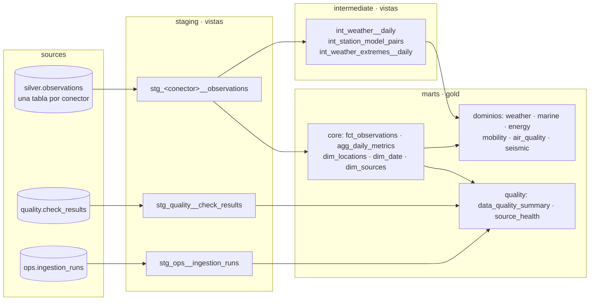

# dbt: de silver a gold

El pipeline de Python deja en PostgreSQL las observaciones limpias (`silver.observations`), los resultados de las
reglas de calidad (`quality.check_results`) y la auditoría de ejecuciones (`ops.ingestion_runs`). dbt construye
encima, en tres capas, todo lo que lee Grafana.



| Capa | Materialización | Esquema | Qué hace |
|---|---|---|---|
| `staging` | vista | `dbt_staging` | Un modelo por tabla de origen y conector: la misma proyección (macro `staging_observations`), día local y marcas de dato ausente o sospechoso. |
| `intermediate` | vista | `dbt_intermediate` | Lógica que reutilizan varios marts. `int_weather__daily` pone en las mismas columnas el tiempo diario de AEMET (diario de origen), SOCIB y Open-Meteo (horarios agregados al día local). |
| `marts` | tabla / incremental | `gold` | Lo que se consulta, por dominio. |

## Marts

| Dominio | Modelo | Grano |
|---|---|---|
| core | `fct_observations` (**incremental, merge**) | fuente, entidad, métrica, hora |
| core | `agg_daily_metrics` (**incremental, delete+insert**) | serie y día local |
| core | `dim_locations`, `dim_date` (contrato), `dim_sources` (seed); snapshot `snap_locations` (SCD2) | — |
| weather | `fct_weather_daily` | estación o punto de modelo y día: observación real junto al modelo |
| weather | `fct_model_bias_daily`, `agg_model_bias_by_station` (contrato) | estación y día / estación: error del modelo |
| weather | `fct_weather_episodes` (contrato) | episodio de lluvia, viento o mar |
| marine | `fct_sea_conditions_hourly` | punto de costa y hora |
| energy | `fct_electricity_daily` | día: demanda, mix, % renovable, CO₂ e importación por el enlace con la península |
| mobility | `fct_bus_network_daily` (EMT), `fct_island_transit_daily` (CTM) | día: paradas con servicio, pasos programados, parada con más servicio |
| water | `fct_water_reserves_monthly` (contrato), `dim_aquifers` (seed) | mes: reservas de la isla, variación y anomalía frente al mismo mes de otros años, acuíferos bajo el 30 % |
| tourism | `fct_tourism_monthly` (contrato) | mes: turistas internacionales, gasto, ocupación hotelera, pasajeros del aeropuerto e interanual |
| air_quality | `air_quality_hourly` | localidad y hora, con la banda del índice europeo |
| seismic | `fct_earthquakes` | sismo |
| quality | `data_quality_summary`, `source_health` | regla / fuente |

## Incrementales

Silver guarda `updated_at`, que cambia al insertar una fila o al cambiar su contenido. Es la marca de agua:

- `fct_observations` hace **merge** solo de las filas de silver con `updated_at` posterior al último build (menos
  `incremental_lookback`, 1 h, por las filas que se confirmaron mientras dbt leía). Un valor que pasa a ausente se
  actualiza y lo borra el post-hook, así que la tabla nunca guarda un valor obsoleto.
- `agg_daily_metrics` detecta los días de cada serie tocados desde el último build y los **recalcula enteros**
  (delete+insert), así que una hora que llega tarde corrige su día en vez de añadir una fila.
- Los datos que llegan tarde (AEMET publica con 3 días de retraso) no necesitan nada especial: llegan con un
  `updated_at` nuevo.

`make dbt-full-refresh` reconstruye todo desde cero (necesario una vez al actualizar desde una versión anterior,
cuyas tablas gold no tenían las columnas nuevas).

## Freshness por conector

Las fuentes de silver se declaran una vez por conector sobre la misma tabla (`identifier` + `filter`), así que
`dbt source freshness` mide cada una con su ritmo: 36 h para las horarias y diarias, 5 días para AEMET, ninguno
para IGN (sin sismos no hay filas). El DAG lo ejecuta antes del build y solo **avisa**: una fuente atrasada aparece
en los logs y en `gold.source_health`, pero no bloquea la construcción de gold.

## Modelos de negocio

**Estación frente a modelo.** `int_station_model_pairs` empareja cada estación real (AEMET, SOCIB) con el punto de
Open-Meteo más cercano (macro `haversine_km`, máximo `model_pairing_max_km`). `fct_model_bias_daily` compara cada
día completo (modelo menos observación) y `agg_model_bias_by_station` resume por estación: sesgo, MAE y RMSE de la
temperatura media, sesgo de lluvia y acierto en días de lluvia. Con datos reales (30 días): frente a AEMET el modelo
apenas tiene sesgo (+0,03 °C, MAE 1,3 °C) y acierta el 90 % de los días de lluvia, pero en las estaciones de montaña
(Alfabia, 1.030 m; Son Torrella, 842 m) se pasa unos 6 °C: el punto del modelo está a nivel del mar, y el gradiente
térmico es de unos 6,5 °C por km. Es la base de la fase de correcciones (ajuste por altitud).

**Episodios meteorológicos.** `int_weather_extremes__daily` saca los extremos de cada día en toda la isla (la
estación AEMET con más lluvia, la racha más fuerte, la ola más alta) y los compara con los umbrales de `vars`.
`fct_weather_episodes` agrupa los días seguidos en episodios con *gaps and islands* (fecha menos número de fila =
mismo grupo). Con datos reales salen 3 episodios en 30 días; el del 18-19 de octubre con lluvia, viento y mar a la
vez: 79,2 mm en Es Capdellà, 20 estaciones por encima de 30 mm, rachas de 87 km/h y olas de 2,6 m.

## Snapshot (SCD tipo 2)

`snapshots/snap_locations.yml` guarda el historial de coordenadas de cada estación, punto de modelo y parada
(`strategy: check` sobre `lat`/`lon`, `hard_deletes: invalidate`): si AEMET reubica una estación o EMT mueve una
parada, la versión anterior se cierra (`dbt_valid_to`) y se abre una nueva. Esquema `snapshots`.

## Paquetes

`dbt_utils` (1.4.1) y `dbt_expectations` (0.10.10, el fork mantenido por Metaplane), fijados en
`package-lock.yml`. Se instalan en la imagen (`/opt/dbt/packages`, variable `DBT_PACKAGES_INSTALL_PATH`) porque el
proyecto se monta en solo lectura; en CI, con `dbt deps`. Se usan para `date_spine` (`dim_date`),
`generate_surrogate_key` (`episode_id`), `recency` y `expression_is_true`, y los tests de rangos y de pares de
columnas de `dbt_expectations`.

## Contratos

Los marts que se consumen fuera (`dim_date`, `fct_electricity_daily`, `fct_bus_network_daily`,
`fct_island_transit_daily`, `fct_tourism_monthly`, `fct_water_reserves_monthly`, `agg_model_bias_by_station`,
`fct_weather_episodes`) tienen
`contract: {enforced: true}`: nombres y tipos de columna fijos, `not_null` y clave primaria creados en
PostgreSQL. Un cambio que rompa el contrato falla en el build, no en Grafana.

## Tests

- Genéricos de dbt: `not_null`, `unique`, `accepted_values`, `relationships`.
- Genéricos propios (`tests/generic/`): `unique_combination` (el grano de cada modelo) y `value_between` (rangos
  físicos y de porcentajes).
- De paquetes: `dbt_utils.recency` (aviso si no hay datos de los últimos 4 días), `dbt_utils.expression_is_true`,
  `dbt_expectations.expect_column_values_to_be_between` y `expect_column_pair_values_A_to_be_greater_than_B`.
- Singulares: completitud entre 0 y 1 y que toda fuente de silver tenga su fila en `dim_sources`.
- **Unit tests** de dbt (datos de entrada fijos y salida esperada, sin depender del warehouse):
  - `eaqi_band_is_the_worst_pollutant`: la banda del índice europeo es la del peor contaminante.
  - `earthquake_distance_and_latest_revision`: distancia Haversine (1° de latitud = 111,2 km) y que un sismo
    revisado conserve solo su última versión.
  - `consecutive_episode_days_form_one_episode`: un día tranquilo separa dos episodios.

```bash
make dbt                # source freshness (avisos) + dbt build
make dbt-full-refresh   # reconstruye también los incrementales
```

## Exposures

`models/exposures.yml` declara quién consume los marts: el dashboard de Grafana (`grafana_overview`) y la futura
fase de correcciones (`corrections_phase`). Aparecen en el grafo de linaje de la documentación y se pueden
seleccionar: `dbt build --select +exposure:grafana_overview` reconstruye y prueba todo lo que lee el dashboard.

## Documentación publicada

El workflow `dbt-docs.yml` genera `dbt docs` (modelos, columnas, tests y el grafo de linaje con las exposures) en
cada push a `develop` y lo publica en GitHub Pages:
**<https://alexandrecoll.github.io/MallorcaDataPlatform/>**. También guarda el `manifest.json` de `develop`, que
usa el slim CI.

## CI de dbt

- **sqlfluff** con el templater de dbt (compila cada modelo con dbt: refs, macros, paquetes e incrementales). Los
  avisos salen como anotaciones en el PR. Reglas en `.sqlfluff`; se excluyen ST06 (orden de columnas) y ST07
  (`USING`), que son decisiones de estilo del proyecto.
- **Slim CI**: en un PR, `dbt build --select +state:modified+ --state state` construye solo lo que cambia, sus
  hijos y, como el warehouse de CI está vacío, sus padres. El estado de referencia es el manifest de `develop`. Si no
  existe (primera vez o artefacto caducado), se construye todo.
- El build se ejecuta dos veces para que también corra el camino incremental.
