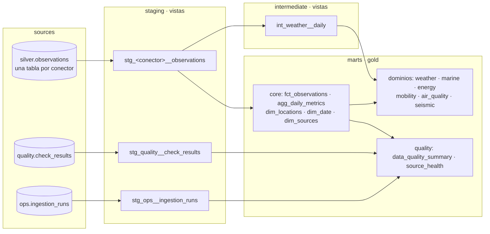

# dbt: de silver a gold

El pipeline de Python deja en PostgreSQL las observaciones limpias (`silver.observations`), los resultados de las
reglas de calidad (`quality.check_results`) y la auditoría de ejecuciones (`ops.ingestion_runs`). dbt construye
encima, en tres capas, todo lo que lee Grafana.



| Capa | Materialización | Esquema | Qué hace |
|---|---|---|---|
| `staging` | vista | `dbt_staging` | Un modelo por tabla de origen y conector: la misma proyección (macro `staging_observations`), día local y marcas de dato ausente o sospechoso. |
| `intermediate` | vista | `dbt_intermediate` | Lógica que reutilizan varios marts. `int_weather__daily` pone en las mismas columnas el tiempo diario de AEMET (diario de origen), SOCIB y Open-Meteo (horarios agregados al día local). |
| `marts` | tabla / incremental | `gold` | Lo que se consulta, por dominio. |

## Marts

| Dominio | Modelo | Grano |
|---|---|---|
| core | `fct_observations` (**incremental, merge**) | fuente, entidad, métrica, hora |
| core | `agg_daily_metrics` (**incremental, delete+insert**) | serie y día local |
| core | `dim_locations`, `dim_date`, `dim_sources` (seed) | — |
| weather | `fct_weather_daily` | estación o punto de modelo y día: observación real junto al modelo |
| marine | `fct_sea_conditions_hourly` | punto de costa y hora |
| energy | `fct_electricity_daily` | día: demanda, mix, % renovable, CO₂ e importación por el enlace con la península |
| mobility | `fct_bus_network_daily` | día: paradas con servicio, pasos de autobús, parada con más servicio |
| air_quality | `air_quality_hourly` | localidad y hora, con la banda del índice europeo |
| seismic | `fct_earthquakes` | sismo |
| quality | `data_quality_summary`, `source_health` | regla / fuente |

## Incrementales

Silver guarda `updated_at`, que cambia al insertar una fila o al cambiar su contenido. Es la marca de agua:

- `fct_observations` hace **merge** solo de las filas de silver con `updated_at` posterior al último build (menos
  `incremental_lookback`, 1 h, por las filas que se confirmaron mientras dbt leía). Un valor que pasa a ausente se
  actualiza y lo borra el post-hook, así que la tabla nunca guarda un valor obsoleto.
- `agg_daily_metrics` detecta los días de cada serie tocados desde el último build y los **recalcula enteros**
  (delete+insert), así que una hora que llega tarde corrige su día en vez de añadir una fila.
- Los datos que llegan tarde (AEMET publica con 3 días de retraso) no necesitan nada especial: llegan con un
  `updated_at` nuevo.

`make dbt-full-refresh` reconstruye todo desde cero (necesario una vez al actualizar desde una versión anterior,
cuyas tablas gold no tenían las columnas nuevas).

## Freshness por conector

Las fuentes de silver se declaran una vez por conector sobre la misma tabla (`identifier` + `filter`), así que
`dbt source freshness` mide cada una con su ritmo: 36 h para las horarias y diarias, 5 días para AEMET, ninguno
para IGN (sin sismos no hay filas). El DAG lo ejecuta antes del build y solo **avisa**: una fuente atrasada aparece
en los logs y en `gold.source_health`, pero no bloquea la construcción de gold.

## Tests

- Genéricos de dbt: `not_null`, `unique`, `accepted_values`, `relationships`.
- Genéricos propios (`tests/generic/`): `unique_combination` (el grano de cada modelo) y `value_between` (rangos
  físicos y de porcentajes).
- Singulares: completitud entre 0 y 1 y que toda fuente de silver tenga su fila en `dim_sources`.

```bash
make dbt                # source freshness (avisos) + dbt build
make dbt-full-refresh   # reconstruye también los incrementales
```
