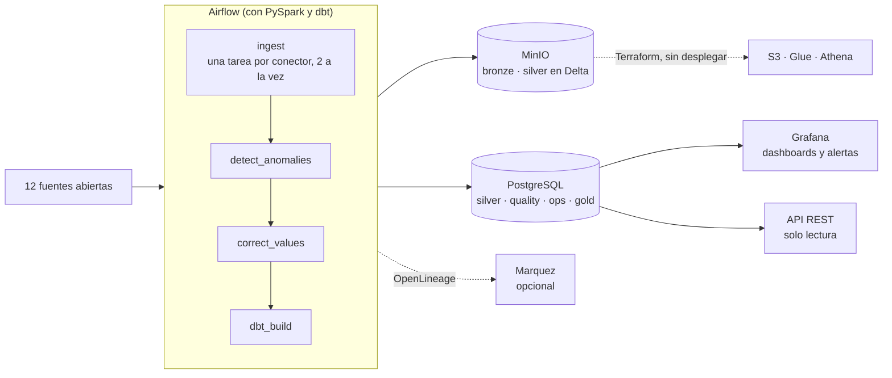
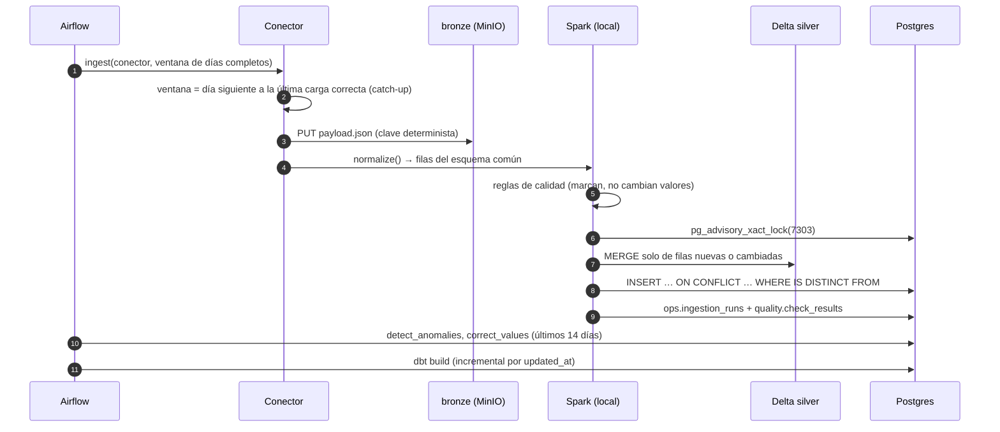

# Caso de arquitectura: Mallorca Data Platform

Este documento cuenta la plataforma como un caso de arquitectura: qué problema resuelve, con qué restricciones, cómo
está montada y, sobre todo, **por qué** se eligió cada pieza y qué se descartó. El detalle de cada parte (conectores,
Delta, anomalías, correcciones, dashboards) está en el [README](../README.md); aquí solo se enlaza.

## 1. Contexto

**Problema.** Los datos abiertos de Mallorca están repartidos en una docena de organismos: tiempo (AEMET, SOCIB,
Open-Meteo), mar, aire (EEA, Govern), electricidad (REData), sismos (IGN), transporte (EMT, CTM), turismo
(SEGITTUR) y agua (Govern). Cada uno publica a su manera: JSON, CSV, Parquet, xlsx, ODS, PDF, GTFS o NetCDF, con
frecuencias de minutos a meses, retrasos de horas a meses, cortes y revisiones. La plataforma los reúne en un
esquema común, comprueba su calidad y responde preguntas que cruzan fuentes, por ejemplo: ¿aprieta el turismo al
agua?

**Restricciones**, que explican casi todas las decisiones:

| Restricción | Consecuencia |
|---|---|
| Coste cero y 100 % local | Todo corre en un `docker compose up` en un portátil; la nube se describe con Terraform, pero no se despliega |
| ~8 GB de RAM para toda la pila | Spark en modo local, como mucho dos conectores a la vez y servicios opcionales tras perfiles de Compose |
| Fuentes poco fiables | Ninguna fuente puede tumbar a las demás; los días perdidos se recuperan solos |
| Datos que se revisan y llegan tarde | Toda escritura es idempotente: relanzar una ventana nunca duplica |
| Proyecto de portfolio, una sola persona | Piezas estándar del sector (Airflow, Spark, Delta, dbt), tests y CI desde el primer día, y cada decisión documentada y medida |

## 2. Vista general

| Capa | Dónde | Para qué |
|---|---|---|
| **bronze** | `s3://bronze/<fuente>/<dataset>/window=<desde>_<hasta>/payload.json` | Guardar la respuesta tal cual llegó, para poder reprocesar sin volver a llamar a la fuente |
| **silver** | Tabla Delta en `s3://silver/observations` y `silver.observations` en Postgres | Esquema común `source, entity, metric, ts, value, unit, quality, lat, lon`, con calidad marcada |
| **gold** | Esquema `gold` (dbt) | Hechos incrementales, marts por dominio con contrato y salud de las fuentes |
| **servicio** | Grafana y FastAPI | Lectura humana y programática de gold, cada una con su usuario de solo lectura |

### Una ejecución, paso a paso

Prueba real con 11 conectores y un día de ventana (noviembre de 2026): unos **8,5 minutos** desde la primera tarea
hasta el final de dbt. La ingesta tarda unos 5 minutos, dos conectores a la vez; después vienen la detección (57 s),
las correcciones (7 s) y `dbt build` (unos 2 min).

## 3. Decisiones

Cada decisión tiene su ADR en [docs/adr](adr/README.md): el contexto, lo que se decidió, las alternativas
descartadas, lo que cuesta y cuándo revisarla. Las sustituidas y las rechazadas se guardan, porque cuentan cómo
evolucionó la plataforma. Este es el resumen de las que están en vigor:

| ADR | Decisión | Por qué, en una línea |
|---|---|---|
| [0001](adr/0001-nucleo-fijo-y-conectores.md) | Núcleo fijo y conectores intercambiables | Una fuente nueva es una carpeta con su YAML, su extractor y sus tests; el núcleo y el DAG no cambian |
| [0002](adr/0002-medallion.md) | Medallion: bronze crudo, silver común, gold con dbt | Bronze versionado permite reprocesar sin volver a llamar a la fuente |
| [0003](adr/0003-idempotencia.md) | Idempotencia en todas las capas | Relanzar no duplica: ventanas de días completos, `MERGE` y upsert con `IS DISTINCT FROM` |
| [0004](adr/0004-spark-local-en-la-tarea.md) | Spark local dentro de la tarea de Airflow | Sin clúster, con el mismo código; el precio son unos 45 s fijos por conector |
| [0006](adr/0006-postgres-y-dbt.md) | Postgres como warehouse y dbt para gold | Un solo servicio sirve en milisegundos y guarda el estado; gold con incrementales y contratos |
| [0007](adr/0007-calidad-de-ingenieria.md) | Calidad de ingeniería y entrega | Fixtures reales grabados para los tests y un E2E semanal contra las APIs, que detecta cuando una fuente cambia |
| [0009](adr/0009-sismos-del-ign.md) | Sismos del IGN a través del FDSN de EMSC | Es la red nacional, con histórico y una API estándar |
| [0010](adr/0010-aislar-fallos-por-fuente.md) | Una fuente caída no para el resto | Una tarea por conector, reintentos solo en los cortes y catch-up de los días perdidos |
| [0011](adr/0011-marcar-no-es-corregir.md) | Marcar no es corregir | Calidad, anomalías y correcciones en tablas separadas; el valor original no se toca |
| [0013](adr/0013-calidad-del-aire-de-la-eea.md) | Calidad del aire de la EEA | Es la fuente oficial, con todas las horas, en Parquet y sin clave |
| [0014](adr/0014-servir-gold.md) | Servir gold: Grafana como código y una API pequeña | Dashboards revisables en los PR y roles de solo lectura por consumidor |
| [0015](adr/0015-local-primero-nube-descrita.md) | Local primero, nube descrita con Terraform | El camino a AWS probado contra un proveedor simulado, sin coste |
| [0016](adr/0016-silver-en-delta.md) | Silver en Delta Lake | El lake pasa de 67.000 ficheros a 12, con historial, *time travel* y `MERGE` |
| [0017](adr/0017-observabilidad-y-linaje.md) | Observabilidad y linaje | Las alertas leen el estado de las tablas; un solo grafo de linaje de la ingesta a gold |
| [0018](adr/0018-sin-cache-de-extraccion.md) | Sin caché aparte (Redis) | Bronze ya hace de caché, y extraer cuesta 1 s de los 45 s que tarda cada conector |

Sustituidas y rechazadas:

- **Silver en Parquet por fuente y día** ([0005](adr/0005-silver-en-parquet.md)), sustituida por 0016.
- **Sismos de USGS** ([0008](adr/0008-sismos-de-usgs.md)), sustituida por 0009: 0 eventos en un año en la zona.
- **Calidad del aire de OpenAQ** ([0012](adr/0012-calidad-del-aire-de-openaq.md)), rechazada: republica las
  mismas estaciones con un 30 % de las horas.

## 4. Atributos de calidad

| Atributo | Mecanismo |
|---|---|
| Idempotencia | Claves deterministas, `MERGE` y upsert con `IS DISTINCT FROM`, recalcular y reemplazar ventanas; E2E con doble ejecución |
| Resiliencia | Tareas aisladas por fuente, reintentos solo para cortes, catch-up, `all_done` |
| Auditabilidad | Bronze versionado, historial y Change Data Feed de Delta, `run_id` en cada fila, calidad y correcciones en tablas propias |
| Observabilidad | `ops.ingestion_runs`, `quality.check_results`, alertas de Grafana con aviso por Telegram, linaje OpenLineage |
| Coste | 0 en local; en AWS, el lake cuesta céntimos al mes (presupuesto de 2 USD y 1 GB como máximo por consulta en Athena) y el gasto real es el cómputo siempre encendido ([sección 5](#5-trade-offs-costes-y-escalado)) |
| Seguridad | Roles de Postgres de solo lectura, claves en `.env` fuera del repo, IAM sin comodines, buckets privados, cifrados y solo TLS |
| Extensibilidad | Contrato de conector, YAML de métricas y reglas, staging de dbt de una línea con una macro común |
| Reproducibilidad | Una sola imagen para Airflow, Spark y dbt (dbt en su propio venv), versiones fijadas, `make up` |

## 5. Trade-offs, costes y escalado

Cada decisión de la sección 3 vale para el tamaño de hoy. Esta sección dice qué se paga por ella, a partir de qué
tamaño deja de valer y qué la sustituiría.

### Volumen de hoy

Medido sobre la pila local el 3 de noviembre de 2026:

| Medida | Valor |
|---|---|
| Fuentes y series | 12 fuentes, 3.910 series (fuente, entidad, métrica) |
| Silver | 9,1 millones de filas; el 87 % es histórico de calidad del aire (Govern 2002-2021 y EEA desde 2021) |
| Carga diaria | Unas 3.900 filas por ejecución, 10.100 como máximo: unos 1,4 millones al año |
| Postgres | 5,9 GB: silver 2,6 GB y gold 3,3 GB (`fct_observations` repite silver con sus propios índices) |
| MinIO | Bronze 0,5 GB y silver en Delta 1,2 GB, con las versiones que aún no ha borrado `VACUUM` |
| Tiempo de una ejecución | 8,5 min, de los que unos 45 s por conector son fijos (arrancar Spark y leer Delta, [0004](adr/0004-spark-local-en-la-tarea.md)) |

La plataforma es pequeña en datos y grande en número de fuentes. Por eso lo primero que se rompe al crecer es el
coste fijo por conector, no el volumen.

### Lo que se gana, lo que se paga y cuándo cambiarlo

| Decisión | Se gana | Se paga | Se revisa cuando… | Por qué se cambiaría |
|---|---|---|---|---|
| Spark local, uno por tarea ([0004](adr/0004-spark-local-en-la-tarea.md)) | Ningún clúster que mantener; el mismo código que en un clúster | Unos 45 s fijos por conector, aunque traiga 10 filas | Hacia 30 fuentes, cuando la ingesta pasa del cuarto de hora | Un servidor Spark Connect compartido; en la nube, EMR Serverless o Glue |
| Un lock para todos los escritores de Delta ([0016](adr/0016-silver-en-delta.md)) | Commits correctos sobre S3 sin DynamoDB | Los commits y la compactación van en fila, de 8 a 25 s cada uno | Más de dos escritores a la vez (hoy son dos) | Compactar fuera del lock (`OPTIMIZE` periódico) y, en AWS, el LogStore de DynamoDB |
| Silver en Delta y en Postgres ([0002](adr/0002-medallion.md)) | Lake auditable y consultas en milisegundos | Doble escritura y 2,6 GB repetidos | El warehouse pasa a un motor que lea el lake | Athena (o Redshift Spectrum) sobre Delta; Postgres solo para marts pequeños |
| Esquema largo, una fila por valor ([0001](adr/0001-nucleo-fijo-y-conectores.md)) | Una fuente nueva no toca ni el núcleo ni el esquema | Los marts tienen que pivotar; los datos que no son series se resumen | Hacen falta tipos que no son números (texto, geometría) | Tablas anchas por dominio en silver, con el esquema largo solo para las series |
| Postgres como warehouse ([0006](adr/0006-postgres-y-dbt.md)) | Un solo servicio para dbt, Grafana, la API y el estado | Almacenamiento por filas: gold ocupa más que silver | Gold pasa de unos 100 millones de filas o las consultas de Grafana tardan segundos | Particionar `fct_observations` por mes; después, un motor columnar con el mismo dbt |
| Lotes diarios | Ventanas de días completos, idempotencia simple | Un día de retraso | Una fuente publica en continuo y alguien necesita actuar en minutos | Streaming solo para esa fuente; las fuentes de hoy publican cada hora como mucho |
| Recalcular 14 días de anomalías y correcciones ([0003](adr/0003-idempotencia.md)) | Sin estado incremental que mantener | Se repite trabajo cada día (57 s) | Muchas más series: el tiempo crece con series × días | Recalcular solo las series que cambiaron (el Change Data Feed de Delta ya lo dice) |

### Qué se rompe primero al crecer

| Escala | Ejemplo | Qué se rompe | Qué se cambia |
|---|---|---|---|
| **1×** (hoy) | 12 fuentes, 9 M filas | Nada; la ingesta se lleva 5 de los 8,5 min | — |
| **10× fuentes** | 120 fuentes, mismo volumen por fuente | La ingesta pasa a unos 50 min con dos tareas a la vez. Con más tareas a la vez, la compactación dentro del lock de Delta suma por sí sola de 16 a 50 min en fila | Spark Connect compartido, compactación fuera del lock, más tareas en paralelo |
| **10× volumen** | 90 M filas en silver | Postgres ronda los 60 GB y los paneles que leen `fct_observations` se vuelven lentos | Particionar por mes en Postgres; Grafana lee agregados, no hechos |
| **100×** | 900 M filas, cientos de fuentes | Postgres ya no sirve como warehouse analítico y un solo nodo de Airflow no basta | Gold en un motor columnar (Athena, Redshift Serverless, BigQuery o Snowflake, con el mismo dbt), Spark en un servicio gestionado y Postgres solo para servir marts y el estado operativo |

Lo que no cambia en ninguna escala: el contrato de conector, bronze, la clave de silver, la idempotencia y el
`MERGE`. Son las decisiones caras de cambiar, y por eso se tomaron pensando en el tamaño grande.

### Costes en AWS

Estimación con precios de lista de AWS en US East (noviembre de 2026). En la región de España (`eu-south-2`) son
algo más altos; la cifra exacta sale de la calculadora de AWS.

| Pieza | Hoy (1×) | 10× volumen |
|---|---|---|
| S3: bronze y silver, unos 2 GB | Unos 0,05 USD/mes | Unos 0,5 USD/mes |
| Athena, 5 USD por TB leído | Una consulta que lee todo silver: menos de 0,01 USD. Con el límite de 1 GB por consulta, mil consultas al mes no pasan de 5 USD | Igual, si las consultas filtran por fuente y fecha; si no, crece con los datos |
| Glue Data Catalog | 0 (gratis hasta un millón de objetos) | 0 |
| Airflow gestionado (MWAA, entorno pequeño) | Unos 360 USD/mes (0,49 USD/h, encendido siempre) | Igual |
| Toda la pila en una EC2 de 8 GB con el mismo Compose | Unos 50 USD/mes | Hay que separar el warehouse |
| Postgres gestionado (RDS pequeño) | Entre 15 y 30 USD/mes | Entre 60 y 120 USD/mes |

La conclusión cambia el diseño en la nube. El lake (S3, Glue y Athena) cuesta céntimos porque se paga por uso. Lo
que cuesta es el cómputo siempre encendido, y sobre todo el orquestador. Para un DAG que trabaja unos 10 minutos al
día, mantener MWAA encendido cuesta decenas de veces lo que el lake, incluso con mil consultas al mes en Athena. Por eso el camino a la nube va en este
orden:

1. Primero, el lake, que es casi gratis (lo que ya describe `infra/terraform`).
2. Después, el cómputo por uso: Spark como job (EMR Serverless o Glue) y un orquestador que cobre por tarea, como
   MWAA Serverless.
3. Solo con usuarios de verdad, un warehouse siempre encendido.

## 6. Limitaciones y siguientes pasos

- **Arranque de Spark por tarea.** Es la mayor parte del tiempo de ingesta. Siguiente paso: un servidor Spark
  Connect compartido.
- **Un escritor a la vez en Delta.** El lock serializa los commits y la compactación. Basta para dos conectores a
  la vez, no para decenas.
- **Silver duplicado** en Delta y en Postgres. En AWS, Athena sobre Delta podría sustituir a la copia de Postgres.
- **Contaminantes muy locales** (NO₂, partículas): casi nunca tienen una fuente de apoyo correlacionada, y sus
  huecos largos se quedan sin corregir a propósito.
- **Detectores.** El desfase horario se escapa a los dos detectores; queda pendiente probar uno estacional y
  combinar los dos que hay.

Modelo de datos: [data-model.md](data-model.md) · Decisiones: [adr](adr/README.md) · Plan completo:
[ROADMAP.md](../ROADMAP.md) · Historial de cambios: [CHANGELOG.md](../CHANGELOG.md)
