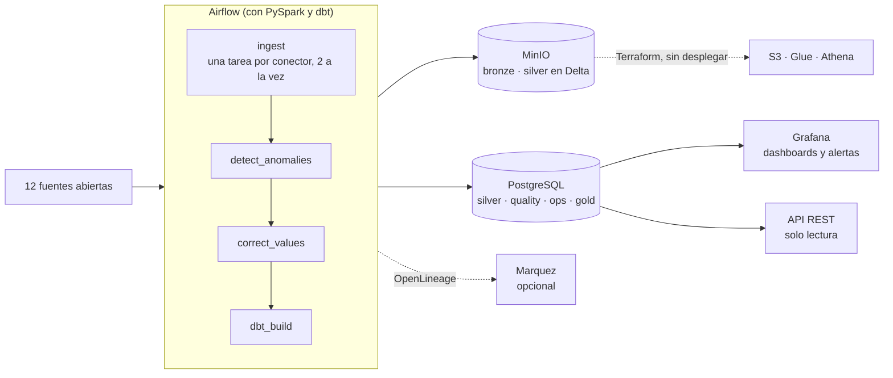
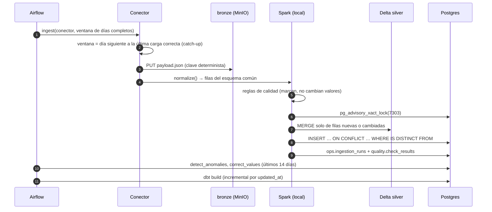

# Caso de arquitectura: Mallorca Data Platform

Este documento cuenta la plataforma como un caso de arquitectura: qué problema resuelve, con qué restricciones, cómo
está montada y, sobre todo, **por qué** se eligió cada pieza y qué se descartó. El detalle de cada parte (conectores,
Delta, anomalías, correcciones, dashboards) está en el [README](../README.md); aquí solo se enlaza.

## 1. Contexto

**Problema.** Los datos abiertos de Mallorca están repartidos en una docena de organismos: tiempo (AEMET, SOCIB,
Open-Meteo), mar, aire (EEA, Govern), electricidad (REData), sismos (IGN), transporte (EMT, CTM), turismo
(SEGITTUR) y agua (Govern). Cada uno publica a su manera: JSON, CSV, Parquet, xlsx, ODS, PDF, GTFS o NetCDF, con
frecuencias de minutos a meses, retrasos de horas a meses, cortes y revisiones. La plataforma los reúne en un
esquema común, comprueba su calidad y responde preguntas que cruzan fuentes, por ejemplo: ¿aprieta el turismo al
agua?

**Restricciones**, que explican casi todas las decisiones:

| Restricción | Consecuencia |
|---|---|
| Coste cero y 100 % local | Todo corre en un `docker compose up` en un portátil; la nube se describe con Terraform, pero no se despliega |
| ~8 GB de RAM para toda la pila | Spark en modo local, como mucho dos conectores a la vez y servicios opcionales tras perfiles de Compose |
| Fuentes poco fiables | Ninguna fuente puede tumbar a las demás; los días perdidos se recuperan solos |
| Datos que se revisan y llegan tarde | Toda escritura es idempotente: relanzar una ventana nunca duplica |
| Proyecto de portfolio, una sola persona | Piezas estándar del sector (Airflow, Spark, Delta, dbt), tests y CI desde el primer día, y cada decisión documentada y medida |

## 2. Vista general

| Capa | Dónde | Para qué |
|---|---|---|
| **bronze** | `s3://bronze/<fuente>/<dataset>/window=<desde>_<hasta>/payload.json` | Guardar la respuesta tal cual llegó, para poder reprocesar sin volver a llamar a la fuente |
| **silver** | Tabla Delta en `s3://silver/observations` y `silver.observations` en Postgres | Esquema común `source, entity, metric, ts, value, unit, quality, lat, lon`, con calidad marcada |
| **gold** | Esquema `gold` (dbt) | Hechos incrementales, marts por dominio con contrato y salud de las fuentes |
| **servicio** | Grafana y FastAPI | Lectura humana y programática de gold, cada una con su usuario de solo lectura |

### Una ejecución, paso a paso

Prueba real con 11 conectores y un día de ventana (noviembre de 2026): unos **8,5 minutos** desde la primera tarea
hasta el final de dbt. La ingesta tarda unos 5 minutos, dos conectores a la vez; después vienen la detección (57 s),
las correcciones (7 s) y `dbt build` (unos 2 min).

## 3. Decisiones

Cada decisión sigue el mismo formato: el contexto, lo que se decidió, por qué, las alternativas descartadas y lo que
cuesta.

### D1 · Núcleo fijo y conectores intercambiables

- **Contexto.** Doce fuentes con formatos distintos, y más por venir.
- **Decisión.** El núcleo (`core/`) solo conoce el contrato `extract()` + `normalize()`. Un conector es una carpeta
  con su `connector.yaml` (métricas, unidades, rangos, frecuencia, retraso), su extractor y sus tests con respuestas
  reales grabadas. El registro los descubre solo.
- **Por qué.** Añadir una fuente no toca el núcleo ni el DAG. En dbt, basta una vista de staging de una línea
  (`{{ staging_observations('ign') }}`). Las reglas de calidad se configuran en el YAML y se reutilizan. Cuando una fuente necesitó algo
  nuevo (eventos sin muestreo regular, datos mensuales, retraso de publicación), el núcleo ganó un concepto general
  (`frequency: event`, `1mo`, `lag_days`) y no un caso especial.
- **Descartado.** Un conector por fuente con su propio pipeline: duplica la escritura, la calidad y los reintentos.
  Herramientas de ingesta genéricas (Airbyte, dlt): no cubren GTFS, THREDDS ni PDF, y ocultan justo la parte que
  el proyecto quiere enseñar.
- **Coste.** El esquema común es largo (una fila por valor). Los datos que no son series (geometrías, horarios
  completos) se resumen en una serie (por ejemplo, autobuses por parada y día) o se quedan fuera.

### D2 · Medallion: bronze crudo, silver común, gold con dbt

- **Contexto.** Las fuentes cambian de formato, se revisan y a veces desaparecen. Por ejemplo, el histórico del
  Govern acaba en 2021.
- **Decisión.** Tres capas. Bronze guarda la respuesta sin tocar en un bucket versionado. Silver es el esquema común
  con la calidad marcada. Gold son modelos de dbt pensados para consultar.
- **Por qué.** Bronze permite reprocesar sin volver a llamar a la fuente y, con el versionado, una revisión de la
  fuente nunca borra lo que dijo antes. Silver separa la limpieza, en Python y Spark, del modelado, en SQL con dbt.
- **Descartado.** Cargar directamente en Postgres: se pierde el crudo y cada cambio de formato obliga a volver a
  descargar.
- **Coste.** Silver vive dos veces: en Delta, para el lake y Athena, y en Postgres, para dbt, Grafana y la API.
  La doble escritura ocurre dentro de la misma tarea, y las dos copias usan la misma clave.

### D3 · Idempotencia en todas las capas

- **Contexto.** Los reintentos, los backfills y el catch-up vuelven a ejecutar ventanas ya cargadas.
- **Decisión.**
  - Las ventanas son siempre días completos, así que la misma petición da la misma clave de bronze.
  - Silver hace `MERGE` en Delta y `INSERT … ON CONFLICT … WHERE IS DISTINCT FROM` en Postgres, por la clave
    (fuente, entidad, métrica, hora).
  - Las filas que no cambian se descartan antes de escribir.
  - Las anomalías y las correcciones recalculan y reemplazan los últimos 14 días.
- **Por qué.** Relanzar algo no debe pensarse dos veces. El E2E de CI ejecuta el DAG dos veces y falla si cambia el
  número de filas de silver. En Delta, relanzar una ventana sin cambios no crea ni versión ni fichero (44 s, 0 filas).
- **Descartado.** Sobrescribir particiones: es idempotente, pero reescribe ficheros enteros y deja una versión
  nueva en cada ejecución aunque no cambie nada.
- **Coste.** Antes del `MERGE` hace falta un *anti-join* contra la tabla, acotado por fuente y días gracias a las
  estadísticas de los ficheros.

### D4 · Una fuente caída no para el resto

- **Contexto.** En una semana normal, alguna API devuelve 5xx, cambia de URL (SOCIB movió su servicio a
  `/ncss/point/`) o deja de publicar (el feed de la EEA se quedó días sin datos).
- **Decisión.** Cada conector es una tarea mapeada e independiente.
  - **Cortes** (errores de conexión, 5xx, 408, 429): se reintenta con espera creciente (2, 4 y 8 min).
  - **Fallos que esperar no arregla** (HTTP 4xx, `SourceNotUpdatedError`): la tarea falla en el acto con
    `AirflowFailException`.
  - Las tareas siguientes se ejecutan igualmente (`all_done`), y dbt reconstruye gold con lo que sí cargó.
  - La siguiente ejecución de una fuente empieza el día después de su última carga correcta (catch-up).
- **Por qué.** El DAG siempre entrega algo, y el fallo queda registrado con su tipo en `ops.ingestion_runs`. Allí
  lo ven las alertas de Grafana y el E2E, que distingue un corte de la fuente (aviso) de un fallo real (error).
  Antes de separar los dos tipos de fallo, la EEA sin datos tardaba unos 14 minutos en reintentos inútiles; ahora
  falla en 7 s.
- **Descartado.** Un DAG por fuente: es más aislado, pero las anomalías, las correcciones y dbt necesitan un punto
  común después de la ingesta.

### D5 · Spark en modo local dentro de la tarea de Airflow

- **Contexto.** Los volúmenes son modestos: unos 9 millones de filas en silver y como mucho miles por ejecución
  diaria. Los backfills, en cambio, mueven millones (5 millones de valores del histórico del Govern).
- **Decisión.** Cada tarea `ingest` arranca su propio Spark `local[2]` con 1 GB. Como mucho hay dos a la vez
  (`max_active_tis_per_dagrun=2`), por la RAM.
- **Por qué.** No hace falta un clúster que mantener ni que arranque aparte. El código es el mismo que correría en
  un clúster o en Databricks, que es lo que el proyecto quiere demostrar. `make run-local` ejecuta el mismo pipeline
  sin Airflow.
- **Descartado.**
  - pandas o DuckDB puros: bastarían para la ejecución diaria, pero no cuentan la historia de Spark ni de Delta, y
    los backfills se quedarían sin memoria.
  - Un clúster de Spark en Compose: más RAM para el mismo trabajo.
- **Coste.** Es el tiempo dominante. En cada conector, extraer cuesta unos 1 s; arrancar la JVM, unos 15 s; el
  primer job, 11 s; leer el estado de Delta, 10 s; y la compactación, entre 8 y 25 s. **Siguiente paso:** un
  servidor Spark Connect compartido, que arranque la JVM una sola vez.

### D6 · Silver en Delta Lake

- **Contexto.** El lake de Parquet estaba particionado por fuente y día: 16.973 particiones de unos 17 KB en
  67.000 ficheros. La sobrescritura de particiones no dejaba historial.
- **Decisión.**
  - Delta Lake 4.4, con una partición por fuente, `MERGE` por la clave y Change Data Feed.
  - Auto compaction tras cada escritura; `OPTIMIZE … ZORDER BY (ts)` y `VACUUM` en `make silver-maintain`.
  - El lake Parquet existente se convirtió en su sitio (`CONVERT TO DELTA`) y se reescribió una vez.
- **Por qué.**
  - Cada carga es una versión, con *time travel* y la lista de filas que cambiaron (`make silver-changes`).
  - Pocos ficheros grandes: el lake pasó de 67.000 ficheros a 12.
  - Athena lee la tabla Delta a través de Glue, sin crawlers.
- **Descartado.**
  - **Iceberg:** todavía no tiene runtime para Spark 4.2.
  - **Partir también por día:** dejaba ficheros diminutos, y `OPTIMIZE` tardaba 25 min en lugar de 2,7.
  - **El paquete de Python `delta-spark`:** fija una versión de PySpark anterior a la del proyecto. Se usan solo
    los jars de Delta y SQL.
- **Coste.** Delta en S3 no tiene un "escribir si no existe" atómico desde Spark. Dos conectores escriben a la vez,
  así que un *advisory lock* de Postgres (clave 7303) serializa los commits, en el papel que en AWS haría DynamoDB.
  La compactación ocurre dentro del lock.

### D7 · Postgres como warehouse y dbt para gold

- **Contexto.** Grafana y la API necesitan respuestas en milisegundos sobre tablas pequeñas, y la plataforma no
  tiene presupuesto.
- **Decisión.**
  - PostgreSQL es el warehouse; dbt construye gold en capas: staging → intermediate → marts.
  - Los dos hechos grandes son incrementales y usan `updated_at` de silver como marca de agua.
  - Doce modelos de gold tienen contrato (`contract: enforced`).
- **Por qué.**
  - Postgres hace a la vez de servidor de consultas, de destino de dbt y de almacén del estado operativo
    (`ops.*`, `quality.*`).
  - Los incrementales mantienen `dbt build` en unos 2 minutos aunque silver tenga 9 millones de filas.
  - Los contratos son la frontera con la API: una columna no cambia sin que falle el build.
- **Descartado.**
  - Athena o Trino para todo: en local hace falta otro servicio con más RAM, y su latencia no sirve para dashboards.
  - DuckDB: muy rápido, pero sin concurrencia de escritores ni acceso por red para Grafana.
- **Coste.** El warehouse no escala como uno columnar. El camino a la nube está trazado (`dbt-athena`), pero no
  está hecho.

### D8 · Marcar no es corregir

- **Contexto.** Una humedad del 140 % es imposible; un pico de NO₂ de madrugada es raro, pero puede ser real.
  Corregir mal un dato borra justo el episodio que interesa.
- **Decisión.** Tres niveles, cada uno en su propia tabla, y ninguno modifica el valor original:
  - las **reglas de calidad** etiquetan (`ok`, `suspect` o `missing`) y explican la etiqueta en `quality_reasons`;
  - los **detectores** de anomalías escriben en `silver.anomalies`;
  - las **correcciones** proponen un valor en `silver.corrections`, con el método, la fuente de apoyo, el sesgo y
    una confianza.

  Gold enseña el valor original y el corregido lado a lado.
- **Por qué.** Cada nivel se puede auditar, medir y desactivar sin tocar los demás. Las anomalías no se corrigen,
  porque una de cada cinco es un episodio real.
- **Cómo se mide.** Las anomalías reales no vienen etiquetadas, así que se crea una verdad conocida:
  - `make evaluate` inyecta fallos conocidos (picos, sensores congelados, derivas, desfases) en las series y mide
    cada detector;
  - `make evaluate-corrections` esconde valores buenos y mide el error de cada método al recuperarlos.

  Esas cifras justifican usar dos detectores complementarios y calibrar el sesgo por hora del día (en la presión,
  14 hPa de error sin sesgo frente a 0,2 con él).

### D9 · Servir gold: Grafana como código y una API pequeña

- **Decisión.**
  - Seis dashboards y tres alertas, provisionados desde ficheros JSON y YAML, con un exposure de dbt por dashboard.
  - Una API FastAPI de solo lectura en su propia imagen, sin Airflow, Spark ni Java.
  - Cada consumidor tiene su rol de Postgres de solo lectura, y las consultas de la API tienen un límite de 15 s.
- **Por qué.** Los dashboards se revisan en los PR como cualquier otro código, y los exposures dicen qué modelos
  rompería un cambio. Una API separada se despliega y escala sola. Las claves (AEMET, Telegram) van en un `.env`
  fuera del repositorio: sin ellas, el conector o el aviso quedan desactivados y lo demás funciona igual.
- **Descartado.** Streamlit o Superset como visor principal: Grafana ya trae alertas, mapas y anotaciones (las
  anomalías se dibujan sobre las series), y se provisiona entero desde ficheros.

### D10 · Observabilidad y linaje

- **Decisión.**
  - Cada ejecución deja su estado y su error en `ops.ingestion_runs`, y los resultados de calidad en
    `quality.check_results`. Las alertas de Grafana leen esas tablas, así que avisan aunque dbt no corra.
  - El linaje con OpenLineage es opcional: las tareas declaran como *assets* los datos que leen y escriben, y dbt
    corre como `dbt-ol`, con linaje por columna.
- **Por qué.** Las tablas de Airflow y las de dbt usan el mismo nombre de dataset. Así, Marquez dibuja un solo
  grafo, de la ingesta a gold. Sin `OPENLINEAGE_URL` no se envía nada y la pila no crece.
- **Descartado.** La integración de OpenLineage con Spark: las filas salen de Python, no de una lectura de Spark,
  así que solo repetiría lo que ya declara la tarea `ingest`.

### D11 · Local primero, nube descrita

- **Contexto.** El objetivo es demostrar el camino a AWS sin pagarlo.
- **Decisión.**
  - MinIO habla S3 y Spark usa S3A: pasar a AWS es cambiar el endpoint y las credenciales.
  - `infra/terraform` describe S3, Glue, Athena, IAM de mínimo privilegio y un presupuesto de 2 USD.
  - El CI lo valida con `terraform test` contra un proveedor de AWS simulado.
- **Por qué.** Se prueba la intención (permisos, cifrado, ciclo de vida, que la tabla sea Delta) sin cuenta y sin
  coste.
- **Descartado.** LocalStack: su edición gratuita no tiene Glue ni Athena.
- **Pendiente.**
  - Que Spark use las credenciales del rol en lugar de claves estáticas.
  - Llevar el warehouse a Athena.
  - Athena no hace *time travel* sobre Delta.

### D12 · Calidad de ingeniería y entrega

- **Decisión.**
  - Los conectores se prueban con respuestas reales grabadas.
  - `core/` exige una cobertura mínima del 80 %.
  - Hay un test de integridad del DAG.
  - dbt construye sobre un Postgres vacío, con slim CI en los PR.
  - El E2E levanta la pila y ejecuta el DAG dos veces contra las APIs reales, en los PR a `main` y cada semana.
  - Git flow con `develop` y `main` protegidas, títulos con gitmoji y Conventional Commits, y una release por tag
    con imágenes en GHCR.
- **Por qué.** Los tests unitarios no detectan que una fuente cambie (SOCIB movió su URL); el E2E semanal sí. Los
  fixtures grabados hacen los tests deterministas y rápidos.
- **Coste.** El E2E depende de APIs ajenas. Por eso distingue un corte de la fuente, que es un aviso, de un fallo
  propio, que es un error.

### D13 · Sin caché aparte (Redis) para la extracción

- **Contexto.** La ingesta parece lenta, y se propuso guardar las descargas para no repetirlas.
- **Decisión.** No añadir una caché.
- **Por qué.** Bronze ya es esa caché: guarda cada respuesta por ventana, y el catch-up solo pide los días que
  faltan. La extracción cuesta unos 1 s por conector; el tiempo se va en arrancar Spark y en Delta (D5). Redis
  añadiría un servicio y RAM para ahorrar ese segundo.
- **Alternativa elegida.** Atacar la causa: un servidor Spark Connect compartido.

## 4. Atributos de calidad

| Atributo | Mecanismo |
|---|---|
| Idempotencia | Claves deterministas, `MERGE` y upsert con `IS DISTINCT FROM`, recalcular y reemplazar ventanas; E2E con doble ejecución |
| Resiliencia | Tareas aisladas por fuente, reintentos solo para cortes, catch-up, `all_done` |
| Auditabilidad | Bronze versionado, historial y Change Data Feed de Delta, `run_id` en cada fila, calidad y correcciones en tablas propias |
| Observabilidad | `ops.ingestion_runs`, `quality.check_results`, alertas de Grafana con aviso por Telegram, linaje OpenLineage |
| Coste | 0 en local; en AWS, el lake cuesta céntimos al mes (presupuesto de 2 USD y 1 GB como máximo por consulta en Athena) y el gasto real es el cómputo siempre encendido ([sección 5](#5-trade-offs-costes-y-escalado)) |
| Seguridad | Roles de Postgres de solo lectura, claves en `.env` fuera del repo, IAM sin comodines, buckets privados, cifrados y solo TLS |
| Extensibilidad | Contrato de conector, YAML de métricas y reglas, staging de dbt de una línea con una macro común |
| Reproducibilidad | Una sola imagen para Airflow, Spark y dbt (dbt en su propio venv), versiones fijadas, `make up` |

## 5. Trade-offs, costes y escalado

Cada decisión de la sección 3 vale para el tamaño de hoy. Esta sección dice qué se paga por ella, a partir de qué
tamaño deja de valer y qué la sustituiría.

### Volumen de hoy

Medido sobre la pila local el 3 de noviembre de 2026:

| Medida | Valor |
|---|---|
| Fuentes y series | 12 fuentes, 3.910 series (fuente, entidad, métrica) |
| Silver | 9,1 millones de filas; el 87 % es histórico de calidad del aire (Govern 2002-2021 y EEA desde 2021) |
| Carga diaria | Unas 3.900 filas por ejecución, 10.100 como máximo: unos 1,4 millones al año |
| Postgres | 5,9 GB: silver 2,6 GB y gold 3,3 GB (`fct_observations` repite silver con sus propios índices) |
| MinIO | Bronze 0,5 GB y silver en Delta 1,2 GB, con las versiones que aún no ha borrado `VACUUM` |
| Tiempo de una ejecución | 8,5 min, de los que unos 45 s por conector son fijos (arrancar Spark y leer Delta, D5) |

La plataforma es pequeña en datos y grande en número de fuentes. Por eso lo primero que se rompe al crecer es el
coste fijo por conector, no el volumen.

### Lo que se gana, lo que se paga y cuándo cambiarlo

| Decisión | Se gana | Se paga | Se revisa cuando… | Por qué se cambiaría |
|---|---|---|---|---|
| Spark local, uno por tarea (D5) | Ningún clúster que mantener; el mismo código que en un clúster | Unos 45 s fijos por conector, aunque traiga 10 filas | Hacia 30 fuentes, cuando la ingesta pasa del cuarto de hora | Un servidor Spark Connect compartido; en la nube, EMR Serverless o Glue |
| Un lock para todos los escritores de Delta (D6) | Commits correctos sobre S3 sin DynamoDB | Los commits y la compactación van en fila, de 8 a 25 s cada uno | Más de dos escritores a la vez (hoy son dos) | Compactar fuera del lock (`OPTIMIZE` periódico) y, en AWS, el LogStore de DynamoDB |
| Silver en Delta y en Postgres (D2) | Lake auditable y consultas en milisegundos | Doble escritura y 2,6 GB repetidos | El warehouse pasa a un motor que lea el lake | Athena (o Redshift Spectrum) sobre Delta; Postgres solo para marts pequeños |
| Esquema largo, una fila por valor (D1) | Una fuente nueva no toca ni el núcleo ni el esquema | Los marts tienen que pivotar; los datos que no son series se resumen | Hacen falta tipos que no son números (texto, geometría) | Tablas anchas por dominio en silver, con el esquema largo solo para las series |
| Postgres como warehouse (D7) | Un solo servicio para dbt, Grafana, la API y el estado | Almacenamiento por filas: gold ocupa más que silver | Gold pasa de unos 100 millones de filas o las consultas de Grafana tardan segundos | Particionar `fct_observations` por mes; después, un motor columnar con el mismo dbt |
| Lotes diarios | Ventanas de días completos, idempotencia simple | Un día de retraso | Una fuente publica en continuo y alguien necesita actuar en minutos | Streaming solo para esa fuente; las fuentes de hoy publican cada hora como mucho |
| Recalcular 14 días de anomalías y correcciones (D3) | Sin estado incremental que mantener | Se repite trabajo cada día (57 s) | Muchas más series: el tiempo crece con series × días | Recalcular solo las series que cambiaron (el Change Data Feed de Delta ya lo dice) |

### Qué se rompe primero al crecer

| Escala | Ejemplo | Qué se rompe | Qué se cambia |
|---|---|---|---|
| **1×** (hoy) | 12 fuentes, 9 M filas | Nada; la ingesta se lleva 5 de los 8,5 min | — |
| **10× fuentes** | 120 fuentes, mismo volumen por fuente | La ingesta pasa a unos 50 min con dos tareas a la vez. Con más tareas a la vez, la compactación dentro del lock de Delta suma por sí sola de 16 a 50 min en fila | Spark Connect compartido, compactación fuera del lock, más tareas en paralelo |
| **10× volumen** | 90 M filas en silver | Postgres ronda los 60 GB y los paneles que leen `fct_observations` se vuelven lentos | Particionar por mes en Postgres; Grafana lee agregados, no hechos |
| **100×** | 900 M filas, cientos de fuentes | Postgres ya no sirve como warehouse analítico y un solo nodo de Airflow no basta | Gold en un motor columnar (Athena, Redshift Serverless, BigQuery o Snowflake, con el mismo dbt), Spark en un servicio gestionado y Postgres solo para servir marts y el estado operativo |

Lo que no cambia en ninguna escala: el contrato de conector, bronze, la clave de silver, la idempotencia y el
`MERGE`. Son las decisiones caras de cambiar, y por eso se tomaron pensando en el tamaño grande.

### Costes en AWS

Estimación con precios de lista de AWS en US East (noviembre de 2026). En la región de España (`eu-south-2`) son
algo más altos; la cifra exacta sale de la calculadora de AWS.

| Pieza | Hoy (1×) | 10× volumen |
|---|---|---|
| S3: bronze y silver, unos 2 GB | Unos 0,05 USD/mes | Unos 0,5 USD/mes |
| Athena, 5 USD por TB leído | Una consulta que lee todo silver: menos de 0,01 USD. Con el límite de 1 GB por consulta, mil consultas al mes no pasan de 5 USD | Igual, si las consultas filtran por fuente y fecha; si no, crece con los datos |
| Glue Data Catalog | 0 (gratis hasta un millón de objetos) | 0 |
| Airflow gestionado (MWAA, entorno pequeño) | Unos 360 USD/mes (0,49 USD/h, encendido siempre) | Igual |
| Toda la pila en una EC2 de 8 GB con el mismo Compose | Unos 50 USD/mes | Hay que separar el warehouse |
| Postgres gestionado (RDS pequeño) | Entre 15 y 30 USD/mes | Entre 60 y 120 USD/mes |

La conclusión cambia el diseño en la nube. El lake (S3, Glue y Athena) cuesta céntimos porque se paga por uso. Lo
que cuesta es el cómputo siempre encendido, y sobre todo el orquestador. Para un DAG que trabaja unos 10 minutos al
día, mantener MWAA encendido cuesta decenas de veces lo que el lake, incluso con mil consultas al mes en Athena. Por eso el camino a la nube va en este
orden:

1. Primero, el lake, que es casi gratis (lo que ya describe `infra/terraform`).
2. Después, el cómputo por uso: Spark como job (EMR Serverless o Glue) y un orquestador que cobre por tarea, como
   MWAA Serverless.
3. Solo con usuarios de verdad, un warehouse siempre encendido.

## 6. Limitaciones y siguientes pasos

- **Arranque de Spark por tarea.** Es la mayor parte del tiempo de ingesta. Siguiente paso: un servidor Spark
  Connect compartido.
- **Un escritor a la vez en Delta.** El lock serializa los commits y la compactación. Basta para dos conectores a
  la vez, no para decenas.
- **Silver duplicado** en Delta y en Postgres. En AWS, Athena sobre Delta podría sustituir a la copia de Postgres.
- **Contaminantes muy locales** (NO₂, partículas): casi nunca tienen una fuente de apoyo correlacionada, y sus
  huecos largos se quedan sin corregir a propósito.
- **Detectores.** El desfase horario se escapa a los dos detectores; queda pendiente probar uno estacional y
  combinar los dos que hay.

Plan completo: [ROADMAP.md](../ROADMAP.md) · Historial de cambios: [CHANGELOG.md](../CHANGELOG.md)
