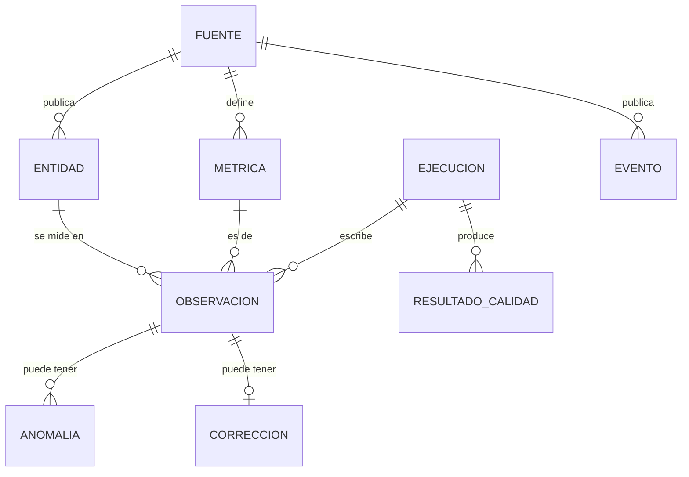
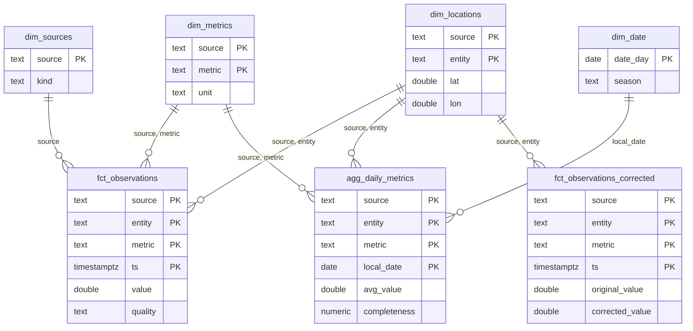

# Modelo de datos

Este documento describe qué datos guarda la plataforma, con qué forma y con qué reglas, de las fuentes a gold. Lo
complementan:

- el [caso de arquitectura](architecture.md), que cuenta cómo se mueven los datos;
- las [ADRs](adr/README.md), que explican por qué se decidió cada cosa;
- el [README de dbt](../dbt/README.md), que es el catálogo modelo a modelo.

La documentación de cada columna y el grafo de linaje se publican con `dbt docs`, en
[GitHub Pages](https://alexandrecoll.github.io/MallorcaDataPlatform/).

## Metodología

Cada capa sigue un patrón conocido del sector. Esta tabla da su nombre propio, para poder buscarlo y compararlo.

| Dónde | Patrón | Qué significa aquí |
|---|---|---|
| Toda la plataforma | **Arquitectura medallion** (bronze, silver, gold) | Tres capas de calidad creciente: el dato crudo, el dato limpio en un esquema común y el dato listo para consultar ([ADR 0002](adr/0002-medallion.md)) |
| Almacenamiento | **Lakehouse** más **data warehouse**, en un esquema híbrido | El lake es una tabla Delta Lake sobre almacenamiento de objetos compatible con S3 (MinIO): ficheros baratos con transacciones ACID, historial y *time travel*. El warehouse es PostgreSQL: consultas en milisegundos, cruces con SQL y el estado operativo ([ADR 0006](adr/0006-postgres-y-dbt.md), [ADR 0016](adr/0016-silver-en-delta.md)) |
| Bronze | **Zona cruda** (*raw* o *landing zone*), inmutable y versionada | La respuesta de la fuente tal como llegó. Permite reprocesar cualquier cambio del modelo sin volver a llamar a la fuente |
| Silver | **Modelo canónico** en formato largo, con el patrón **EAV** (*entity-attribute-value*) aplicado a series temporales | Una sola tabla estrecha (*narrow* o *tall table*) para todas las fuentes: la entidad (`entity`), el atributo (`metric`), el valor (`value`) y el instante (`ts`), con la calidad de cada fila ([sección 2](#2-silver-un-modelo-largo-y-común)) |
| Gold | **Modelado dimensional de Kimball**: esquemas en estrella por dominio (*data marts*) | Tablas de hechos con un grano declarado alrededor de **dimensiones conformadas** (*conformed dimensions*), las mismas para todos los dominios ([sección 3](#3-gold-estrellas-por-dominio)) |
| Gold, para los consumidores | **Tablas anchas desnormalizadas** | Los marts de dominio pivotan el formato largo a una columna por medida (`temperature_mean`, `demand_mwh`), para que Grafana y la API no tengan que conocer las métricas |
| Historia de las dimensiones | **SCD** (*slowly changing dimensions*) de tipo 1 y tipo 2 | Tipo 1 sobrescribe el valor; tipo 2 cierra la versión anterior y abre una nueva (el snapshot `snap_locations`) |
| Capas de dbt | **staging, intermediate y marts**, de la guía de estilo de dbt Labs | Limpiar, combinar y servir ([convenciones de nombres](#8-convenciones-de-nombres)) |
| Cargas | **Incremental con marca de agua** (*watermark*) y **upsert** idempotente | `updated_at` dice qué ha cambiado; `MERGE` en Delta y en dbt, e `INSERT … ON CONFLICT` en Postgres. Relanzar nunca duplica ([ADR 0003](adr/0003-idempotencia.md)) |
| Cambios en silver | **CDF** (*Change Data Feed*) de Delta | La lista de filas que cambió en cada versión (`make silver-changes`) |
| Fronteras | **Contratos de datos** (*data contracts*) | Nombres, tipos y claves fijos en los marts que se leen fuera (`contract: enforced` de dbt) |
| Periodos | **Huecos e islas** (*gaps and islands*) | Agrupar días u horas seguidos en episodios y avisos: la fecha menos el número de fila da el mismo grupo |

**Patrones que no se usan, y por qué:**

- **Data Vault** (*hubs*, *links* y *satellites*). Está pensado para muchas fuentes que cambian de forma y para auditar cada cambio. Aquí la auditoría ya la dan bronze versionado y el historial de Delta, y una sola persona mantiene el modelo.
- **One Big Table** para todo. Los marts anchos lo son por dominio; una sola tabla con todas las medidas tendría cientos de columnas casi vacías.
- **Snapshots acumulativos** (*accumulating snapshots*). Sirven para procesos con hitos, como un pedido que se paga, se envía y se entrega. Ningún dato de la plataforma tiene esa forma.
- **Claves subrogadas** en las dimensiones. Ver [claves naturales](#claves-naturales-no-subrogadas).

## 1. Modelo conceptual

La plataforma mide cosas en sitios a lo largo del tiempo.

| Concepto | Qué es | Ejemplos |
|---|---|---|
| **Fuente** | Un organismo y un servicio de datos; un conector por fuente | AEMET, EEA, REData |
| **Entidad** | Lo que se mide: una estación, un punto de modelo, una parada o un sistema entero | `B228` (estación de AEMET), `sant_joan_de_deu` (estación de la EEA), el sistema eléctrico balear |
| **Métrica** | Una magnitud con su unidad, propia de cada fuente | `temperature_2m_mean` en `degC`, `nitrogen_dioxide` en `ug/m3`, `electricity_demand` en `MWh` |
| **Observación** | Un valor de una métrica, en una entidad y un instante, con su etiqueta de calidad | 21,3 °C en Palma a las 10:00 UTC |
| **Ejecución** | Una pasada de un conector sobre una ventana de días | `run_id` de Airflow, por fuente |
| **Resultado de calidad** | Lo que dijo una regla en una ejecución | `range` sobre `temperature_2m_mean`: 24 filas comprobadas, 0 fallidas |
| **Anomalía** | Un valor señalado por un detector, sin cambiar la observación | Un pico de NO₂ con un z-score de 6 |
| **Corrección** | Un valor propuesto para un hueco o un valor dudoso, con su método y su confianza | Un hueco de 3 h relleno por interpolación |
| **Evento** | Algo que ocurre una vez, sin muestreo regular | Un sismo |

Una entidad no siempre es un lugar. El sistema eléctrico o una serie de turismo no tienen coordenadas, y por eso
`lat` y `lon` pueden ser nulos.

## 2. Silver: un modelo largo y común

Todas las fuentes van a la misma tabla, `silver.observations`, con una fila por valor. Está en Postgres y en la
tabla Delta del lake, con la misma clave ([ADR 0002](adr/0002-medallion.md)).

| Columna | Tipo | Significado |
|---|---|---|
| `source` | text | Conector que escribió la fila |
| `entity` | text | Identificador estable de la entidad dentro de su fuente |
| `metric` | text | Nombre de la métrica, en inglés y `snake_case` |
| `ts` | timestamptz | Instante del valor, en UTC (ver las [convenciones de tiempo](#5-tiempo-unidades-y-nulos)) |
| `value` | double precision | El valor tal como lo dio la fuente, convertido a la unidad del conector. Nulo si falta |
| `unit` | text | Unidad. Siempre la misma para una fuente y una métrica |
| `quality` | text | `ok`, `suspect` o `missing` |
| `quality_reasons` | text | Las reglas que explican la etiqueta, separadas por `;` |
| `lat`, `lon` | double precision | Coordenadas de la entidad, si es un lugar |
| `run_id` | text | La ejecución que escribió la versión actual de la fila |
| `ingested_at` | timestamptz | Cuándo se escribió por primera vez |
| `updated_at` | timestamptz | Cuándo cambió su contenido por última vez. Es la marca de agua de dbt |

**Clave primaria:** `(source, entity, metric, ts)`. Está definida una sola vez, en `core/models.py`, y la usan el
`MERGE` de Delta, el upsert de Postgres, la regla de duplicados y la deduplicación.

**Por qué es largo.** Diecinueve fuentes con decenas de métricas distintas caben en un solo esquema. Una fuente nueva no
cambia ninguna tabla, y la calidad, la idempotencia y la frescura se resuelven una vez para todas
([ADR 0001](adr/0001-nucleo-fijo-y-conectores.md)). El precio es que una consulta que cruza métricas tiene que
pivotar. Eso se hace una sola vez, en gold.

Las anomalías (`silver.anomalies`) y las correcciones (`silver.corrections`) están en tablas aparte, con la misma
clave más su detector o su método. El valor original no se toca nunca ([ADR 0011](adr/0011-marcar-no-es-corregir.md)).
Los nombres de las paradas y estaciones están en `silver.entities` (una fila por fuente y entidad): las
observaciones solo llevan el identificador (`stop_452`, `B228`). Cada ejecución los lee de sus propios payloads de
bronze (el método opcional `describe` de los conectores) y los actualiza si la fuente los cambia. Es una dimensión
pequeña y solo está en Postgres: el lago Delta guarda las observaciones.
Los recorridos de las líneas de bus, tren y metro están en `silver.routes` (una fila por fuente y línea):

- **Qué guarda**: su nombre, su tipo, su color y la geometría (GeoJSON `MultiLineString`).
- **De dónde sale**: del método opcional `routes` de los conectores GTFS. Una geometría no cabe en el silver largo,
  así que tiene su propia tabla.
- **Salidas por día**: son la serie `scheduled_trips` de la misma entidad (`route_<route_id>`).
- **Actualización**: cada ejecución sustituye las líneas de su fuente.
El estado operativo está en `ops.ingestion_runs` y `quality.check_results`.

## 3. Gold: estrellas por dominio

dbt construye gold en tres capas: staging, intermediate y marts. Los marts siguen un modelo dimensional: hechos
con un grano declarado y dimensiones compartidas entre dominios.

### Dimensiones compartidas

| Dimensión | Clave | Origen | Historia |
|---|---|---|---|
| `dim_sources` | `source` | Seed (`dbt/seeds/dim_sources.csv`): etiqueta, tipo de dato, descripción y la ficha de gobierno (dueño, licencia, acceso, datos personales, clasificación, ciclo de vida y SLA; [data-governance.md](data-governance.md)) | Se sobrescribe (tipo 1); vive en git |
| `dim_locations` | `source, entity` | Derivada de silver: nombre (de `silver.entities`), coordenadas y cobertura temporal | Tipo 1 en la tabla y tipo 2 en el snapshot `snap_locations`: si una estación se reubica, la versión anterior se cierra |
| `dim_routes` | `source, route` | `silver.routes`: nombre, tipo (bus, tren, metro), color y recorrido en GeoJSON | Tipo 1: cada ejecución sustituye las líneas de la red |
| `dim_metrics` | `source, metric` | Derivada de silver: unidad, número de entidades y cobertura | Tipo 1. La clave primaria impide que una métrica tenga dos unidades |
| `dim_date` | `date_day` | Calendario de `dbt_utils.date_spine`, desde el 1-9-1981 (el primer día de NOAA OISST) hasta un año después de hoy: semana ISO, fin de semana y estación meteorológica | Fija |

### Dimensiones de un dominio

No las comparten todos los dominios, pero siguen las mismas reglas. Todas son seeds, CSV que viven en git y que dbt
carga como tablas, salvo `dim_routes`, que sale de silver, y `dim_sea_temperature_climatology`, que sale de gold.

| Dimensión | Clave | Origen | Historia |
|---|---|---|---|
| `dim_source_texts` | `source, language` | Seed: etiqueta, descripción y licencia de cada fuente en catalán e inglés. Amplía `dim_sources`, que guarda el castellano ([ADR 0024](adr/0024-la-web-en-tres-idiomas.md)) | Tipo 1 |
| `dim_aquifers` | `entity` (`aquifer_<código>`, la entidad de la fuente) | Seed: las masas de agua subterránea (MAS) de Mallorca, con su nombre y su unidad hidrogeológica | Tipo 1 |
| `dim_warning_zones` | `zone` | Seed: las zonas de aviso de AEMET (cinco de tierra y sus aguas costeras), con su polígono | Fija: solo cambia si AEMET las redibuja |
| `dim_municipalities` | `municipality` | Seed: los 53 municipios, con su código INE, su superficie y su límite simplificado | Fija |
| `dim_sea_temperature_climatology` | `point, day_of_year` | Derivada de `int_sea_temperature__daily`: la media y el percentil 90 de la temperatura del mar de 1991-2020 para cada punto y día del año (1-366) | Fija mientras no cambie el periodo de referencia (`sst_baseline`) |

`dim_sources.kind` clasifica las fuentes por el tipo de dato: `observation` (una medida real), `model` (un modelo
numérico), `system` (el sistema eléctrico), `schedule` (un servicio programado), `statistic` (estadística oficial),
`event` (un suceso puntual, como un sismo) y `warning` (un aviso oficial con su nivel). Mezclar una observación con
un modelo es justo lo que miden los marts de sesgo, así que el tipo forma parte del modelo.

### Núcleo: la estrella de las observaciones

Los marts de dominio pivotan el modelo largo a columnas con nombre (`temperature_mean`, `precipitation_sum`, `demand_mwh`). Así
Grafana, la API y quien escriba SQL no tienen que conocer los nombres de las métricas.

### Hechos y grano

| Hecho | Grano: una fila por… | Tipo | Materialización | Contrato |
|---|---|---|---|---|
| `fct_observations` | fuente, entidad, métrica e instante | Transacción (la medida atómica) | Incremental, `merge` | — |
| `agg_daily_metrics` | serie y día local | Snapshot periódico | Incremental, `delete+insert` | — |
| `fct_observations_corrected` | serie e instante, desde la primera corrección | Transacción, con el valor original y el corregido | Tabla | — |
| `fct_weather_daily` | estación o punto de modelo y día | Snapshot periódico, ancho | Tabla | — |
| `fct_model_bias_daily` | estación y día | Snapshot periódico (modelo menos observación) | Tabla | — |
| `agg_model_bias_by_station` | estación | Agregado | Tabla | ✅ |
| `fct_weather_episodes` | episodio de lluvia, viento o mar | Agregado por episodio: días seguidos sobre un umbral, con inicio, fin y extremos | Tabla | ✅ |
| `fct_sea_conditions_hourly` | punto de costa y hora | Snapshot periódico, ancho | Tabla | — |
| `fct_wave_model_comparison_hourly` | boya y hora | Snapshot periódico: la ola medida por la boya junto a la del modelo en el punto más cercano | Tabla | — |
| `agg_wave_model_bias_by_buoy` | boya | Agregado: sesgo, MAE, RMSE y correlación del modelo de oleaje | Tabla | ✅ |
| `fct_sea_temperature_daily` | punto de costa y día (UTC) | Snapshot periódico: la temperatura del mar por satélite, su anomalía frente a la climatología del mismo día del año y si es día de ola de calor marina | Tabla | — |
| `fct_marine_heatwaves` | ola de calor marina de un punto | Transacción (evento): inicio, fin, días, intensidad y categoría, con islas y huecos | Tabla | ✅ |
| `fct_sea_temperature_monthly` | mes | Snapshot periódico, con la anomalía frente a 1991-2020 y los días de ola de calor | Tabla | ✅ |
| `fct_sst_model_comparison_daily` | punto de costa y día (UTC) | Snapshot periódico: la temperatura del mar del modelo junto a la del satélite | Tabla | — |
| `agg_sst_model_bias_by_point` | punto de costa | Agregado: sesgo, MAE, RMSE y correlación de la temperatura del mar del modelo | Tabla | ✅ |
| `fct_weather_warnings` | aviso: zona, fenómeno y periodo seguido al mismo nivel | Agregado por periodo (*gaps and islands* sobre las horas de AEMET) | Tabla | ✅ |
| `air_quality_hourly` | localidad y hora | Snapshot periódico, con la banda del índice europeo | Tabla | — |
| `fct_air_quality_model_bias_daily` | estación, contaminante y día | Snapshot periódico | Tabla | ✅ |
| `fct_air_quality_monthly` | fuente, estación, contaminante y mes | Snapshot periódico, con cobertura | Tabla | ✅ |
| `fct_pollen_dust_daily` | punto del modelo y día local | Snapshot periódico: polen (con su nivel), polvo sahariano y UV de CAMS | Tabla | ✅ |
| `fct_dust_episodes` | episodio de polvo sahariano | Transacción (evento): días seguidos de polvo, con islas y huecos, y el PM10 de las estaciones durante el episodio frente a los días de alrededor | Tabla | ✅ |
| `agg_dust_pm10_by_station` | estación de la EEA | Agregado: PM10 y sesgo de CAMS los días con polvo y el resto | Tabla | ✅ |
| `fct_electricity_daily` | día | Snapshot periódico, ancho | Tabla | ✅ |
| `fct_bus_network_daily`, `fct_island_transit_daily` | día | Snapshot periódico | Tabla | ✅ |
| `fct_bike_stations_hourly` | estación de BiciPalma y hora UTC | Snapshot periódico, ancho: media, mínimo y máximo de las instantáneas de 5 minutos de la hora. Incremental | Tabla | ✅ |
| `fct_bike_stations_daily` | estación de BiciPalma y día | Agregado de las horas: ocupación media y horas sin bicis o sin anclajes | Tabla | ✅ |
| `fct_tourism_monthly`, `fct_water_reserves_monthly`, `fct_climate_monthly`, `fct_resources_monthly` | mes | Snapshot periódico, con la anomalía frente al mismo mes | Tabla | ✅ |
| `fct_earthquakes` | sismo, en su última revisión | Transacción (evento) | Tabla | — |
| `fct_population_yearly` | municipio y año | Snapshot periódico: padrón a 1 de enero, densidad y cambio frente al padrón anterior | Tabla | ✅ |
| `fct_tourist_dwellings` | municipio y mes de referencia | Snapshot periódico irregular: dos recuentos al año del INE, con el cambio frente al recuento anterior y el peso frente al padrón | Tabla | ✅ |
| `fct_human_pressure_daily` | día | Snapshot periódico: personas presentes en la isla frente a las empadronadas | Tabla | ✅ |
| `data_quality_summary`, `source_health` | regla / fuente | Estado actual | Tabla | — |
| `fct_anomaly_evaluations` | ejecución del benchmark, fuente, detector y tipo de fallo | Transacción (evento): cada ejecución de `make evaluate`, con la más reciente de cada fuente marcada (`is_latest`) | Tabla | ✅ |

Cada grano está declarado como test: `unique_combination` en los modelos sin contrato y clave primaria en los que
lo tienen. Un hecho que pierde su grano falla el build.

### Claves naturales, no subrogadas

Kimball recomienda que cada dimensión tenga una **clave subrogada**: un entero sin significado que los hechos usan en
lugar de la clave de la fuente. Aquí las dimensiones y los hechos usan las **claves naturales**, compuestas cuando
hace falta: `(source, entity)`, `(source, metric)`, `date_day`.

- **Por qué.**
  - Los identificadores de las fuentes son estables: el indicativo de una estación de AEMET o el código de una
    parada no cambian.
  - La misma clave viaja de silver a gold y a la API sin traducirla en cada paso.
  - Los incrementales y el upsert fusionan por esa clave.
  - Con este volumen, un join por dos columnas de texto indexadas cuesta milisegundos en Postgres.
- **Lo que cuesta.** Un hecho apunta a la versión actual de su dimensión. Para cruzarlo con la versión de
  `snap_locations` que valía en su momento hay que comparar fechas (`ts` entre `dbt_valid_from` y
  `dbt_valid_to`), en lugar de usar una clave por versión.
- **Excepciones.** Un episodio o un aviso no tiene identificador en la fuente. `episode_id` y `warning_id` son
  claves subrogadas: un hash de las columnas que lo definen (`dbt_utils.generate_surrogate_key`), estable entre
  builds.
- **Cuándo revisarla.** Si un dominio necesitara cruzar a menudo hechos con la historia de una dimensión de tipo 2, o
  si las claves de texto empezaran a pesar en los índices.

## 4. Contratos: tres fronteras

| Frontera | Qué se acuerda | Dónde | Qué pasa si se rompe |
|---|---|---|---|
| **Fuente → silver** | Métricas, unidades, rangos físicos, frecuencia y retraso de cada fuente | `connectors/<fuente>/connector.yaml` y el esquema común de `core/models.py` | Las reglas de calidad marcan la fila (`suspect` o `missing`); la fila no se pierde |
| **Silver → gold** | Las fuentes declaradas en dbt, su frescura, una unidad por métrica y la cobertura del calendario | `dbt/models/staging/_sources.yml`, los tests y las dimensiones | La frescura avisa; un test o una clave primaria fallan el build |
| **Gold → consumidores** | Nombres, tipos y clave de los marts que se leen fuera | `contract: enforced` en `_marts.yml` y `exposures.yml` | El build falla antes de que Grafana o la API vean el cambio |

Los exposures dicen qué dashboard o endpoint lee cada mart. Antes de cambiar un contrato,
`dbt ls --select +exposure:<nombre>` enseña a quién afecta.

## 5. Tiempo, unidades y nulos

- **Instantes en UTC.** `ts` es `timestamptz` en silver y en los hechos horarios.
- **El día local es el de Mallorca.** Los modelos diarios usan `local_date` = `ts` en `Europe/Madrid` (la variable
  `local_timezone` de dbt). Así, un día de verano empieza a las 22:00 UTC del día anterior.
- **Datos diarios y mensuales.** Se marcan con la medianoche local del inicio del periodo. Un valor de AEMET del
  3 de noviembre tiene `ts` = 3 de noviembre a las 00:00 en Madrid; un mes de turismo, el día 1 a las 00:00.
- **Una unidad por métrica.** La unidad la fija el conector al normalizar y la garantiza la clave de `dim_metrics`.
  En los marts anchos, la unidad va en el nombre de la columna cuando el nombre de la métrica no la deja clara
  (`demand_mwh`, `co2_emissions_t`).
- **Nulos con significado.** Un valor que falta es una fila con `value` nulo y `quality = 'missing'`, no una fila
  que no existe. Así se distingue "la fuente no midió" de "no se cargó". `fct_observations` solo guarda los valores
  presentes, y la completitud diaria sale de `agg_daily_metrics`.

## 6. Frescura por fuente (SLA)

Hay tres controles, de lo más técnico a lo acordado:

- **El SLA de cada fuente** está en su ficha del catálogo (`dim_sources`). Fija la antigüedad máxima de su dato más
  reciente y la parte mínima de cargas correctas en 7 días. `gold.source_health` lo evalúa (`sla_met`). La web
  marca la fuente como *Fuera de SLA* y Grafana avisa con *Fuente fuera de su SLA*. La tabla de SLAs y cómo se fija
  cada uno están en [data-governance.md](data-governance.md).
- **`dbt source freshness`**, que corre antes de cada build, mide si las cargas traen filas nuevas (`updated_at`).
  Cada fuente tiene dos umbrales en `_sources.yml`, en la tabla de abajo:
  - `warn_after`, un aviso temprano a la cadencia de la fuente;
  - `error_after`, que es su SLA del catálogo: sin una fila nueva en ese tiempo, el dato más reciente también es
    más antiguo que el SLA.

  Un test (`tests/test_freshness_sla.py`) exige que cada fuente del catálogo esté declarada, que `error_after` sea su
  SLA y que `warn_after` no lo supere. Ni el aviso ni el error paran la construcción de gold: quedan en los logs.
- **La alerta de Grafana *Fuente sin ejecución correcta*** salta si una fuente activa lleva 36 h sin ninguna carga
  correcta. Lee solo `ops.ingestion_runs`, así que avisa aunque dbt no corra.

| Fuente | Publica | Aviso sin datos nuevos en | Error (SLA) |
|---|---|---|---|
| Open-Meteo, Open-Meteo Marine | Cada hora (modelo) | 36 h | 48 h |
| SOCIB, REDMAR, EEA | Cada hora (estación) | 36 h | 48 h |
| REData | Cada hora (demanda) y cada día (mix y CO₂) | 36 h | 48 h |
| EMT Palma, CTM | Feed GTFS diario | 36 h | 48 h |
| AEMET (avisos) | Cada emisión de avisos | 36 h | 48 h |
| AEMET | Valores diarios, con 2-3 días de retraso | 5 días | 5 días |
| NOAA OISST | Diaria: provisional al día siguiente, definitiva unos 16 días después | 48 h | 4 días |
| Dataestur, reservas hídricas | Mensual, con 1-3 meses de retraso | 40 días | 100 días |
| Ibestat (presión humana) | Mensual, unos dos meses tarde | 40 días | 120 días |
| INE (padrón) | Anual, en diciembre | 400 días | 2 años |
| INE (viviendas turísticas) | Dos recuentos al año, unos seis meses tarde | 240 días | 400 días |
| IGN | Solo cuando hay sismos | Sin umbral | Sin SLA |
| GOIB (histórico) | Cerrado en junio de 2021 | Sin umbral | Sin SLA |

## 7. Evolución del esquema

| Cambio | Cómo se hace | ¿Rompe algo? |
|---|---|---|
| Fuente nueva | Un conector, una línea en `_sources.yml`, una vista de staging y una fila en `dim_sources` con su ficha de gobierno completa (los tests lo exigen) | No |
| Métrica nueva en una fuente | Se añade en su `connector.yaml`; aparece sola en silver, `agg_daily_metrics` y `dim_metrics` | No; un mart ancho la ignora hasta que se le añade una columna |
| Columna nueva en un mart | `on_schema_change: append_new_columns` en los incrementales; en los de contrato, añadirla al YAML | No para quien lee por nombre |
| Cambiar la unidad de una métrica | Métrica nueva con otro nombre, o reprocesar el histórico desde bronze | Sí: la clave de `dim_metrics` lo rechaza |
| Renombrar o quitar una columna con contrato | En el mismo PR que adapta a sus consumidores (los exposures dicen cuáles) | Sí: el contrato falla el build |
| Cambiar la clave de silver | Una ADR nueva y reprocesar desde bronze | Sí, en todas las capas |

Bronze guarda cada respuesta tal cual llegó. Por eso cualquier cambio del modelo, incluido uno de la clave, se
puede aplicar al histórico sin volver a llamar a las fuentes.

## 8. Convenciones de nombres

Los modelos siguen la guía de estilo de dbt Labs. El prefijo dice qué es cada tabla, y el sufijo, su grano.

| Prefijo | Qué es | Esquema | Materialización | Ejemplos |
|---|---|---|---|---|
| `stg_<fuente>__<tabla>` | Staging: una vista por tabla de origen, con el doble guion bajo entre la fuente y la tabla | `dbt_staging` | Vista | `stg_aemet__observations`, `stg_ops__ingestion_runs` |
| `int_<tema>` o `int_<tema>__<grano>` | Intermediate: lógica que reutilizan varios marts | `dbt_intermediate` | Vista | `int_weather__daily`, `int_station_model_pairs` |
| `fct_<tema>_<grano>` | Hecho, con el grano en el sufijo (`_hourly`, `_daily`, `_monthly`, `_yearly`) o sin sufijo si cada fila es un suceso | `gold` | Tabla o incremental | `fct_weather_daily`, `fct_earthquakes` |
| `agg_<tema>_by_<dimensión>` | Agregado: resume un hecho por la dimensión que nombra, sin tiempo | `gold` | Tabla | `agg_model_bias_by_station`, `agg_wave_model_bias_by_buoy` |
| `dim_<entidad>` | Dimensión, sea un modelo o un seed | `gold` | Tabla o seed | `dim_locations`, `dim_sources` |
| `snap_<entidad>` | Snapshot de tipo 2 | `snapshots` | Snapshot | `snap_locations` |

Fuera de dbt, los esquemas de Postgres dicen quién escribe: `silver`, `quality` y `ops` los escribe el pipeline de
Python; `dbt_staging`, `dbt_intermediate`, `gold` y `snapshots`, dbt.

**Columnas:**

| Convención | Ejemplos |
|---|---|
| Inglés y `snake_case` | `source`, `local_date`, `hydrological_year` |
| `ts` es el instante medido, en UTC; `local_date`, su día en Mallorca; `month` y `year`, el periodo | `ts`, `local_date`, `month` |
| `_at` es un instante de la plataforma, no del dato | `ingested_at`, `updated_at`, `last_run_at` |
| La unidad va en el sufijo cuando el nombre no la deja clara | `demand_mwh`, `reserves_pct`, `rain_mm`, `distance_km`, `elevation_m` |
| `is_` para los booleanos | `is_missing`, `is_weekend`, `is_heavy_rain` |
| `n_` para los recuentos | `n_metrics`, `n_entities` |
| `_id` solo para las claves subrogadas | `episode_id`, `warning_id` |

**Excepciones, y por qué se quedan.** Renombrar un mart rompe su contrato, la API, Grafana y los exposures que lo
leen, así que estas excepciones se documentan en lugar de corregirse:

| Modelo | Por la regla sería | Por qué tiene otro nombre |
|---|---|---|
| `agg_daily_metrics` | `fct_metrics_daily` | Es un snapshot periódico diario de todas las series. Nació como el agregado diario de `fct_observations` y lo leen Grafana y la API |
| `air_quality_hourly` | `fct_air_quality_hourly` | Es anterior a la convención y lo leen los dashboards de calidad del aire |
| `source_health`, `data_quality_summary` | — | No son hechos ni dimensiones: son informes del estado actual de las fuentes y las reglas, una fila por fuente o regla |
| `fct_resources_monthly` | — | Sigue la regla, pero está en `core` y no en un dominio porque cruza turismo, agua, clima y electricidad |

