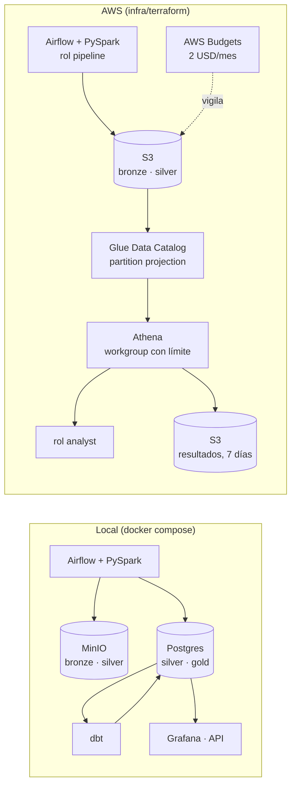

# Infraestructura en AWS (Terraform)

La misma plataforma, con S3 en lugar de MinIO y Athena para consultar el lake sin servidor de base de datos. El
código apunta a AWS real, pero **no se despliega**:
- el CI lo formatea, lo valida, lo pasa por tflint y lo prueba con `terraform test` contra un proveedor de AWS
  simulado (`mock_provider`);
- no hace falta cuenta ni credenciales, y no cuesta nada.

```bash
make tf-check
```

## Local frente a AWS



| Pieza | Local | AWS |
|---|---|---|
| Lake | MinIO (`bronze`, `silver`) | S3, un bucket por capa, cifrado SSE-S3, solo TLS, sin acceso público y con versionado en bronze y silver |
| Tabla de silver | Postgres (`silver.observations`) | Glue Data Catalog sobre los Parquet. *Partition projection* sigue el `source=…/date=…` que escribe Spark, sin crawlers |
| Consultas | Postgres, dbt y Grafana | Athena (motor 3), con un workgroup que limita cada consulta a 1 GB escaneado |
| Permisos | Usuarios de Postgres | Dos roles de IAM de mínimo privilegio, `pipeline` y `analyst` (ver abajo) |
| Coste | 0 | Céntimos al mes, con un presupuesto de 2 USD y alertas al 80 % gastado y al 100 % previsto |

## Qué crea

| Fichero | Recursos |
|---|---|
| `main.tf` y `modules/bucket` | Tres buckets con los mismos valores por defecto: ACL desactivadas, acceso público bloqueado, SSE-S3, una política que deniega peticiones sin TLS y reglas de ciclo de vida. **Bronze** guarda 90 días las versiones sustituidas (relanzar una ventana nunca pierde la respuesta original), **silver** las guarda 30 días y **athena-results** borra lo que tiene a los 7 días |
| `glue_athena.tf` | Base de datos y tabla `observations` (las columnas de `SILVER_SCHEMA`, con `source` y `date` como particiones), workgroup de Athena y una consulta guardada |
| `iam.tf` | Rol **pipeline**: lee y escribe bronze sin poder borrar, y lee, escribe y borra en silver (la sobrescritura dinámica de particiones de Spark borra los ficheros que reescribe). Rol **analyst**: consulta con Athena, lee silver y el catálogo, y no ve bronze. Sin `*` en acciones ni recursos |
| `budget.tf` | Presupuesto mensual filtrado por la etiqueta `Project`, con avisos por correo si se configuran |

## Tests

`terraform test` aplica la configuración contra el proveedor simulado y comprueba:

| Suite | Qué asegura |
|---|---|
| `storage` | Nombres por entorno; buckets privados, cifrados y solo TLS; versionado y caducidad según el uso; validación del nombre |
| `access` | Bronze sin borrado; silver con borrado para Spark; sin comodines; el analista no lee bronze ni cambia el catálogo; confianza de los roles |
| `catalog` | Las particiones y columnas coinciden con lo que escribe Spark; Athena limitado y con su bucket de resultados; avisos del presupuesto solo con destinatarios; variables inválidas rechazadas |

## Desplegarlo de verdad (no hecho)

1. Copia `terraform.tfvars.example` a `terraform.tfvars`, con un prefijo propio (los nombres de bucket son
   globales).
2. Para guardar el estado en S3, renombra `backend.tf.example` y activa la etiqueta de coste `Project` en
   Billing.
3. Ejecuta `terraform init` y `terraform apply` con credenciales de AWS. `terraform output pipeline_env` da las
   variables del pipeline: `S3_ENDPOINT_URL` de S3 real, la región, los buckets y `S3A_INPUT_STREAM=analytics`.

**Pendiente** para que el pipeline corra en AWS de punta a punta:
- **Credenciales de Spark**: `core/spark.py` usa claves estáticas (`S3_ACCESS_KEY` y `S3_SECRET_KEY`). Con el rol
  haría falta el proveedor de credenciales de AWS (`fs.s3a.aws.credentials.provider`).
- **Warehouse**: Postgres y dbt siguen siendo locales. Athena sustituiría a Postgres para consultar silver, y dbt
  podría apuntar a Athena (`dbt-athena`).
