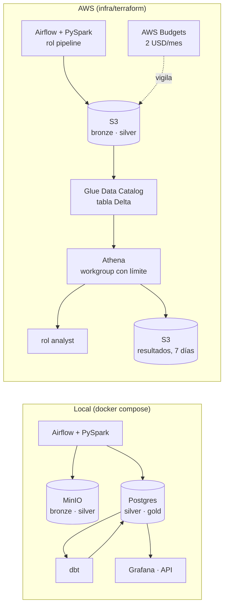

# Infraestructura en AWS (Terraform)

La misma plataforma, con S3 en lugar de MinIO y Athena para consultar el lake sin servidor de base de datos. El
código apunta a AWS real, pero **no se despliega**:
- el CI lo formatea, lo valida, lo pasa por tflint y lo prueba con `terraform test` contra un proveedor de AWS
  simulado (`mock_provider`);
- no hace falta cuenta ni credenciales, y no cuesta nada.

```bash
make tf-check
```

## Local frente a AWS



| Pieza | Local | AWS |
|---|---|---|
| Lake | MinIO (`bronze`, `silver`) | S3, un bucket por capa, cifrado SSE-S3, solo TLS, sin acceso público y con versionado en bronze y silver |
| Tabla de silver | Postgres (`silver.observations`) y la tabla Delta de MinIO | Glue Data Catalog sobre la tabla Delta (`table_type = DELTA`): Athena lee el `_delta_log`, que dice qué ficheros están vigentes y sus particiones, sin crawlers ni `MSCK REPAIR` |
| Consultas | Postgres, dbt y Grafana | Athena (motor 3), con un workgroup que limita cada consulta a 1 GB escaneado |
| Permisos | Usuarios de Postgres | Dos roles de IAM de mínimo privilegio, `pipeline` y `analyst` (ver abajo) |
| Coste | 0 | Céntimos al mes, con un presupuesto de 2 USD y alertas al 80 % gastado y al 100 % previsto |

## Qué crea

| Fichero | Recursos |
|---|---|
| `main.tf` y `modules/bucket` | Tres buckets con los mismos valores por defecto: ACL desactivadas, acceso público bloqueado, SSE-S3, una política que deniega peticiones sin TLS y reglas de ciclo de vida. **Bronze** guarda 90 días las versiones sustituidas (relanzar una ventana nunca pierde la respuesta original), **silver** las guarda 30 días y **athena-results** borra lo que tiene a los 7 días |
| `glue_athena.tf` | Base de datos y tabla Delta `observations` (las columnas de `SILVER_SCHEMA` y `date`, como documentación: Athena toma el esquema y las particiones del log), workgroup de Athena y una consulta guardada |
| `iam.tf` | Rol **pipeline**: lee y escribe bronze sin poder borrar, y lee, escribe y borra en silver (el `VACUUM` de Delta borra los ficheros que `MERGE` y `OPTIMIZE` sustituyeron). Rol **analyst**: consulta con Athena, lee silver y el catálogo, y no ve bronze. Sin `*` en acciones ni recursos |
| `budget.tf` | Presupuesto mensual filtrado por la etiqueta `Project`, con avisos por correo si se configuran |

## Tests

`terraform test` aplica la configuración contra el proveedor simulado y comprueba:

| Suite | Qué asegura |
|---|---|
| `storage` | Nombres por entorno; buckets privados, cifrados y solo TLS; versionado y caducidad según el uso; validación del nombre |
| `access` | Bronze sin borrado; silver con borrado para Spark; sin comodines; el analista no lee bronze ni cambia el catálogo; confianza de los roles |
| `catalog` | La tabla es Delta, apunta al directorio de Spark y no declara particiones en Glue; Athena limitado y con su bucket de resultados; avisos del presupuesto solo con destinatarios; variables inválidas rechazadas |

## Desplegarlo de verdad (no hecho)

1. Copia `terraform.tfvars.example` a `terraform.tfvars`, con un prefijo propio (los nombres de bucket son
   globales).
2. Para guardar el estado en S3, renombra `backend.tf.example` y activa la etiqueta de coste `Project` en
   Billing.
3. Ejecuta `terraform init` y `terraform apply` con credenciales de AWS. `terraform output pipeline_env` da las
   variables del pipeline: `S3_ENDPOINT_URL` de S3 real, la región, los buckets, `S3A_INPUT_STREAM=analytics`,
   `S3_CREDENTIALS=role` y el ARN del rol `pipeline` (`S3_ROLE_ARN`).

**Credenciales del pipeline** (`core/credentials.py`, `S3_CREDENTIALS`). Bronze (boto3) y Spark (S3A) escriben con la
misma identidad, en uno de tres modos:

| Modo | Qué hace | Cuándo |
|---|---|---|
| `static` | Claves fijas (`S3_ACCESS_KEY`, `S3_SECRET_KEY`) | MinIO en local, por defecto |
| `role` | Asume `S3_ROLE_ARN` por STS y usa credenciales temporales que se renuevan antes de caducar. Quien lo asume es la identidad de las claves o, sin ellas, la cadena por defecto del SDK | Con este Terraform: la cuenta asume `<prefijo>-pipeline` |
| `default` | La cadena por defecto del SDK (rol de la tarea de ECS, perfil de la instancia EC2...), sin ninguna clave | En una máquina que ya corre con el rol |

El modo `role` se prueba en local sin AWS: `make minio-pipeline-user` crea en MinIO un usuario con la misma política
que el rol `pipeline` (`docker/minio/pipeline-policy.json`; un test la compara con `iam.tf`), y el pipeline asume el
rol contra el STS de MinIO. Una ejecución real con ese usuario escribe bronze y hace el MERGE de silver, y se le
deniega borrar en bronze o crear buckets. Dos detalles que solo se vieron así:

- S3A solo habla con STS por HTTPS. Con el STS local, que es HTTP, Spark recibe la sesión que asumió boto3 (no se
  renueva, dura `S3_ROLE_SESSION_SECONDS`); en AWS, S3A asume el rol él mismo y lo renueva.
- El pipeline ya no activa el versionado de un bucket que existe: el rol no tiene `s3:PutBucketVersioning`, y en
  AWS los buckets los crea y configura Terraform.

**Pendiente** para que el pipeline corra en AWS de punta a punta:
- **Warehouse**: Postgres y dbt siguen siendo locales. Athena sustituiría a Postgres para consultar silver, y dbt
  podría apuntar a Athena (`dbt-athena`).
- **Time travel en Athena**: Athena lee la versión actual de la tabla Delta, pero no `VERSION AS OF`. Las versiones
  anteriores se consultan con Spark (`make silver-changes`) mientras `VACUUM` no borre sus ficheros (7 días).
